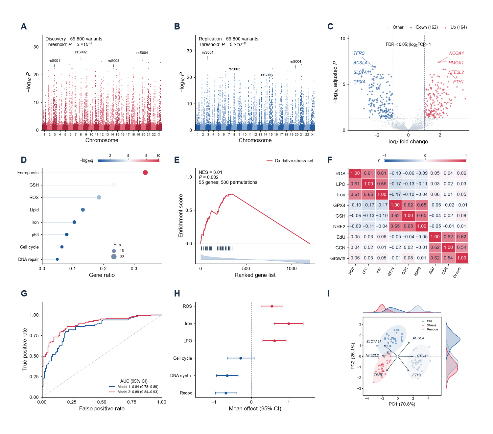
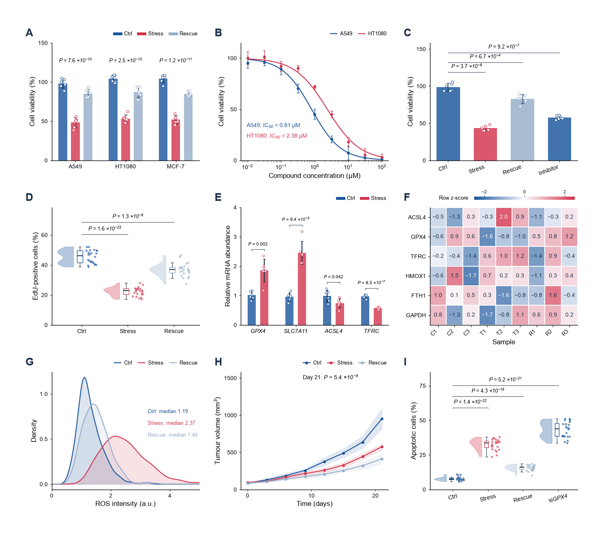
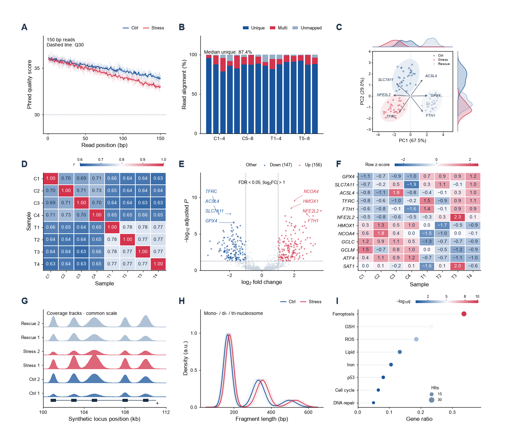

# polish-sci-figures · Product guide

[Home](README.md) · [English](README.en.md) · [中文](README.zh-CN.md)

**From data to assembled figures: editable templates, explicit statistical analysis, and reversible, precise layout.**

polish-sci-figures brings scientific plotting, image standardization, and figure quality checks into one workflow. Install **Figure Studio** to edit directly in your browser, or use the three companion AI skills to move from data analysis to final delivery. Both use the same local plotting and analysis code.

[](https://github.com/zhoy0409-debug/polish-sci-figures/actions/workflows/python-app.yml)
[](LICENSE)

**Suite v1.4.8 · Figure Studio 0.1.8 (Windows desktop edition)**

[Official downloads](https://github.com/zhoy0409-debug/polish-sci-figures/releases) · [English quick start](desktop/QUICKSTART.en.md) · [中文入门](desktop/QUICKSTART.zh-CN.md) · [Release notes](docs/release-notes-v1.4.8.md)

## Choose your workflow

| How you want to work | Start here | Requirements |
| --- | --- | --- |
| Preview, replace data, edit, and assemble figures directly | Figure Studio Windows installer | Windows 10/11 x64; no Codex, separate Python installation, account, or API key |
| Upload a skill to Claude | [Self-contained skill upload](https://github.com/zhoy0409-debug/polish-sci-figures/releases/download/v1.4.8/polish-sci-figures-v1.4.8-skill.zip) | A host with skills and code execution; see [platform installation](docs/platform-installation.en.md) |
| Ask AI to analyze data, suggest plots, and check the output | Three-skill suite: `sci-figure-suite-v1.4.8.zip` | A compatible AI environment and the suite's Python dependencies |
| Refine an existing SVG manually | Generate a self-contained Studio page with AI or the CLI | Layout and appearance editing work offline; data recomputation requires the local engine |

Figure Studio is the official visual editor for polish-sci-figures. The original AI/CLI workflow remains available through the three-skill suite. Model-result templates display supplied analysis outputs; they do not fit unspecified models.

- [Install and start](#install-and-start)
- [Editable chart library](#editable-chart-library)
- [From data updates to final layout](#from-data-updates-to-final-layout)
- [Statistical analysis and interpretation](#statistical-analysis-and-interpretation)
- [Examples in papers](#examples-in-papers)
- [Image duplicate check](#image-duplicate-check)
- [AI and command-line workflows](#ai-and-command-line-workflows)
- [Verification scope and current limits](#verification-scope-and-current-limits)
- [Official distribution and licensing](#official-distribution-and-licensing)

## Install and start

1. Download `polish-sci-figures-Studio-0.1.8-Setup-x64.exe` from [GitHub Releases](https://github.com/zhoy0409-debug/polish-sci-figures/releases).
2. Install it and open the **polish-sci-figures Studio** shortcut. The launcher opens the editor in your default browser.
3. Choose **Start from a template**, inspect the preview, and replace the example data with your own. You can also import an existing image, SVG, or selected PDF page. Supported native text and vector paths remain editable; PDF effects may require a local image layer or a whole-page appearance image. See the [conversion limits](docs/release-v1.4.3.en.md#what-changed), and review substituted fonts before export.
4. Export SVG / PNG / TIFF and use **Save** to download an editable JSON backup.

The portable edition is `polish-sci-figures-Studio-0.1.8-Portable-x64.zip`. Extract the entire archive, run `Figure Studio.exe`, and keep the adjacent `_internal` folder. The desktop package includes its plotting and statistical runtime and works offline. The data editor accepts cell edits, pasted Excel ranges, and CSV/TSV imports. To import an Excel workbook as a file, export it as CSV/TSV first.

Closing the browser does not stop the local service; close the launcher when you finish. Autosaves live in the browser's local storage. Clearing site data, switching browsers, or using a private window can lose those records. **Download JSON backups of important projects.** See the [English quick start](desktop/QUICKSTART.en.md).

## Image insets and updates

Select a raster image, choose **Magnify region**, and draw a box over the detail you want to show. Move or resize the resulting inset, choose 2× / 3× / 4×, and adjust its border and connecting lines. To add an accurate scale bar, trace a known scale on the original image and enter its real length in µm. Automatic scale bars use familiar 1 / 2 / 5 values with a line length calculated from that calibration. SVG keeps the embedded original pixels and editable inset elements; TIFF export uses the chosen output resolution.

The header **Updates** entry checks official GitHub release metadata and opens the download for your platform. Checking does not send images, tables or projects, install software automatically, or stop local work when offline. **Version 0.1.6 has no reminder: install 0.1.8 manually once to receive future reminders.** Save a project backup before upgrading. [Release notes and platform scope](docs/release-notes-v1.4.8.md).

## Editable chart library

This version provides **218 editable starting templates**: 191 table-driven templates, 15 ROC / PR views based on observation data, and 12 layouts for supplied ROC results. Each comes with input requirements and an example preview. Example data are labeled; inserting a template does not present them as your results.

| Scientific question | Examples | Required inputs |
| --- | --- | --- |
| Distributions and group comparisons | Raw points, box plots, rainclouds, violins, effects with intervals, faceted comparisons | Observations, groups, and actual experimental units; inference requires a confirmed design |
| Relationships, time, and dose | Scatter plots, trajectories, time bands, dose–response, decomposition and diagnostic plots | Observations or fitted results specified by the template |
| Classification and diagnostic performance | ROC, PR, thresholds, confusion matrices, confidence bands, partial AUC, cross-validation | Prediction observations or calculated results, depending on the template; not all methods are fitted automatically |
| Omics and matrices | Heatmaps, volcano and Manhattan plots, enrichment, GSEA, genomic coverage tracks | Corresponding numeric matrices, statistical results, or track data |
| Survival, synthesis, and model interpretation | Survival curves with risk tables, forest plots, SHAP, PCA, nomograms | Survival records or explicit model, summary, and interpretation results |
| Composition and connections | Composition plots, UpSet, flow diagrams, networks, and structure diagrams | Set membership, composition, edges, flows, or other specified data |

Previews, applied charts, and outputs after data replacement use the same renderers. Compatible candidates appear first; the full library offers search across categories, category navigation, and enlarged previews. Compatibility depends on explicit data and scientific meaning, not just matching column names.

The count does not mean 218 statistical models or visual approval of every possible dataset, label length, and size. [Input contracts and implementation notes](skills/polish-sci-figures/references/figure_studio.md#original-editable-gallery-2026-10-12) record the specific scope. The original reference numbers 1–124 remain accessible through `template_router.py` to find the corresponding scientific workflow.

The following composites use synthetic data to demonstrate assembly capabilities; they are not biological evidence:



<details>
<summary>Basic-research and sequencing examples</summary>





</details>

## From data updates to final layout

- **Data stay connected to the chart.** Paste a table or import CSV/TSV, check highlighted cells, and choose **Update chart**. Automatic updates are optional. Invalid changes preserve the draft and last valid chart; extreme but valid values are retained. Comparisons bound to the current data are recomputed. If the local service disconnects, the project and data drafts are retained so you can reconnect and continue.
- **Layouts remain adjustable.** Drag panels, span rows or columns, insert rows and columns, and change spacing. Supported templates redraw at the actual physical size; other assets retain their proportions. A supported faceted comparison can split into separate panels in one row while retaining its original comparison-family record.
- **Edit objects directly.** Marquee-select, multi-select, align, group, and lock objects. Move existing objects, add text, lines, and shapes, and nudge with arrow keys. Double-click text to edit in place; character-level bold, italic, superscript, and subscript preserve local scientific formatting.
- **Place annotations with less effort.** Dedicated horizontal and vertical lines keep their direction as you drag either endpoint; free lines snap near the axes, with Shift constraining the angle. A comparison-bracket tool supports manual annotation. Text opens for editing at the insertion point.
- **Tune marks and color.** Choose solid or hollow points, or set fill and outline colours separately. Error bars can follow group colours or stay black, grey or custom-coloured. Independent switches hide and restore either element without deleting data or settings. Live sliders control point size and outline width; error bars retain upper, lower or both directions, cap length and line width, anchored to the actual estimates and intervals.
- **Control the details.** Supported axes expose true limits, first-group spacing, and reference lines in data coordinates. Heatmaps offer continuous palettes, real cell values, and numeric formatting. Scale bars require user-supplied calibration; panel labels support automatic numbering and manual edits.
- **Bring groups closer together.** The shared Group spacing control in Properties moves supported horizontal or vertical category groups in real time, including existing bar charts. Points and intervals retain their sizes; comparison labels and connecting lines follow the groups. One undo restores the previous spacing. Numeric axes, matrices, and plots with insufficient space are not forced to move.
- **Keep changes reversible.** Undo, redo, named versions, a project overview, and appearance presets support continued editing. Pasting appearance across figures retains the destination's data, statistics, and calibration.
- **Adjust horizontal and vertical panel gaps separately.** The left pane provides independent controls. Enable **Trim unused margins** for a tighter layout based on visible content, retaining glyph and artwork sizes. Spanning panels or annotations crossing cells keep their original margins with an explanation.
- **Export at publication dimensions.** Right-click a panel cell and choose **Save panel as…** to export SVG, lossless RGB TIFF, or PNG; choose **Export → TIF** for whole-figure TIFF. Single-panel output uses the current cell crop and retains its label, statistical annotations, condition table, and edits. The export dialog locks the aspect ratio, accepts width in mm, offers 600 / 900 / 1200 dpi for raster formats, and shows actual pixel dimensions. SVG retains existing vectors and live text; TIFF rasterizes vectors at the selected dpi and cannot restore detail missing from low-resolution source images.

Switch between Chinese and English interfaces. Your data, project names, and figure text are not translated without your instruction. See the full [Figure Studio reference](skills/polish-sci-figures/references/figure_studio.md).

## Statistical analysis and interpretation

The guided analysis panel detects likely data columns and ranks applicable methods with a short explanation of what each compares. Confirm whether observations are independent or paired, and identify the experimental unit; then choose a method to calculate results and preview the statistical annotations. Advanced column mapping remains available when the proposed mapping needs adjustment.

**In Figure Studio 0.1.6:** choose statistical styles in **Annotations**; the panel context menu opens this same section. If comparisons are missing, complete the analysis first. Valid results can switch between supported styles without repeating the analysis. Statistical styles and condition-table controls are no longer repeated across inspector tabs.

Grouped bar plots (`grouped_observations`) and faceted box plots (`compare_facet_boxes`) place each comparison above its matching group or facet. The anchors follow group spacing, data redraws, font size, and panel dimensions; large labels use staggered rows when needed. Generated lines and text remain separately editable and movable. This placement requires identified groups and valid comparisons; continuous axes and unsupported imported artwork do not automatically receive the same brackets.

Analysis of observations requires a confirmed independent or paired design, group and value columns, and an explicit definition of the experimental unit. Paired data require matching unit IDs; without an ID column, independent data require confirmation that each row is a separate experimental unit. The software does not infer independence from row numbers or treat technical replicates as independent samples. Interactive analysis currently supports:

| Design | Method | Main comparison target |
| --- | --- | --- |
| Independent groups | Welch *t* test | Difference in means |
| Independent groups | Mann–Whitney *U* test | Distributional or rank differences; generally not equivalent to a median test |
| Paired observations | Paired *t* test | Mean paired difference |
| Paired observations | Wilcoxon signed-rank test | Rank-based location of paired differences, subject to the method's assumptions |

For all-pairs or specified-control comparisons, **one Holm correction covers every comparison requested, including those within different facets**. Different facets are not combined into cross-facet comparisons. Recommendations follow the design and estimation target, not the smallest *P* value. Complete pairwise results can be displayed as letter groups, hashes, stars, or explicit *P* values. An omnibus ANOVA *P* value is not a pairwise result, and shared letters do not establish equivalence.

Existing comparisons can be connected through column mapping, with the method and correction status declared. Linked external results and retained split-facet results become stale when the corresponding chart data change; old significance is not carried forward. Result templates for SHAP, GSEA, model intervals, diagnostic synthesis, and similar analyses present supplied outputs rather than replacing the upstream model. See the [local analysis protocol and method scope](skills/polish-sci-figures/references/figure_studio.md#analyze-observations-or-connect-comparison-results).

The original skill workflows for independent, paired, multigroup, relationship, survival, and dose data keep their own analysis contracts. Standardize microscopy images using real calibration before assembly; do not infer a scale bar from an image's appearance.

## Examples in papers

In Figure Studio 0.1.6, expand **Chart types → Examples in papers** and choose **Find examples**. The section stays collapsed until needed; opening it does not start a search. You may enter a short research topic or leave it blank. The optional search connects to Europe PMC only on request, sending predefined chart search terms and the topic you typed. It does not send your table, measurements, images, or project contents. A disconnected literature service leaves local plotting, analysis, and editing available.

Results show paper details and source links. A **Chart type found in caption** badge means a matching chart term was found in an accessible full-text figure caption; the result can then show the figure label and link. **Preview with my data** is offered when that figure type also has a compatible local candidate for your current data. Review the preview before applying it; applying is undoable. Unverified results show paper information only, without an inferred figure number or data-preview action.

A caption match identifies how a paper presents a result; it does not establish that its study design or analysis fits your data.

## Image duplicate check

Check whether an image was accidentally used twice before delivering a figure. Figure Studio can screen the current figure, selected images, or a local image batch without dismantling panel groups. It compares 2–60 raster images locally, including embedded raster images in SVGs, and presents exact duplicates and suspected overlap after rotation, flipping, resizing, or cropping.

Choose images from the source checklist, then open **View details** to zoom, pan, toggle matching lines or compare an aligned overlay. Locate both canvas images after layout changes, and record a review decision and note for each pair. Decisions stay with the saved project and appear in exported reports; original source images are retained in the project, not embedded in review reports. Project import/export accepts up to 200 MB per file.

Screening does not alter or remove images. A flagged pair needs review against the source and acquisition record; an empty result is not a guarantee that every possible duplication was excluded. The [step-by-step guide](docs/image-duplicate-check.md) explains supported original-image viewing, TIFF/high-depth previews and source-change messages.

For the AI/CLI workflow:

```bash
python sci_figures.py duplicates image-a.png image-b.tif figure.svg --out image-check
```

## AI and command-line workflows

The three skills retain their existing roles. Figure Studio is the visual entry point to the same product, not a mandatory fourth skill.

**Claude users:** download [polish-sci-figures-v1.4.8-skill.zip](https://github.com/zhoy0409-debug/polish-sci-figures/releases/download/v1.4.8/polish-sci-figures-v1.4.8-skill.zip) and import it using the host's skill-upload interface. The single-entry package contains all three workflows and the CLI; no repackaging is needed. The earlier v1.4.1 release fixed Claude rejecting the previous upload package for containing multiple `SKILL.md` files. The skill has run in Claude and its PNG passed visual review; the platform guide records the specific scope of HTML delivery and download checks. Claude Code can also use a personal or project skill directory. The [platform installation guide](docs/platform-installation.en.md) gives steps, official sources, and host-verification status.

| Skill | Role |
| --- | --- |
| [`make-sci-data-figures`](skills/make-sci-data-figures/SKILL.md) | Data and design checks, statistical records, candidate plots, the chart library, and redrawable data packages |
| [`standardize-sci-images`](skills/standardize-sci-images/SKILL.md) | Microscopy / pathology image standardization, consistent display settings, authoritatively calibrated scale bars, and processing audits |
| [`polish-sci-figures`](skills/polish-sci-figures/SKILL.md) | Refinement and assembly, Figure Studio, text and geometry checks, and quality checks at final dimensions |

Download `sci-figure-suite-v1.4.8.zip` from the [official releases](https://github.com/zhoy0409-debug/polish-sci-figures/releases) and extract the whole suite. The AI/CLI route requires installation of its dependencies; the Windows desktop package already contains its runtime.

```powershell
python -m pip install -r requirements.txt
New-Item -ItemType Directory -Force "$HOME/.agents/skills" | Out-Null
Copy-Item -Recurse -Force ./skills/make-sci-data-figures "$HOME/.agents/skills/"
Copy-Item -Recurse -Force ./skills/standardize-sci-images "$HOME/.agents/skills/"
Copy-Item -Recurse -Force ./skills/polish-sci-figures "$HOME/.agents/skills/"
```

You do not need a technical prompt in an AI environment with skill support. In Claude, first click `+` beside the message box → Skills → polish-sci-figures; in other hosts, use their skill-selection interface. Upload a table and ask:

> Help me turn this table into a figure for a paper. Show me a few suitable styles to choose from.

Successful installation does not guarantee that an ordinary request invokes the skill automatically. Select it from the menu first, then use everyday language without memorizing technical invocation syntax.

The skill automatically checks fonts and dependencies, then reads the table, selects a small set of suitable candidates, and explains what each shows. When the design is unclear, it asks only about facts that affect the analysis—for example, “Are these measurements from the same subjects before and after treatment, or from two different groups?” Subsequent color, font-size, and position changes can be made directly in the editor without repeated AI calls.

Keep the suite together so its skills can call one another. On macOS / Linux, copy the same three directories into `~/.agents/skills/`; use the skill location configured by your AI tool. The formal desktop installer is available for Windows x64; [Mac and Android development previews](docs/local-device-trial.md) have separate requirements.

### Inspect data and generate a template

```bash
python sci_figures.py doctor --font Arial
python sci_figures.py inspect data.xlsx --sheet 0 --json
python sci_figures.py route data.csv --structure group-comparison --design paired
python skills/make-sci-data-figures/scripts/gallery_cli.py --list
python skills/make-sci-data-figures/scripts/gallery_cli.py --view compare_raincloud --input observations.csv --out results/raincloud
```

`inspect` / `route` report structural evidence and facts still requiring confirmation; they do not silently decide an inferential design. Input to the chart-library CLI must meet the selected template's column contract—for example, `group,unit,value` for a raincloud. CLI data inspection accepts CSV/TSV/XLSX; the template CLI uses CSV.

### Deliver a page that remains editable

```bash
python sci_figures.py studio results/raincloud panel2.svg --out figure-studio.html
python sci_figures.py studio-serve figure-studio.html --port 8767
python sci_figures.py qa final.svg --font Arial
```

Each candidate directory becomes one panel. The generated HTML supports offline layout and appearance editing; data recomputation needs the local service, which the desktop version starts automatically. Data packages retain observations, analysis, and recipes. Browser edits do not automatically rewrite Python/R source. When AI resumes work from a saved project, it should preserve the user's choices before performing final checks.

## Verification scope and current limits

This release's tests cover input contracts, actual redraws, data replacement, SVG text and dimensions, statistical bindings, undo, and the local service. Browser checks cover specific cases involving object editing, heatmap values and palettes, statistical recomputation, facet splitting, axis settings, character formatting, and export. See the [validation record](docs/figure-studio-validation.md) and the [build guide](desktop/BUILD.md) for reproducible source and packaged-application checks.

These records do not mean every template, dataset, label length, imported SVG, or browser has received visual approval. Automated bounds checks do not replace inspection of readability, legend meaning, overlap, and journal requirements at the intended output size. A common exact plotting frame applies only to explicitly supported templates. Other assets keep their existing canvas or geometry to avoid unequal stretching.

- **Desktop runtime:** Windows 10/11 x64 distribution target with a frozen CPython 3.12 runtime; the release record identifies the environments actually tested.
- **Skills and CLI:** CI is configured for Python 3.10 / 3.12 on Windows / macOS / Ubuntu. Consult the check link above for the final run status; a configured matrix is not itself evidence that the tests passed.
- **Output:** Studio currently exports SVG, PNG, TIFF, and project JSON. PDF can be produced by suitable original plotting workflows; the editor does not yet have a PDF export button.
- **Image input:** Text inside a regular PNG/JPEG does not automatically become an editable object. SVG import accepts a restricted static subset and does not execute scripts or external resources.
- **Analysis:** Repeated measures, hierarchical data, covariate adjustment, and complex prediction models need an explicit specialist workflow. The interface does not invent statistical results from a chart's appearance.

Autosaving and local computation are not cloud backups. Desktop editing and analysis run locally; the official-project link opens only when clicked. The source version's [optional literature search](#examples-in-papers) also connects only on request and does not send research data. Codex, other AI environments, and external services used in an AI workflow have their own data-handling policies.

## Official distribution and licensing

[zhoy0409-debug/polish-sci-figures](https://github.com/zhoy0409-debug/polish-sci-figures) is this project's sole official maintenance and release channel. Maintained versions are distributed through its Releases page, with separate version identifiers for the desktop application and skill suite.

The project remains under the [MIT License](LICENSE), with copyright and license notices retained. Packaged third-party components carry their own notices and are not all MIT-licensed. Official branding, the fixed repository link, and SHA-256 checksums help identify the source and verify files. They are not DRM, do not prevent copying, and are not a publisher's digital signature. Current builds are not code-signed; Windows may show an unknown-publisher or reputation prompt.

See [CITATION.cff](CITATION.cff) for citation information. Thanks to Gliese-876 for suggestions on runtime dependencies and source portability. The original skills' contribution and license records remain in place.
