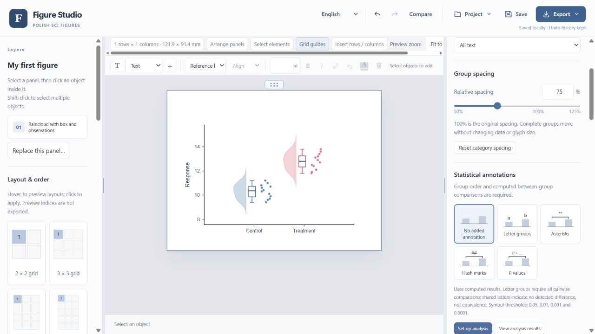
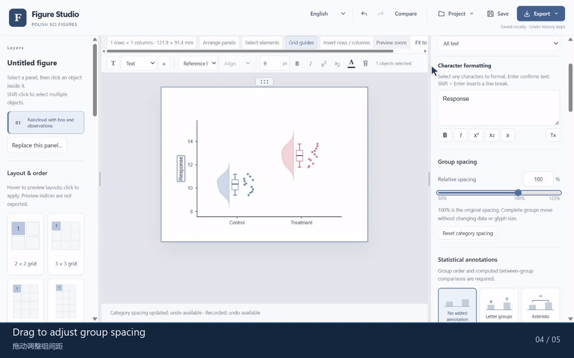
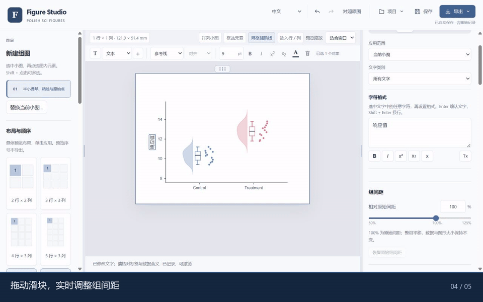

Figure Studio 0.1.23 保留原简约小猫并增加同风格小狗；首次安装 Setup，后续从编辑器内更新。[Windows 安装包](https://github.com/zhoy0409-debug/polish-sci-figures/releases/download/v1.4.23/polish-sci-figures-Studio-0.1.23-Setup-x64.exe) · [本版验收范围](docs/release-notes-v1.4.23.md#中文) · [使用入门](desktop/QUICKSTART.zh-CN.md)。

[2026-10-18 发布后更新验收](https://github.com/zhoy0409-debug/polish-sci-figures/blob/main/docs/qa/live-preview/postrelease-20261018/README.md)：原官方 0.1.20／0.1.21 → 0.1.22 更新、工程自动恢复和正常清理均已实测通过。

# polish-sci-figures

**Scientific figures, thoughtfully made.**

Turn research data and scientific images into clear, editable figures. 
Explore the right chart, refine every detail, and bring your results together. 

[Figure Discovery / 智能选图](docs/figure-discovery.md) · [Appearance / 外观](docs/figure-studio-appearance.md) · [Image tools / 图片工具](docs/figure-studio-image-tools.md) · [Current release / 本版更新](docs/release-notes-v1.4.23.md)
AI skills for plotting, scientific image preparation, and figure refinement, with Figure Studio for hands-on editing.

[English](#polish-sci-figures) · [中文](#中文)

**[Download Figure Studio](https://github.com/zhoy0409-debug/polish-sci-figures/releases/download/v1.4.23/polish-sci-figures-Studio-0.1.23-Setup-x64.exe)** · **[Use the AI skills](docs/platform-installation.en.md)** · **[Explore the guide](README.en.md)**

From individual results to a coherent figure · Synthetic demonstration data · Click the figure to view it in full resolution

[Core capabilities](#from-source-material-to-publication) · [Watch the workflow](#see-figure-studio-in-action) · [What you can make](#what-you-can-make) · [Get started](#get-started) · [Guides and project](#guides-and-project)

## From source material to publication

The original scientific figure skills remain at the heart of **polish-sci-figures**. Start with a table, a batch of scientific images, or figures you already have. The AI workflow covers preparation through final review; **Figure Studio** adds direct visual editing whenever you want to adjust the details yourself.

- **Plot from your data.** Inspect CSV, TSV, or Excel tables, clarify the experimental design, and compare suitable chart candidates. The data workflows retain analysis records, effect estimates, uncertainty, and plotting recipes so the chosen figure can be regenerated.
- **Prepare scientific images.** Process microscopy, fluorescence, histology, pathology, and electron-microscopy images in batches. Apply a consistent crop and display policy, match panel dimensions, and add scale bars from supplied calibration. Preserve the originals and record the processing steps.
- **Refine existing figures and assemble panels.** Work from plotting source or editable artwork to unify fonts, colors, scientific notation, and physical canvas sizes. Align axes and panel boundaries, balance whitespace, and adapt the composition to a manuscript, poster, or presentation while preserving the reported results.
- **Check the final figure and keep its source.** Combine font, SVG editability, and canvas checks with visual review at the intended publication size for clipping, overlap, and readability. Source workflows deliver SVG/PDF/PNG, with plotting code, source data, and relevant analysis or image-processing records.
- **Catch accidentally reused images.** Screen a figure or local batch for duplicates and suspected overlap. Zoom into matching details, compare an aligned overlay, locate the images and save review decisions with your project or report. [Image duplicate check](docs/image-duplicate-check.md).

The three skills cover [data plotting](skills/make-sci-data-figures/SKILL.md), [scientific image preparation](skills/standardize-sci-images/SKILL.md), and [figure refinement and quality checks](skills/polish-sci-figures/SKILL.md). [Use them with AI](#work-with-ai) or follow the [command-line guide](README.en.md#ai-and-command-line-workflows).

## See Figure Studio in action

Start with a template, bring in your data, and shape the figure directly on the canvas.

The recordings below show the earlier light interface. The current Carbon/Pearl controls are described in the [appearance guide](docs/figure-studio-appearance.md); the editing workflow remains available.

Figure Studio · Actual editor interface · Synthetic demonstration data

https://github.com/user-attachments/assets/c073bae3-fce8-41c7-84aa-a569a07a5872

Actual editor recording · English / Chinese step captions · Waiting pauses shortened · Synthetic demonstration data

Play, pause, or scrub through the video to follow each step. [Download the MP4](docs/media/figure-studio-walkthrough.mp4) to watch offline.

Quick preview: drag to adjust group spacing

1. **Choose a starting point.** Preview a suitable template and add it to your figure.
2. **Make it your data.** Replace the example values and see the plot update.
3. **Refine the details.** Edit text and adjust group spacing with the figure in view.
4. **Export your result.** Save an editable SVG or a high-resolution PNG / TIFF, for one panel or the whole figure.

**[Install and open Figure Studio](#open-figure-studio)** · [Follow the illustrated walkthrough](docs/editor-tour.en.md) · [Try the demonstration data](docs/media/demo-observations.csv)

## What you can make

**polish-sci-figures** brings data visualization, scientific image preparation, and figure assembly into one workflow. Use the AI skills to work from a research question, or open **Figure Studio**, the companion visual editor, to work directly with your figures.

- **Find a form that fits your data.** Explore distributions, paired observations, effects and intervals, time courses, heatmaps, survival curves, and more. Compare suitable alternatives before choosing a figure.
- **Get guidance on analysis.** Let the editor identify the table structure, confirm a few study-design details, and compare applicable methods in recommendation order. Choose a method to calculate results and preview its annotations.
- **Continue with an existing figure.** Import SVG or a PDF page and edit supported native text and vector elements. PDF effects may require a local image layer or a whole-page appearance image; see the [conversion limits](docs/release-v1.4.3.en.md#what-changed).
- **Make the details yours.** Draw straight lines and comparison brackets, edit individual characters, and choose distinct palettes. Switch point fills, outlines and error-bar colours, or hide either element with one click. Adjust group spacing and arrange panels with alignment guides; undo and redo keep refinements reversible.
- **Take the result into your paper.** Export individual panels or the complete layout as editable SVG or high-resolution PNG / TIFF. Save the project to continue editing later.

**Figure Studio 0.1.22** adds reversible canvas drafts and docked border/image tools, with real axis previews separated from application. It retains Carbon Atelier, Pearl Pro and the update companions. Confirmation keeps the real draft rendering and canonical final validation; all eight complete palette previews remain available. Input-method composition keeps candidate selection separate from committing or cancelling an edit. [Live editing](docs/live-preview-editing.en.md) · [Validation scope](docs/live-preview-validation.md) · [Windows IME observations](docs/windows-native-ime-acceptance.md).

The image workflows and professional axes introduced in **0.1.20** remain available: independent object borders, local duplicate review, reference display checks and overview/detail refinement. Supported native numerical axes re-render from data. [Usage and limits](docs/figure-studio-image-tools.md) · [0.1.20 acceptance](docs/figure-studio-experience-round2-validation.md).

The [current library](README.en.md#editable-chart-library) offers **218 editable starting templates**. Statistical methods follow the declared study design; result-based templates use the corresponding supplied analyses. Scientific images retain their calibration and processing records.

<strong>See more examples</strong>

**Experimental biology** — group comparisons, dose response, distributions, expression and time courses.

**Sequencing and omics** — quality profiles, alignment composition, PCA, matrices, differential expression and genomic tracks.

All examples use synthetic data.

## Get started

Choose the way you prefer to work. Both paths belong to the same polish-sci-figures suite.

### Open Figure Studio

[Download the Windows installer](https://github.com/zhoy0409-debug/polish-sci-figures/releases/download/v1.4.23/polish-sci-figures-Studio-0.1.23-Setup-x64.exe), install it, and open the shortcut. Choose a template, replace its example data, then edit and export in your browser. Windows 10/11 x64; the runtime is included, with no separate Python setup, Codex, account, or API key required.

[Quick start](desktop/QUICKSTART.en.md) · [Portable edition](https://github.com/zhoy0409-debug/polish-sci-figures/releases)

[Mac / Android development previews and iPhone/iPad status](docs/local-device-trial.md). Windows is the formal desktop release; the other device builds retain their stated preview scope.

### Work with AI

Use the companion skills in **Codex**, **Claude**, or another compatible environment. Install and select the skills using the [platform guide](docs/platform-installation.en.md), attach your data, and ask in everyday language:

> Help me turn this table into a figure for my paper. Show me a few suitable styles, and let me edit the result.

For scientific images or existing figures, everyday requests work too:

> Make these microscopy panels the same size and add scale bars using the calibration I supplied. Keep the originals and processing record.

> These figures are already plotted. Unify their fonts and colors, arrange them for my journal's figure width, and check for overlap and unreadable labels.

The suite covers plotting and analysis, calibrated image preparation, and final figure refinement through three cooperating skills. You can continue adjusting the result in Figure Studio without another AI call. Host requirements, installation steps, and actual testing coverage are listed in the platform guide.

[Codex / CLI setup](README.en.md#ai-and-command-line-workflows) · [Claude upload package](https://github.com/zhoy0409-debug/polish-sci-figures/releases)

## Guides and project

[Product guide](README.en.md) · [Latest improvements](docs/release-notes-v1.4.23.md) · [Validation record](docs/figure-studio-validation.md) · [Contributing](CONTRIBUTING.md)

Official downloads and updates come from [this repository's Releases](https://github.com/zhoy0409-debug/polish-sci-figures/releases). The project is available under the [MIT License](LICENSE); citation details are in [CITATION.cff](CITATION.cff).

---

## 中文

**从数据到成图，让科研表达更清晰。**

**polish-sci-figures** 将科研绘图、科学图像处理和组图精修连接在一起。从研究问题出发，找到适合数据的图形；也可以直接打开配套编辑器 **Figure Studio**，调整细节、编排小图，完成论文中的整幅图。

**[下载 Figure Studio](https://github.com/zhoy0409-debug/polish-sci-figures/releases/latest)** · **[使用 AI 技能](docs/platform-installation.md)** · **[阅读完整指南](README.zh-CN.md)**

从单项结果到完整组图 · 合成数据演示 · 点击图片查看高清原图

[核心能力](#从原始素材到投稿成图) · [观看操作演示](#看看编辑器怎么用) · [能做什么](#能做什么) · [开始使用](#开始使用) · [指南与项目](#指南与项目)

### 从原始素材到投稿成图

原有的科研作图技能仍是 **polish-sci-figures** 的核心。无论手里是数据表、一批科研图像，还是已经画好的图，都可以用 AI 工作流完成素材处理、绘图与终稿检查；需要自己手动精修时，可以打开配套的 **Figure Studio** 调整细节。

- **从数据开始作图。** 检查 CSV、TSV 或 Excel 表格，确认实验设计，比较适合数据的候选图。数据工作流保留分析记录、效应估计、不确定性和绘图配方，方便重新生成与继续修改。
- **批量规范科研图像。** 处理显微、荧光、组织学、病理和电镜图像，统一裁剪与显示设置、匹配小图尺寸，并根据提供的校准信息添加比例尺。原始文件保留，处理过程有记录可查。
- **精修已有图形并完成组图。** 从绘图源码或可编辑图形出发，统一字体、配色、科学符号和实际画布尺寸；对齐坐标轴与小图边界、调整留白，适配论文、海报或汇报版面，同时保留已有结果。
- **检查终稿并保留可复现材料。** 结合字体、SVG 可编辑性和画布检查，在实际发表尺寸下查看裁切、重叠及可读性。源码工作流交付 SVG/PDF/PNG，并保留绘图代码、源数据及相应的分析或图像处理记录。
- **找出可能放重的图片。** 检查组图或本地批次中的重复图像和疑似重叠，放大匹配细节、对齐叠加比较、定位原图，并将复核判断随工程或报告保存。查看[图片查重指南](docs/image-duplicate-check.md#中文)。

三个技能分别负责[数据作图](skills/make-sci-data-figures/SKILL.md)、[科学图像处理](skills/standardize-sci-images/SKILL.md)和[图形精修与质检](skills/polish-sci-figures/SKILL.md)。可以[用日常语言交给 AI](#开始使用)，也可以查看[命令行指南](README.zh-CN.md#ai-与命令行工作流)。

### 看看编辑器怎么用

选一个合适的模板，换成自己的数据，再直接在画布上调整细节。

下方录制展示早期浅色界面；当前 Carbon／Pearl 外观入口见[外观指南](docs/figure-studio-appearance.md#中文)，原有编辑步骤继续保留。

https://github.com/user-attachments/assets/f9359952-cdaf-43b5-a66f-50b5b1160718

中文界面实际操作录制 · 中文步骤说明 · 已缩短文件选择等待 · 合成数据演示

可以播放、暂停或拖动进度，按自己的节奏查看每一步。也可以[下载中文版 MP4](docs/media/figure-studio-walkthrough.zh-CN.mp4) 离线观看。

快速预览：拖动调整组间距

1. **选模板。** 预览适合数据的图形，加入当前组图。
2. **换数据。** 替换示例数值，查看图形更新。
3. **调细节。** 一边看图，一边改文字、调整组间距。
4. **导出成图。** 将单个小图或整幅组图保存为可编辑 SVG，或高清 PNG / TIFF。

**[安装并打开 Figure Studio](#开始使用)** · [跟着图文步骤操作](docs/editor-tour.zh-CN.md) · [下载演示数据](docs/media/demo-observations.csv)

### 能做什么

从单幅图到完整组图，让图形更好地表达数据中的信息。

- **找到适合数据的表达方式。** 从分布、配对观察、效应量与区间，到时间趋势、热图和生存曲线，先比较合适的候选，再决定用哪一种。
- **跟着引导完成统计。** 编辑器识别表格结构，确认少量研究设计信息后，按推荐顺序展示适用方法；选定方法即可计算结果并预览统计标注。
- **接着修改已有图形。** 导入 SVG 或 PDF 页面，继续修改受支持的原生文字和矢量元素。PDF 特效可能需要局部图片图层或整页外观图像；详见[转换边界](docs/release-v1.4.3.md#本版更新)。
- **把细节调整到位。** 插入水平线和比较括号、修改单个字符，选择差异鲜明的配色。快捷切换样本点填充、描边和误差棒颜色，也可一键隐藏或恢复。调整组间距，借助对齐辅助线编排小图；撤销与重做让精修可以随时回退。
- **把结果带进论文。** 单个小图和整幅组图均可导出可编辑 SVG 或高清 PNG / TIFF，保存工程后还能继续编辑。

**Figure Studio 0.1.22** 增加可取消的真实画布草稿，边框与图片工具停靠侧栏，坐标轴真实预览与应用分开；保留 Carbon Atelier、Pearl Pro 和更新角色。确认时保留真实草稿渲染，最终仍执行规范校验，保留完整八卡色板；输入法选词与编辑的确认、取消分别处理。[实时编辑说明](docs/live-preview-editing.zh-CN.md) · [实际验收范围](docs/live-preview-validation.md) · [Windows 输入法观察](docs/windows-native-ime-acceptance.md)。

**0.1.20** 已加入的图片工具与专业坐标轴继续保留：独立对象边框、本地查重、参考颜色检查及原图坐标定位精修，支持的原生数值轴按数据重新生成。[操作说明与限制](docs/figure-studio-image-tools.md) · [0.1.20 验收记录](docs/figure-studio-experience-round2-validation.md)。

[当前图形仓库](README.zh-CN.md#可编辑的图形仓库)提供 **218 个可编辑模板起点**。统计方法匹配明确的研究设计，结果类模板使用对应的已有分析；科学图像保留校准信息和处理记录。页面中的演示均使用合成数据，红蓝配色贯穿不同类型的图形。

### 开始使用

按自己的习惯选择入口，两种方式都属于同一套 polish-sci-figures 产品。

**直接打开 Figure Studio。** [下载 Windows 安装包](https://github.com/zhoy0409-debug/polish-sci-figures/releases)，安装后打开快捷方式。选模板、换数据，在浏览器中完成编辑和导出。支持 Windows 10/11 x64，运行环境已包含，无需单独配置 Python、打开 Codex、注册账号或填写 API 密钥。

[快速入门](desktop/QUICKSTART.zh-CN.md) · [便携版](https://github.com/zhoy0409-debug/polish-sci-figures/releases)

[Mac / Android 开发预览与 iPhone/iPad 状态](docs/local-device-trial.md#中文)。Windows 为正式桌面发行版，其他设备按页面说明提供开发预览或模拟器验证。

**让 AI 协助作图。** 在 **Codex**、**Claude** 或其他兼容环境中，按[平台指南](docs/platform-installation.md)安装并选用技能，附上数据，用日常语言描述需求即可：

> 帮我把这张表画成适合论文的图，给我几个合适的样式选一下，最后让我自己继续编辑。

处理科研图像或已有图形，也可以直接这样说：

> 把这批显微图统一成相同尺寸，按我提供的校准信息加比例尺，保留原图和处理记录。

> 这些图已经画好了，帮我统一字体和配色，按期刊要求的宽度组图，再检查有没有重叠或看不清的字。

三个配套技能分别负责数据作图与分析、带校准的图像处理，以及最终精修和组图。生成后可以直接在 Figure Studio 中继续调整，无需每次修改都重新请求 AI。宿主要求、安装步骤及实际测试范围见平台指南。

[Codex / 命令行安装](README.zh-CN.md#ai-与命令行工作流) · [Claude 上传包](https://github.com/zhoy0409-debug/polish-sci-figures/releases)

### 指南与项目

[完整功能指南](README.zh-CN.md) · [本版更新](docs/release-notes-v1.4.23.md#中文) · [验证记录](docs/figure-studio-validation.md) · [参与贡献](CONTRIBUTING.md)

官方下载与更新统一通过[本仓库的 Releases](https://github.com/zhoy0409-debug/polish-sci-figures/releases)提供。项目采用 [MIT 许可](LICENSE)，引用信息见 [CITATION.cff](CITATION.cff)。

[↑ Back to English](#polish-sci-figures)
