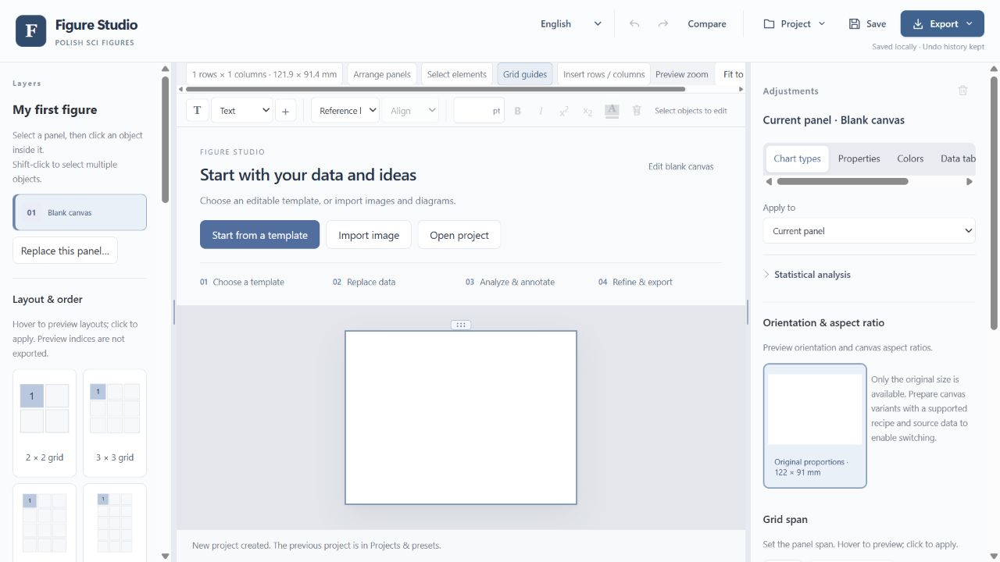
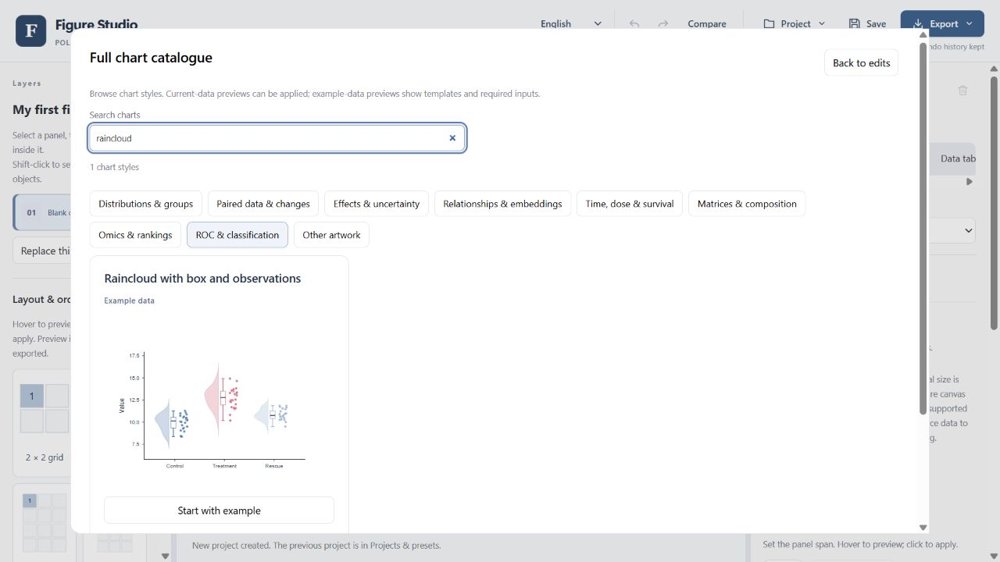
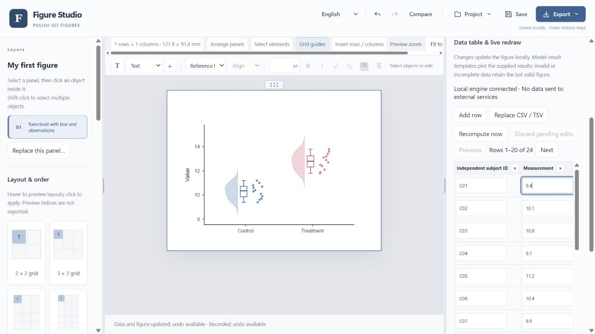
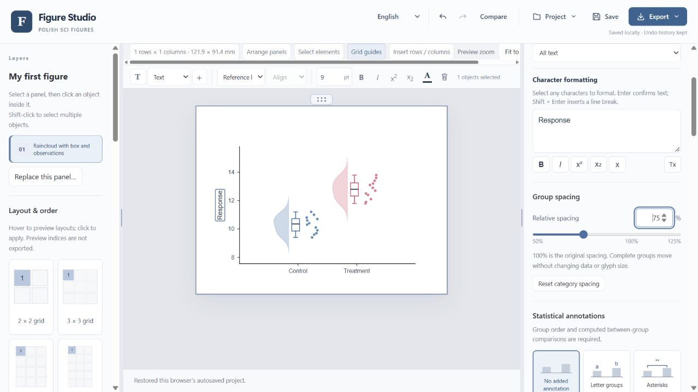
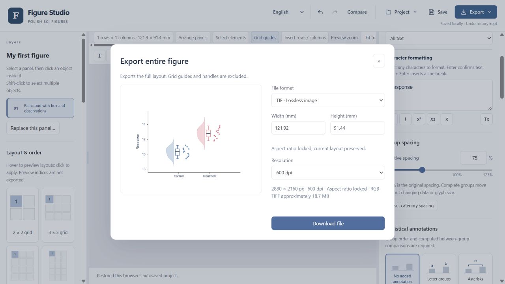

# Your first figure in Figure Studio

Follow this short tour to turn a table into a raincloud plot, edit its labels and spacing, and export a TIFF. The screenshots show the working editor; the data are synthetic and supplied so you can repeat the steps.

[English](editor-tour.en.md) · [中文](editor-tour.zh-CN.md) · [Back to the project](../README.md)

This is the still-image version of the [homepage demonstration](../README.md#see-figure-studio-in-action). Read at your own pace, and click an image to see it at full size.

## 1. Open the editor

[Download Figure Studio](https://github.com/zhoy0409-debug/polish-sci-figures/releases/latest), install the Windows desktop edition, and open **polish-sci-figures Studio** from its shortcut. When the launcher says **Editor is ready**, the editor opens in your browser. Choose **English** at the top if needed.

Click **Start from a template** on the welcome screen.

## 2. Choose a template

Enter **raincloud** in **Search charts**, then click **Start with example** on the raincloud card. You now have a figure you can edit.

## 3. Replace the example data

Open the [demonstration CSV](media/demo-observations.csv) and use GitHub's **Download raw file** button to save it to your computer. It contains 24 synthetic observations in two groups. Its three columns are `group`, `unit` (the observation's identifier), and `value`.

In the editor, select the plot and open **Data table**. Choose **Replace CSV / TSV**, then select the downloaded CSV. If the editor asks you to apply pending data changes, click **Recompute now** and wait for the updated plot.

For your own figure, replace the demonstration values with your measurements while keeping the column structure required by the template. Export an Excel sheet as CSV or TSV before importing it.

## 4. Adjust text and spacing

Double-click the axis title **Value**, type **Response**, and press **Enter**. Select the plot, open **Properties**, and move **Group spacing** from **100%** to **75%**. The two groups move closer while their measured values stay the same.

Use **Undo** if you want to compare with the previous arrangement. Text and spacing can be refined again at any time.

**Current source additions (14 October 2026):** the **Annotations** tab holds statistical styles and condition tables. Complete the analysis if results are missing; generated comparisons remain editable and movable. Grouped bars and supported faceted comparisons now anchor above their matching groups, with staggered rows for large labels. You can also open **Chart types → Examples in papers** for an optional Europe PMC search and, where a figure caption is matched and a compatible candidate exists, preview with your own data. See [search behavior and privacy](../README.en.md#examples-in-papers). These additions are not shown in the older screenshots and do not indicate a new installer release.

## 5. Export and keep an editable copy

Open **Export** in the top toolbar and choose **TIF**. Set **600 dpi**, review the output dimensions, and click **Download file**. The exported TIFF contains the figure, without the editing controls.

For vector artwork, choose **Export → SVG** instead. To save just one panel in a multi-panel figure, right-click that panel and choose its export option.

Also click **Save** in the toolbar to download the editable project JSON. Choose **Project → Open project** later to continue changing the data, labels and layout.

**[Download Figure Studio](https://github.com/zhoy0409-debug/polish-sci-figures/releases/latest)** · [Installation and project backup](../desktop/QUICKSTART.en.md) · [Full product guide](../README.en.md)
