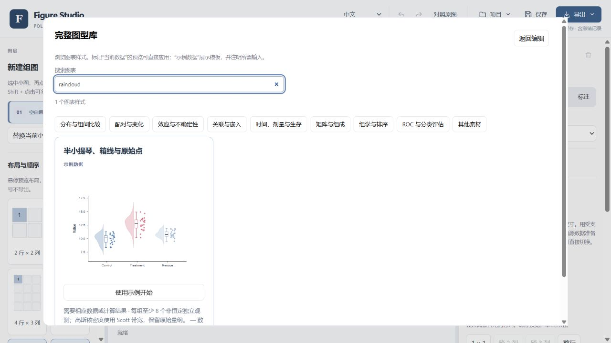
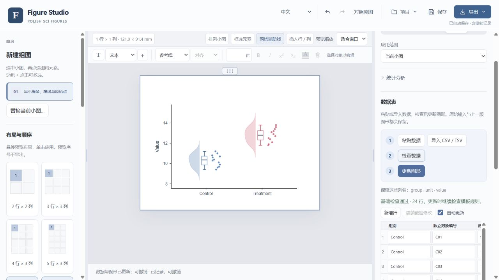
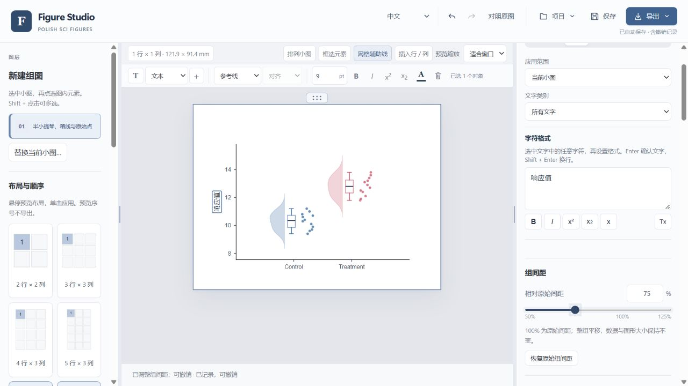

# 用 Figure Studio 完成第一张图

跟着这份图文演示，把数据表变成雨云图，修改文字和组间距，再导出 TIFF。截图来自实际编辑器，合成示例数据也已提供，可以直接跟着操作。

[English](editor-tour.en.md) · [中文](editor-tour.zh-CN.md) · [返回项目首页](../README.md#中文)

这是[首页中文操作演示](../README.md#看看编辑器怎么用)的静态图文版，截图与操作说明均对应中文界面。可以按自己的节奏阅读，点击图片查看大图。

## 1. 打开编辑器

[下载 Figure Studio](https://github.com/zhoy0409-debug/polish-sci-figures/releases/latest)，安装 Windows 桌面版，然后打开 **polish-sci-figures Studio** 快捷方式。编辑器会在浏览器中打开；如果当前是英文界面，在顶部语言菜单选择 **中文**。

点击欢迎页面上的 **从模板开始**。

## 2. 选择模板

在 **搜索图表** 中输入 **raincloud**，点击雨云图卡片上的 **使用示例开始**。此时画布上会出现一张可以继续编辑的图。

## 3. 换成新的数据

打开[演示用 CSV 数据](media/demo-observations.csv)，点击 GitHub 的 **Download raw file** 按钮，把文件下载到电脑。文件包含两组、共 24 条合成观测记录，三列分别为 `group`（组别）、`unit`（观测编号）和 `value`（数值）。

回到编辑器，选中图形，打开 **数据表**。点击 **导入 CSV / TSV**，选择刚下载的文件，图形会自动更新。也可以直接粘贴从 Excel 复制的表格；手动修改数据后，点击 **检查数据** 复查，再点击 **更新图形**。

正式作图时，将演示值替换为自己的测量数据，并保留模板要求的列结构。如果出现红色提示，先检查对应单元格，再更新图形。

## 4. 调整文字和组间距

双击纵轴标题 **Value**，输入 **响应值**，按 **Enter** 生效。选中图形，打开 **属性**，拖动 **组间距** 滑块，将间距从 **100%** 调至 **75%**。两组会靠得更近，测量数值保持不变。

想与之前的布局比较时，可以使用 **撤销**；文字和间距都可以继续调整。

**当前源码补充（2026 年 10 月 14 日）：** 统计样式和条件表统一在**标注**页调整。缺少结果时先完成分析，自动比较标注仍可编辑和移动；分组柱图及受支持的分面比较直接锚定在对应组上方，字号较大时错层排布。也可从**图表类型 → 文献作图实例**主动检索 Europe PMC；核对到图注且当前数据存在兼容图型时，可用自己的数据预览。详见[检索方式与隐私说明](../README.zh-CN.md#文献作图实例)。这些新增操作未体现在旧版截图中，也不代表已发布新的安装包。

## 5. 导出并保留可编辑工程

打开顶部工具栏的 **导出**，选择 **TIF**。分辨率默认为 **600 dpi**，核对成图尺寸后点击 **下载文件**。导出的 TIFF 只包含图形，不会带上编辑器的操作控件。

需要矢量图时，选择 **导出 → SVG**。在组图中只想导出某一个小图，可以右键点击该小图，选择相应的导出选项。

同时点击工具栏上的 **保存**，下载可编辑的工程 JSON。以后选择 **项目 → 打开工程**，就能接着修改数据、文字和布局。

**[下载 Figure Studio](https://github.com/zhoy0409-debug/polish-sci-figures/releases/latest)** · [安装与工程备份](../desktop/QUICKSTART.zh-CN.md) · [完整功能指南](../README.zh-CN.md)
