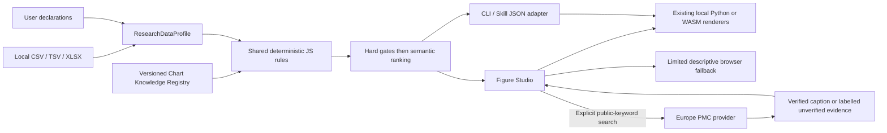

# Figure Discovery / 科研图表智能发现与推荐

Figure Studio now starts from a table and a research question. Choose **数据与智能选图 / Data & discovery** above the canvas, or **智能选图 / Figure Discovery** on the welcome screen or in **图表类型 / Chart types**. Import CSV/TSV/XLSX (2 MB; 10,000 rows; 100 columns), or use the current workbench table. XLSX uses the local Python/WASM engine and the first sheet; export another sheet as CSV, or select it with CLI `--sheet`.

Confirm data level, design, experimental unit, outcome type, technical repeats and nesting. Review automatically suggested column roles. These suggestions do not establish biological independence. Long-format paired records require before/after labels in their true order. Continuous models are not automatically assigned to counts. A missing required value is reported rather than imputed.

The page offers up to six distinct scientific views, with fewer when appropriate. Compare **your actual data** and apply a view to the editor; the existing undo/redo, save, project reopening, element editing and exports remain available. Applying to an occupied editor uses a free cell or adds a row and retains existing artwork; an untouched empty starter canvas is replaced. The existing panel and grid limits still apply. One undo restores the previous layout. Changing the table or design invalidates previews. Original uploaded rows, declarations and rule trace are retained locally with the applied asset; editing its data invalidates that binding.

The question, sample type and assay fields stay local. In the separate literature section, enter only public search keywords and click **Find examples**. The privacy note describes the exact outbound content: chart names plus the topic/sample/assay keywords entered in that section. No automatic transfer from your research description, table, filename or project occurs. Known local cell values and private labels are blocked from discovery queries; obvious identifiers, emails, numbers and query syntax are rejected. This is a guard against accidental disclosure, not a reliable detector of every personal name: review the keywords before clicking. Literature results never determine experimental independence or statistical eligibility.

## Shared CLI and Skill

From the source suite with Python 3.10–3.12, normal requirements and Node.js 18+:

```sh
python sci_figures.py discover measurements.csv --json
python sci_figures.py discover measurements.xlsx --sheet 0 --context research-context.json --out discovery-results --json
python sci_figures.py studio-serve discovery-results/figure-discovery.html --port 8767
```

The second command writes `discovery.json` and, when at least one candidate renders, `figure-discovery.html`. Choose a new output directory each time. No statistical calculation is represented as executed until the existing renderer/workbench actually runs. CLI does not currently initiate literature searches; use the explicit Studio action.

Example `research-context.json` for two independent continuous groups:

```json
{
  "research_question": "Compare viability after treatment",
  "sample_type": "independent cultures",
  "assay": "cell viability assay",
  "data_level": "raw",
  "design": "independent",
  "outcome_type": "continuous",
  "unit_confirmed": true,
  "technical_replicates": "no",
  "nesting": "none",
  "roles": {"unit": "sample_id", "group": "condition", "value": "viability"}
}
```

Use `design: "paired"` and `pair_order: ["Before", "After"]` for genuine paired long tables, or map `unit`, `before`, `after` for wide data. Use `design: "technical"`, `technical_replicates: "yes"`, `nesting: "experiment"` and map `experiment` for descriptive SuperPlots. This does not treat nine technical measurements as nine independent experiments. Use `design: "repeated"` and map `time` for longitudinal observations. Summary-only inputs declare `data_level: "summary"` and map `group`, `mean`, `sd`, `n`. SD is displayed as SD, not CI. Supplied differential results declare `data_level: "results"` and `effect_threshold` / `p_threshold`; raw expression matrices cannot enter this route. ROC uses `outcome_type: "binary"` plus `positive_class` and one score per confirmed independent unit.

## Architecture and contracts



`research-discovery.js` is the only implementation of profile and recommendation rules. `scripts/discover_figures.cjs` reads JSON on stdin, and the Python CLI handles local file import and the existing renderer. No Node runtime is needed by the desktop/browser UI. The versioned JSON registry is a reviewed subset of existing gallery/workbench contracts, not a second replacement catalogue; `scripts/build_discovery_registry.py` deterministically rebuilds it from authoritative Python contracts. Entries separate semantic purpose from appearance, and include bilingual names, synonyms, fields/types, design restrictions, sufficiency, estimand/uncertainty, information loss, renderer and review/source references. Additions require a real renderer and contract/preview tests.

Profile values use `observed`, `declared`, `inferred_unverified`, `unknown`. Counts and duplicate IDs are observed; design facts require declarations. Hard gates reject wrong level/type/design, repeats counted as independent, duplicate cells, missing values, insufficient density observations, invalid adjusted P values and unsupported nesting. Ranking favors actual observations, uncertainty and distinct scientific views; citation counts and impact factors are not used. `other_eligible` and `excluded` preserve the decision audit. `local_contract_ready` means the shared gates passed; `rendered` records a successful full renderer invocation.

With `--goal auto` (the default), a small bilingual keyword map suggests presentation emphasis from the research question and labels it `inferred_unverified`. The user can override it. These words never establish pairing, independence or replication. Outcome names and measurement units are optional local metadata shown in the overview; final axis wording can be edited in the existing editor.

Pure standalone HTML works without Python for a limited exact-data descriptive subset: raw points/median, ECDF, paired observations/change, individual time trajectories/baseline change, scatter and supplied mean/SD summaries. The fallback performs no statistical inference, CI estimation or density smoothing. The normal local engine supplies all other registered renderers. Existing saved-variant previews remain usable offline. The downloadable HTML embeds scripts, styles and knowledge data; no CDN or cloud AI is required at runtime.

## Literature evidence and providers

The Europe PMC implementation retains official search and open-access `fullTextXML`, bounded responses, no credentials/referrers/redirects, external-DTD removal and entity rejection, cancellation and a 10-second timeout. At most two search pages, ten papers and three concurrent full-text checks occur per search. HTTP 429 receives at most one retry with a capped 0.25–1 second delay, within the same timeout. A ten-minute in-memory cache holds at most twelve complete searches; partial/error results are retried when the user clicks again. Stable DOI/PMID/PMCID aliases deduplicate results. No page scraper or paper image download is used. Official references: [REST service](https://europepmc.org/RestfulWebService) and [article-specific open-access licensing](https://europepmc.org/downloads/openaccess).

Evidence mode includes eligible chart synonyms; exploration mode searches the explicitly entered public topic/method/sample words without requiring a chart word in the search. Caption extraction still uses only locally eligible charts, so discovered papers cannot bypass hard gates. Results retain authors, journal/year, IDs, source links, captions, anchors and check dates. `figure_verified` requires an explicit chart term in an accessible labelled caption; `paper_relevant` means a topic match only; `design_inferred` means an abstract chart-term match without a verified figure. No inferred result carries a fabricated figure number. Caption-only matching has limited recall and does not certify that all panels in a composite use that chart type.

The `providers` interface exposes Europe PMC capabilities and a disabled OpenAlex slot. OpenAlex, cross-provider aggregation, persistent literature caching and broad method-based chart extraction are deferred. Article images are never embedded or cached: `license: null`, `imageReuseAllowed: false` is conservative, even for open-access records. Only links and textual metadata/caption excerpts are displayed.

## 中文使用说明与范围

首页点击“智能选图”，上传数据，核对字段与实验设计，再点“寻找适合我的数据的方案”。候选卡使用本人真实数据；不满足条件的图会列出原因，不凑足数量。应用后可撤销，原有编辑器功能继续可用。断网不影响本地推荐和绘图；纯 HTML 降级只提供有限描述性图，不伪造推断结果。

已有工程可从画布上方的“数据与智能选图”进入。应用时使用空格或追加一行，保留原有图形；只有尚未编辑的空白画布会被替换。原有小图和行数上限继续有效，一次撤销即可恢复应用前的布局。

初版支持独立连续组比较、前后配对、独立实验内技术重复的描述性展示、纵向轨迹、连续变量关联、已完成差异分析结果、真实二分类标签/预测分数及均值/SD/n 汇总。其他图型仍可通过原有模板库和专业工作台使用。多因素剂量×时间、混合模型、其他嵌套结构、自动自然语言诊断与跨领域语义 AI 均未新增。顺序型剂量/时间不应伪装为任意独立组；请声明重复结构并使用已有专业工作台。

See [validation and platform scope](figure-discovery-validation.md) before describing this source change as a packaged release.
