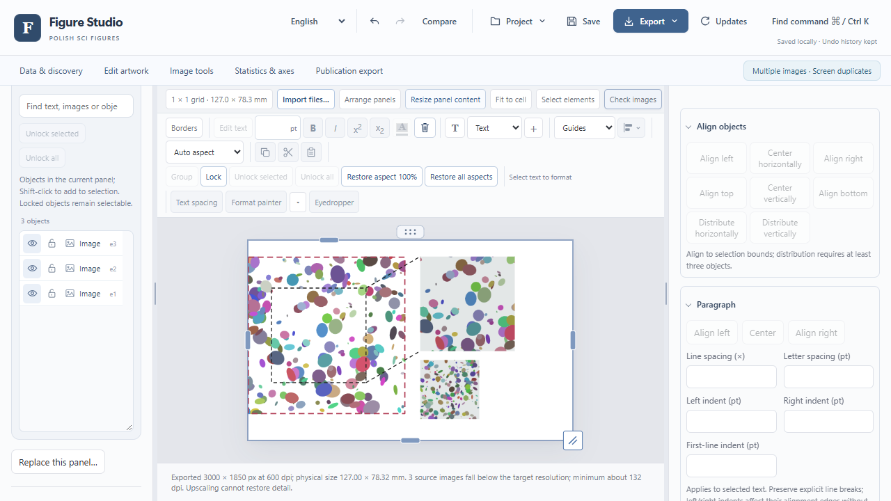
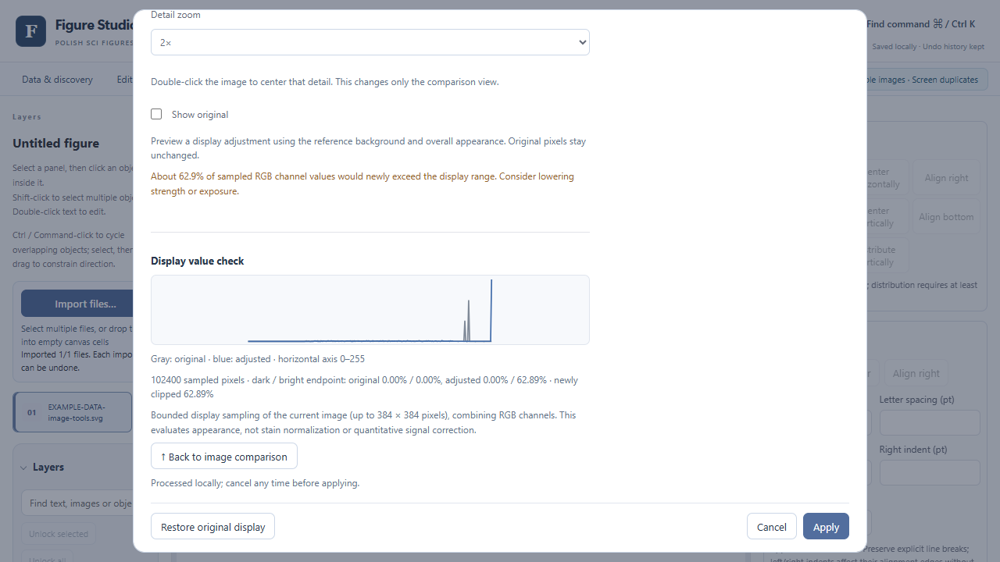
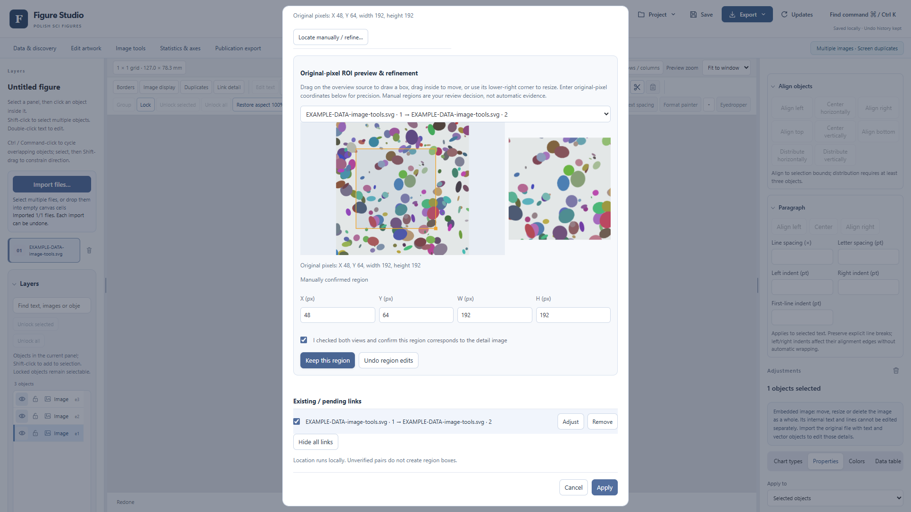
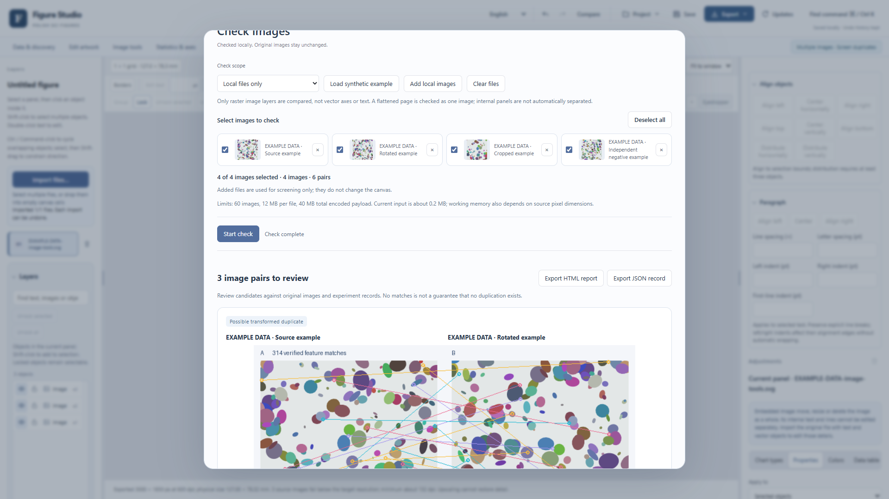
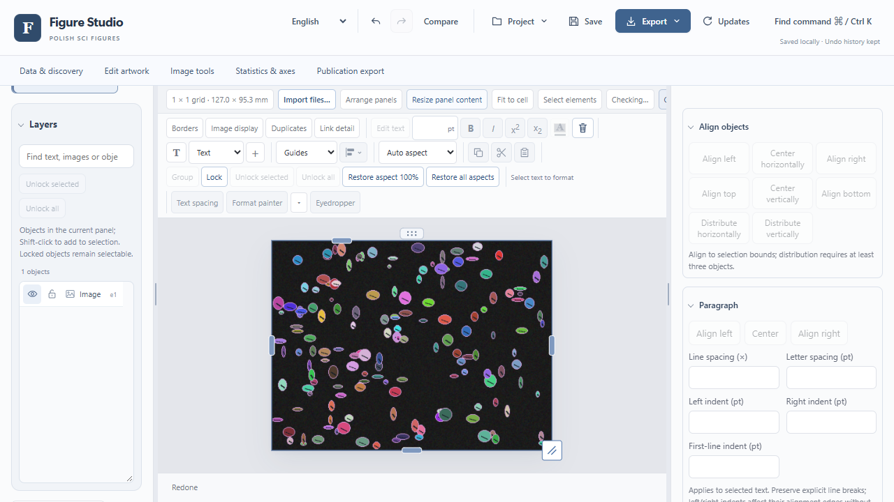

# Figure Studio 第二轮体验与性能验收

日期：2026-10-17。比较基线为已发布且实际安装的 Suite v1.4.19 / Studio 0.1.19；本轮目标为 Suite v1.4.20 / Studio 0.1.20。以下分开记录已有功能、可发现性、实际操作、验证证据和当前边界。旧版安装验收不能替代新版成品验收。

## 基线审计与变更

基线从已发布安装包安装到隔离目录，在 Windows Chrome 的 1280 × 720 与 1920 × 1080 视窗实际运行：颜色工具、总览／细节自动定位及查重引擎原已存在；定位返回已知裁剪位置，查重返回一对待复核结果。没有五组工作导航、显示直方图或人工 ROI 精修入口。原编辑器保留，改动以入口和操作缺陷为起点。

| 能力／现状 | 可发现性 | 实际操作 | 已验证范围 | 不支持／未验证 |
| --- | --- | --- | --- | --- |
| 边框：补充独立装饰记录 | 顶部搜索、图片工具、选中对象工具栏、右侧入口与右键 | 颜色、最终 pt、线型、圆角、可见／完整外缘、多选、格式复制、锁定、移除、撤销、保存和导出 | Chrome 实际 SVG CTM／裁剪、选中图片完整编辑器流程、原始载荷保持；源码替换边框迁移回归 | 居中／外侧位置；复杂蒙版可见外缘；普通元素剪贴板携带独立边框 |
| 查重：保留原有科学门槛，补预检与入口 | 图片工具、上下文菜单、多图手动提示 | 范围／配对数、显式开始、本机示例、进度、取消、复核持久化 | 真实本机 API、公开真实来源 70 对与本地私有构造案例；完整失败列表另附 | 单张压平图内部复制；独立人工真实盲测尚未进行；低纹理条带与重裁剪有漏检 |
| 颜色：复用原显示管线 | 单图可打开；图片工具中选择目标／参考 | 手动显示、同位置对比、细节、直方图和截断检查、一次应用及撤销 | 公开及私有真实来源手动显示流程、源载荷不变、显示统计回归 | 浏览器手动显示测试不等于自动参考匹配准确性评估；不做染色归一化或荧光定量 |
| 总览／细节：保留自动几何验证，补精修 | 独立命名入口，区别于图内创建局部放大 | 同源确认、候选原图坐标、绘制／移动／尺寸／像素精修、人工证据标记、一次应用 | 已知构造裁剪实际定位、公开与私有来源工程回归、保存重开、ROI SVG 导出 | 无共同来源、强重裁剪、低纹理条带可能拒绝；拒绝后不猜框 |
| 专业轴：原数值轴延伸基础上补四区设置 | 工作入口、搜索、右侧按钮、双击识别轴 | 原生配方真实范围、刻度、印刷尺寸和外观；导入矢量保留安全延伸 | 24 项新渲染、22 项既有轴回归、14 项导入轴、真实 UCI Iris 浏览器流程 | 任意压平图数值还原、跨独立 Panel 轴批量套用、几何缩放字形模式 |
| 现有编辑器与智能选图 | 原入口及五组导航并存 | 原数据／统计／编辑／导出继续使用 | 针对受影响合同及已有模块回归，成品验证另记 | 不以局部回归宣称所有模板与所有平台视觉通过 |

## 实际浏览器与材料

两种指定视窗完成了四条操作链：边框、颜色、总览／细节、查重，含应用、撤销重做、工程保存重开与实际文件下载。结果没有远端请求和页面异常。公开截图采用明确标记的合成素材，展示操作；它们不用于检测可靠性分母。真实来源 H&E 和私有 RGB 图的已知裁剪另在本机运行，原始载荷保持。私有 TIFF 转 PNG 时逐像素验证，只适用于这张 RGB 素材，不外推为高位深／多通道原图转换认证。

源码实际操作记录：[1280 × 720](qa/round2/image-tools-1280x720.json)、[1920 × 1080](qa/round2/image-tools-1920x1080.json)、[边框几何与锁定](qa/round2/object-borders-browser.json)。以下截图来自实际浏览器，不是设计稿。









专业坐标轴在 UCI Iris 150 株植物实测数据上运行：核对全部原表值不变，实际重新绘制范围、刻度、240 × 180 pt 绘图区、线宽与字号，再导出 SVG／PNG、撤销重做并保存重开。未据此声明实验独立性或执行假设检验。[来源与步骤](figure-studio-axes-round2.md)。

本地实际操作脚本：

```powershell
# 将 STUDIO_ROUND2_URL 设置为本机已运行的编辑器地址。
$env:STUDIO_ROUND2_WIDTH = '1280'
$env:STUDIO_ROUND2_HEIGHT = '720'
node scripts/test_studio_image_tools_round2_browser.cjs
node scripts/test_studio_object_borders_browser.cjs
node scripts/test_studio_axis_settings_browser.cjs
```

脚本需要开发者 Playwright／Chrome 环境；安装版用户不需要 Node。复跑实际数据时显式设置脚本说明中的本地材料路径，证据默认写入忽略的 `.cache`。不要把私有输出目录直接发布。检测的分层混淆矩阵、原图关联限制、置信区间与漏检见[独立评估记录](scientific-image-evaluation-round2.md)。

## 性能与 Windows 成品状态

正式同机 45 次冷／暖对照已完成：60 图 1,770 对的基线 P50/P95 为 32.853/35.553 s，当前首次为 32.078/33.978 s，暖重复为 8.062/8.538 s。重复检查 P50 减少约 75%；首次不声称显著加速，20 图首次 P50 实测反而增加。内存、CPU、取消及原始计时见[完整性能记录](scientific-image-evaluation-round2.md#性能优化和复核)。

广泛源码回归完成 85 个 JavaScript／DOM 脚本、53 项资产语法和 19 个 Python 测试入口，最终全部通过。[逐项退出码](qa/round2/source-regressions.json)。初次暴露的英文词表缺项已修复；一个旧版 variant 测试仍期待锁定对象自动切换尺寸，与已发布的锁定策略矛盾，现同时验证锁定不切换及解锁后字体／颜色迁移。初次日志保留在本机，没有改掉生产锁定保护来迎合测试。

新版 Windows 0.1.20 已实际安装，并完成下列成品验收；环境为本机 Windows 11 x64，未使用全新虚拟机，也未新增 Windows 10、Mac、Linux、手机或平板成品认证。

- [安装、覆盖升级、卸载和冻结运行](qa/round2/windows-installer.json)：所有安装文件与构建一致；清除 Python 路径、设置无效 PYTHONHOME 后仍完成真实统计／绘图／PDF／查重／定位；升级与卸载保留外部工程哨兵及设置。
- [真实 0.1.19 → 0.1.20 覆盖升级](qa/round2/windows-upgrade-0.1.19-to-0.1.20.json)：实际先安装已发布旧版，再覆盖本版，2,501 个文件与构建逐一相同；外部测试工程和设置 SHA-256 不变。此前同版本重复安装检查另行保留。
- [1280 × 720](qa/round2/windows-image-tools-1280x720.json)及[1920 × 1080](qa/round2/windows-image-tools-1920x1080.json)：实际图片元素边框、颜色显示、总览／细节、查重四条操作链，含应用、撤销重做、保存重开及 SVG／PNG／TIFF 下载。报告核对服务版本为 0.1.20。
- [专业轴](qa/round2/windows-axes.json)使用 Iris 实测数据完成真实重绘；[智能选图](qa/round2/windows-discovery.json)回归独立组、配对、工程往返、导出、离线降级及零未授权远端请求。[20 类代表模板](qa/round2/windows-catalogue.json)通过实际冻结引擎渲染与数据合同检查，不能据此声称全部模板视觉认证。
- [原生 WB／uint16 本机 API](qa/round2/windows-private-raster-api-summary.json)6/6，通过实际安装版 Pillow／OpenCV 路径；最低有效位单像素变化产生不同原生哈希，没有误报精确相同。大幅全图仍具体返回 12 MB 限制。
- [栅格导出](qa/round2/windows-raster-export.json)：两种公开视窗及一例私有真实图的 PNG／TIFF 解码后 RGB 像素逐项一致，TIFF 为 600 dpi。私有原图、实验名、路径及截图未分发。
- [60 图后台响应](qa/round2/windows-background-screening-60.json)：预检 1,770 对，实际启动后关闭窗口仍能搜索、缩放、编辑边框和撤销重做；操作耗时 73–614 ms，取消确认 635 ms，旧证据和复核保留。RAF P95 为 8.5 ms、最大间隔 641.6 ms，包含测试启动／截图停顿，不声称零卡顿或跨机器保证。

[真实来源参考颜色补验](qa/round2/windows-reference-color.json)保留完整 H&E 因背景门槛拒绝的案例；另对显式记录的自然视野裁剪，使用温和已知线性 RGB 色偏的派生参考，实际完成“建议匹配 → 应用 → 撤销重做 → 保存重开 → SVG 导出”，原始嵌入字节不变。背景显示误差的改善仅针对算法定义的近白背景，不代表组织染色、扫描器校准或总体匹配准确率。选例与裁剪偏倚明确记录；没有为通过验收而放宽阈值。

这次补验发现选中图片后的上下文快捷入口未立即刷新，已在选择工具栏同步点修复，并补充实际可见性断言。快捷工具、导入、状态与方向键热路径回归通过；最终安装资源版的快捷入口、参考匹配及 1280 × 720 四条图片操作链也已实际复核通过。

原生启动器已显示本机服务就绪并点击“打开编辑器”；桌面工具随后未能以足够置信度核实默认浏览器地址，Windows UI 自动化因此停止。该默认浏览器步骤和本版原生退出按钮未独立复核，未被算作通过；已完成的成品 Chrome 流程与脚本化生命周期检查分别保留。



## 明确保留的边界

用户确认没有独立人工标签，先完成工程验证。因此本轮可以交付可操作功能、真实来源适配和可复现工程检验；尚不能给出代表性科研图像的独立盲测准确率。自动颜色建议的广泛真实图像可靠性、任意 PDF 数值轴恢复、单图内部复制检测和跨独立小图轴批量复制也未宣称完成。[使用说明](figure-studio-image-tools.md)同步列出普通用户可执行的步骤和限制。
