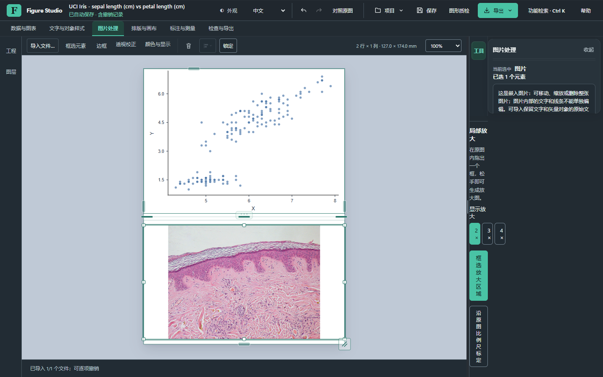
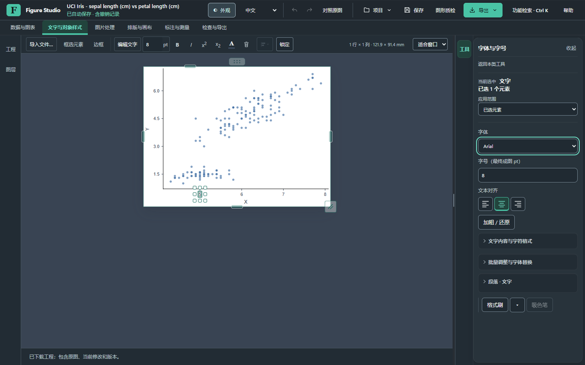

# Figure Studio 整体 UI/UX：真实界面审查与改造方案

**阶段：审查与方案，等待用户确认后实施。** 本轮建议沿用 Carbon Atelier／Mineral Jade 与 Pearl Pro，保留六类任务、唯一功能归属和原有科研编辑器。优先修复面板归属与响应布局，再统一视觉密度；当前没有从截图或源代码中发现需要重做产品的理由。

审查基线为 `3c055e6970582334fc9df71b99f1ca61dd3c5724`。该提交八项 CI 成功，WB 候选 wn21 的来源核对和隐藏隔离自检通过，但实际界面仍能复现下面的问题。**CI 成功不能替代使用体验验收，当前也不具备发布结论。**

**后续状态：用户已确认“先修 P0，再统一核心界面”，本方案随后进入实施。** 本文保留实施前的审查与待确认语境，实际改动及结果见[实施报告](qa/windows-next-stable/uiux-core-20261031.md)；确认实施不代表批准发布。

## 1. 本轮实际看了什么

使用独立源码 Chrome 156，加载公开 Iris、公开许可 H&E 图片和明确标注的合成 WB。所有作为下文证据的图均来自本轮真实运行画面；没有用参考软件、设计稿或生成效果图替代。11 张用户参考图仅用于提炼低饱和、清楚分区、克制边界及紧凑导航，没有复制第三方图标或 Dashboard 卡片布局。

Iris 为 Fisher（1936）的 [UCI 数据集](https://archive.ics.uci.edu/dataset/53/iris)，CC BY 4.0，DOI 10.24432/C56C76；显微图为 [scikit-image 的 skin 示例](https://scikit-image.org/docs/0.25.x/api/skimage.data.html#skimage.data.skin)，作者 Kilbad，公有领域。合成 WB 明示为演示，不用来冒充实验图或检测准确率。

1366×768、1440×900、1920×1080，各按 100%／125%／150% 的 **CSS 内容区与 DPR 等效重排**、中文／英文采集默认与文字状态，共 36 张矩阵画面。另完成 15 步连续流程和三种既有画布衬底对比。选取下列代表画面逐张实看并记录；其余矩阵有布局测量和本机原图，未据此宣布全部可读性合格。

这里的等效重排不是点击 Chrome 菜单改变真实浏览器缩放，也不是 Windows 系统缩放。已停止的原生控制接口没有重试，原生安装实操和真实浏览器缩放仍留作后续人工验收。本机服务与测试浏览器均为独立测试进程，没有操作用户工程窗口。

| 步骤 | 实际操作与画面 | 当前判断 |
| --- | --- | --- |
| 1 | 打开公开工程，点画布空白处：[默认状态](qa/windows-next-stable/uiux-audit-20261031/default.png) | 六类任务和窄导航可保留；默认仍保留当前小图上下文，不能把它误称为完全没有选区 |
| 2 | 选择文字，进入唯一字体工具：[文字属性](qa/windows-next-stable/uiux-audit-20261031/text.png) | 字体／字号可直接访问；返回、作用对象、范围和分隔占据较多首屏空间 |
| 3 | 手动 100%，收起再恢复工具：[收起后](qa/windows-next-stable/uiux-audit-20261031/panels-closed.png) | 工程状态、比例及尺寸不变；图形横向居中位置改变，需改善编辑锚点 |
| 4 | 从文字任务导入并选中图片，再进图片处理：[图片状态](qa/windows-next-stable/uiux-audit-20261031/image-containment.png) | **失败：局部放大控件进入 44 px 窄栏，文字逐字折行，影响工具可达性** |
| 5 | WB 中导入、框选、返回、切英文再进：[WB 英文](qa/windows-next-stable/uiux-audit-20261031/wb-en.png) | 原图／最终组图／属性分区有效；同排长标签使输入顶边不齐。目录受前述问题影响时用正常 Ctrl+K 才继续 |
| 6 | 打开功能检索：[长列表](qa/windows-next-stable/uiux-audit-20261031/search.png) | 检索可以恢复路径；条目重复分类文字、外框较重，首屏可浏览数量偏少 |
| 7 | 项目下拉及新建弹窗：[下拉](qa/windows-next-stable/uiux-audit-20261031/menu.png)、[弹窗](qa/windows-next-stable/uiux-audit-20261031/dialog.png) | 等现有过渡结束后，文字、遮罩和主操作清楚，主体结构应保留 |
| 8 | 同一图进入 Pearl：[浅色参照](qa/windows-next-stable/uiux-audit-20261031/pearl.png) | 主题结构一致；局部放大归属问题在浅色中仍存在，不能靠颜色修复 |
| 9 | 检查缩放重排：[英文顶部](qa/windows-next-stable/uiux-audit-20261031/header-overflow.png)、[短窗口](qa/windows-next-stable/uiux-audit-20261031/compact.png) | 英文一档宽度横向溢出；更窄时顶部多排挤占画布，需要优先级收纳 |

菜单另等待 300 ms 复查，未把打开中的过渡帧当成最终低对比问题。三次采集遇到的工具遮挡失败均保留，恢复使用实际滚轮或正常功能检索，未使用强制穿透点击。

## 2. 已确认的问题，按影响排序

| 编号／优先级 | 证据与影响 | 最小修改方向 |
| --- | --- | --- |
| A01 · P0 | `imageInsetsControls` 的实际父节点变回 `.inspector#mobileAdjustmentsRegion`，成为导航／属性之外的第三个网格子项，宽度仅 **44 px**。字体→图片→任务切换后，局部放大竖排；固定标题拦截 WB／字体目录按钮，普通点击超时 | 抽屉宿主统一管理控件归属；局部放大 refresh 更新内容和状态，不再把控件搬回旧宿主。保留非抽屉界面的原路径，校验右侧只存在导航和内容两列。先解决这一共同原因，再复判标题遮挡，避免逐按钮打补丁 |
| A02 · P0 | 1440×900 的 125% 英文等效场景为 **1152×720 CSS px**，文档实际宽 **1195 px**，溢出 **43 px**。中文未在同一档触发；仅按 1100 px 换行不足以覆盖较长英文 | 以内容和剩余宽度处理顶栏收纳，允许项目名称截断并提供完整提示；保存、撤销重做、导出保持可达。低频项目／界面操作进入现有菜单，不缩小字体 |
| A03 · P1 | 1366×768／150% 等效内容区 910×512，文字工具条变为 **116 px**，画布仅 **532×227 px**；普通 1366 状态工具条为 44 px | 为上下文命令设置优先级和“更多”，收纳次要格式命令；避免第三排常驻。保留文字字号、基础格式和当前模式；不把所有工具挪位置 |
| A04 · P1 | 手动 100% 时，收起工具使画布视口宽从 **1062→1344 px**；图形尺寸维持 **460.8×345.6 px**、viewBox 不变，但左边位置 **352.6→493.6 px**，平移 **141 px**；恢复后返回 | 区分适合窗口与手动视图。手动视图保存编辑焦点／视口锚点与滚动，面板开关不额外居中；适合窗口只按明确意图重算 |
| A05 · P1 | WB 英文同排“Exposure”和“Sample set / membrane ID”行数不同，输入顶边不齐；右侧嵌套分组与普通文字面板密度不同 | 共用成对字段的标签／输入对齐规范；常用字段优先，解释按需展开。保留大图工作区，不把 WB 重新挤进窄弹窗 |
| A06 · P1 | 功能检索每项同时出现分类标题、较高外框和重复路径，目录看起来像一排大卡片 | 复用当前检索与分类数据，改为紧凑命令行：名称为主，路径只在必要时显示，快捷键靠右；保留键盘选择和唯一目标 |
| A07 · P1 | 文字工具顶部同时有标题、返回、当前选中、数量、范围及多处分隔；有效参数开始偏低 | 合并成简短的对象／范围提示，必要时固定；用户显式选择工具后不自动跳回属性。通用属性才随对象更新，不新增第二套控件 |
| A08 · P2 | 已有完整色彩、字体、间距和圆角 Tokens，但 WB 等模块仍有等价硬编码；全量图标细节尚未逐个量测 | 先把等价值接回现有 Tokens，保留语义上的标准／紧凑密度；图标只在证实尺寸／笔画不一致时调整，不批量换图标或颜色 |

A01 的代码依据是 `image-insets-ui.js` 的 `refresh` 会按 `host.detailContainer` 重新安置 section，而 `drawer-workspace.js` 已经为它指定唯一的 `inset` 归属。运行时 DOM 与截图一致。相关宿主适配应是首轮重点，科研 ROI 算法和图像像素处理无须随之改动。

## 3. 保留的一套设计语言

现有深色背景、青绿色选中、有限阴影、白色科研画布、清楚的焦点与 Pearl 主题已有基础。11 张参考图中可借鉴的是相关信息靠近、导航低噪声、内容优先和规则间距；不引入 Dashboard 指标卡、渐变背景或玻璃层。

| 组件规范 | 本轮方案 |
| --- | --- |
| 表面 | 沿用 `surface-0/1/2`，区分工作区、面板、浮层；普通属性分组使用留白与标题，不再层层包边框 |
| 字体 | 继续使用现有 Segoe／微软雅黑栈。标签和输入以 13 px 为常用层级，次级说明 12 px，分组 14 px，面板标题 16–18 px；具体沿用语义 Token，不普遍缩小文字 |
| 控件 | 标准高度沿用 36 px；确有密集操作需要的紧凑控件明确使用 30–32 px 语义。相邻输入框、下拉和按钮同基线；禁用同时保留真实 disabled 与可读状态 |
| 间距 | 复用 4／8／12／16／24 px 梯度：组内紧密、组间拉开。避免空标题、重复说明和装饰分隔累加 |
| 圆角 | 沿用现有 4／6／8 px 与浮层 12 px 层级；不全局放大圆角 |
| 阴影 | 留给菜单、弹窗和真正浮层；主工作区不用逐卡片阴影。保持不透明可读的面板，不模糊科研图片 |
| 强调 | 青绿用于选中、确认、焦点和重要状态；状态同时有文字／图标／禁用语义，不靠颜色单独传达 |
| 图内样式 | UI Tokens 不作用到科研 SVG、原图、图内字体、统计符号、比例尺或导出像素 |

画布衬底已有“中性／深／浅”设置，无须再造主题。下面是**现有设置的真实对比，非改造后效果图**。独立比对确认工程与科学图形不变；是否改变默认衬底留给体验确认，现有用户偏好应保留。

## 4. 确认后的实施顺序与边界

**第一轮：P0 可达性和归属。** 修复 A01／A02，覆盖文字→图片→文字、图片→WB→返回、切中英文与 Pearl、滚动后切任务。复用当前宿主与控件，加入针对这条真实失败路径的检查；不改科研算法、统计规则、撤销合同或更新安全。

**第二轮：核心工作台。** 处理 A03／A04／A06／A07。保留上方六类任务与窄工程／图层导航，右侧最多一个有效内容抽屉。增加一个可恢复先前开关状态的沉浸入口，输入框和中文组词中不拦截快捷键。右侧上下文更新不抢占用户明确选择的任务，搜索继续跳到同一个参数页面。

**第三轮：专用模块的一致性。** 先把普通图片、局部放大、比例尺、矫正和 WB 共用字段、工具状态及滚动规范接齐。病理、电镜、胶图沿用已有图片工作流与科学限制，不借此新建未成熟的独立编辑器或平台。保留 WB 原图／成图并列、异步计算／取消、像素来源和草稿恢复。

**第四轮：同条件复核。** 所有前后图必须同一窗口、语言、源图、参数、视图倍率和选中状态。每次比较同时复查项目 JSON、原始字节、统计数据、撤销／重做与真实导出。静态截图检查排版，实际操作检查找工具、焦点、保存和取消；不能相互替代。

当前尚未开始这些整体改造，因此没有标注为“改造后”的画面。用户确认方案后再实施；不会先改完再要求追认。

## 5. 验收门槛

| 检查 | 第一轮及后续通过条件 |
| --- | --- |
| 面板归属 | `imageInsetsControls` 始终留在其唯一内容宿主；右侧无第三个隐式网格子项，图片／WB／字体按钮真实点击可达，无逐字竖排 |
| 布局矩阵 | 三种目标窗口、中英文、三档重排无横向页面溢出、必要按钮不遮挡。当前 CSS／DPR 检查之后，另做真实 Chrome／Edge 缩放及 Windows 显示缩放人工验收 |
| 画布空间 | 1366／1440／1920 常规状态的画布不小于本轮基线；910×512 等效短窗口明显减少工具条占用，不缩小图内文字和按钮来达成 |
| 编辑位置 | 手动倍率、选区、视图锚点及项目状态在抽屉／沉浸开关前后保持；适合窗口与主动缩放单独验证 |
| 上下文 | 图片、文字、WB 与无对象状态显示对应基础入口；显式工具／草稿／展开状态不被选区或语言变化清除，无重复主页 |
| 科学与编辑回归 | 原图／位深／来源、Iris 原始表与分析、ROI／比例尺、轴、文字、历史、保存重开、支持的导出均核对；不以样式测试代替 |
| 无障碍 | 检查实际文字／图标对比、键盘顺序、焦点不被标题盖住、禁用语义和读屏标签。截图中的焦点清楚不等于全面合规 |
| 性能 | 同工程、同协议保留全部选择／改色／确认批次及长任务；另做当前安装包实操。新观察器不得扫描科研 SVG 选择热路径 |

## 6. 本轮限制与交付位置

本轮无源页面异常、无非主动外联；有两次工具目录遮挡中断及一次后续字体遮挡，原记录均保留。恢复采用正常检索；最后等待过渡稳定后的连续流程完成。代表截图、SHA、DOM 尺寸、控件归属和失败边界见[结构化材料](qa/windows-next-stable/uiux-audit-20261031/audit.json)。本机保留全部矩阵和失败画面，公开材料只含许可明确的示例。

本次没有完成用户工具发现盲测、真实系统缩放、读屏全面测试或新安装版人工操作。现有 WB 工程验收与范围见[WB 报告](qa/windows-next-stable/wb-workflow-20261031.md)。wn21 是整体 UI 改造前的 WB 候选，含本轮已发现的界面问题；不称为最终稳定版。

**待确认的方案：先实施 A01／A02，复查共同原因修复后的实际页面，再按上面的统一规范推进核心工作台与模块适配。** PR #41 保持草稿，不合并、不发布、不部署。

### 复核与采集入口

`scripts/capture_studio_uiux_audit.cjs <独立QA本机URL> <新的输出目录>` 保存实际画面、可见控件、尺寸和恢复步骤，拒绝覆盖旧输出。它是审查采集器，不把被遮挡后改走检索的路径计作目录成功。运行需要项目已有的 Playwright／Chrome、`test_studio_carbon_helpers.cjs` 中带哈希／许可记录的公开 Iris 与 H&E 夹具，以及独立本机测试服务；缺失夹具会明确失败，不静默换成演示数据。当前报告以已保存的本轮数据为准。
