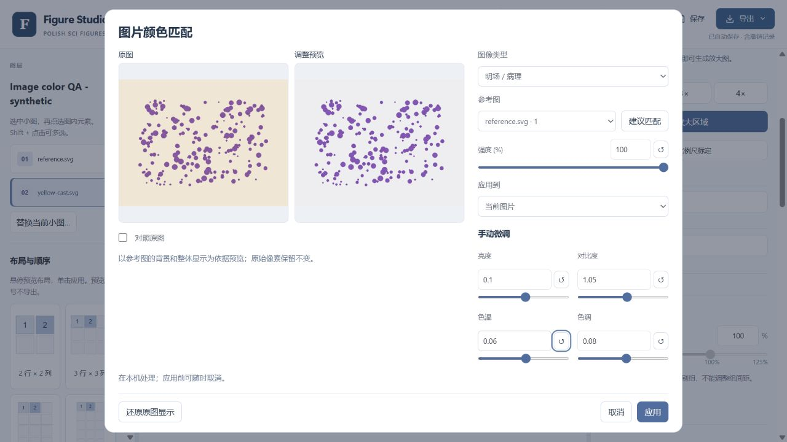
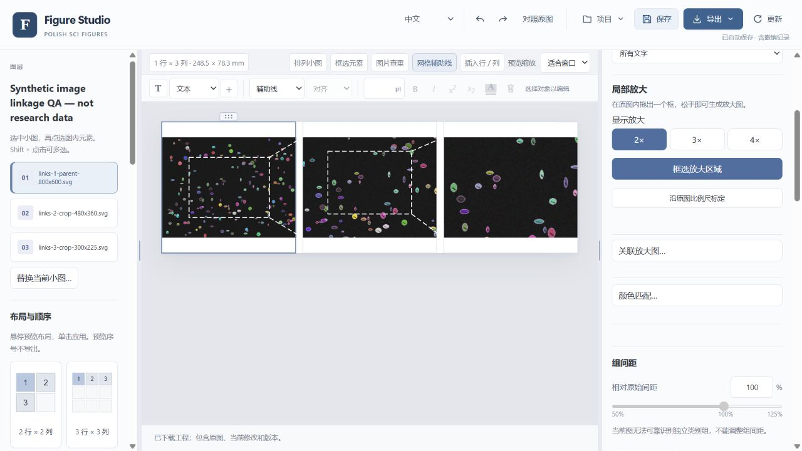

# Image detail tools: validation record

English · [中文](#中文)

Checked on 14 October 2026 against source commit `9ba784cad2838ca4c1892215d6a02eae3de308b7` for suite v1.4.7 / Figure Studio 0.1.7. The images below are **synthetic test fixtures, not experimental specimens**. This record covers browser interaction, geometry, source preservation and source-package checks. It does not establish performance or recognition accuracy on arbitrary microscopy datasets, physical mobile devices, or a subsequently built installer.

## Manual color refinement



The 1280 × 720 browser view keeps brightness, contrast, temperature, green–magenta tint and Apply visible. Reference matching was followed by manual refinement; Undo, Redo and project reload retained the parameters. Sliders and numeric inputs change only their own parameter, so displaying rounded values does not round unrelated automatic estimates. A uniquely named saved reference is restored; otherwise another available image is selected. With one image, manual controls remain available and automatic reference matching is hidden.

Color changes are reversible whole-image display filters. Embedded source pixels remain intact. Fluorescence mode exposes shared linear brightness and contrast rather than automatic white balance or per-image channel normalization. These checks are not a validation of stain normalization.

## Linked overview and detail images



The browser test imported three independent SVG files, each embedding a PNG: an 800 × 600 parent, its 480 × 360 crop, and a 300 × 225 crop of that child. The known crop bounds were `(160, 120)–(640, 480)` in the parent and `(90, 50)–(390, 275)` in the child. Local matching returned both regions, which were reviewed before application.

Verified interactions and outputs:

- Two region frames and four connectors; white, 1.5 pt, long-dash styling survived export.
- A 1 pt keyboard move of the parent moved the associated region coordinates by 1 pt.
- Hide all removed the frames; Undo restored them. Saving and reopening the project restored both links and their source anchors.
- SVG contained the three original images, two region frames and four connectors. TIFF export produced 5869 × 1850 pixels at 600 dpi.
- Original image pixel SHA-256 checks remained unchanged. The SHA checks establish preservation for these fixtures, not general matching accuracy.

Unreliable matches do not receive guessed region frames. Replacing, recropping or changing the orientation of a linked source invalidates its recorded relationship until it is relocated or hidden. Suggested regions still require review against the source images.

## Calibration and high-depth regression

The separate inset fixture has 1200 × 800 source pixels and a known calibration of 0.1 µm/source pixel. Its 20 µm bar spans exactly 200 pixels. The reference ROI is `(96, 96, 240, 160)`, representing 24 × 16 µm. Print DPI and display zoom are not used to infer this physical calibration. Scale-bar values use suitable 1 / 2 / 5 × 10ⁿ steps with accurately calculated line lengths.

A final review found that large high-depth images could be downsampled before a crop was applied in original-pixel coordinates. This was fixed by cropping the native pixels first. Real OpenCV regression checks now cover 16-bit PNG and TIFF: a full-image ROI is pixel-identical to uncropped analysis; partial parent/child ROIs, including fractional boundary coordinates, locate the correct region in the full original image. Native dimensions and source hashes remain unchanged.

| Targeted check | Result |
|---|---|
| Image localization, including high-depth positives and hard negatives | 13 tests passed |
| Existing image duplicate screening and native-depth identity | 11 tests passed |
| Link controller transport, ROI, movement, invalidation and panel export | 5 tests passed |
| Link geometry, orthogonal rotations/reflections and source anchors | 11 tests passed |
| Panel export | 357 assertions passed |
| State/history and English-message coverage | Passed |

The earlier broad regression snapshot contained two interim failures in panel-export test fixtures and English-message coverage; the targeted final reruns above passed. It is not being presented as an independently repeated full-suite run.

## Source packages

Both archives were rebuilt from the source above. The included high-depth analysis module was byte-for-byte checked against that source. Extracted CLI and bytecode-runtime checks passed for the full suite; the portable skill passed extraction, local dependency checks, a 16-row raw-table workflow, three candidate previews and editable-page generation without changing the source table.

| Archive | Bytes | Skill entry files |
|---|---:|---:|
| `sci-figure-suite-v1.4.7.zip` | 9,239,193 | 3 — complete suite |
| `polish-sci-figures-v1.4.7-skill.zip` | 9,250,906 | **1 — single-skill upload** |

SHA-256:

```text
sci-figure-suite-v1.4.7.zip
38d066a8a10ad0cf01d8087bb6310843e6104c6ec3fcfd857599d60b507fbc13

polish-sci-figures-v1.4.7-skill.zip
2bdc68c04850ef17b05c6c7a57bfea5ad4a9b455716100499792359c3b6e4614
```

These are source/skill archive checks, not a declaration that a new installer has already been published. See the [release notes](release-notes-v1.4.7.md) for package and platform scope.

## 中文

2026 年 10 月 14 日，基于源码提交 `9ba784cad2838ca4c1892215d6a02eae3de308b7` 检查 suite v1.4.7 / Figure Studio 0.1.7。上方截图均为**合成测试素材，不是真实实验标本**。记录涵盖浏览器操作、几何关系、原图保留和源码压缩包验证，不代表任意显微图的识别准确率、移动真机性能或后续安装包已经通过验证。

### 手动调色

[实际调色界面](media/image-details-color-controls.jpg)在 1280 × 720 视口内同时显示亮度、对比度、色温、绿—洋红色调和应用按钮。参考匹配后继续手动微调，撤销、重做及工程重开均保留正确参数。滑杆和数值输入仅修改对应参数；显示值的四舍五入不会改写其他自动估计值。重新打开时恢复名称唯一的已保存参考图，否则选择另一张可用图片；只有一张图时保留手调，隐藏自动匹配。

颜色调整通过可逆的整图显示滤镜完成，嵌入的原始像素保持不变。荧光模式提供共同的线性亮度、对比度调整，不做自动白平衡或逐图通道归一。本次检查不属于染色归一化验证。

### 概览与细节图关联

[实际关联界面](media/image-details-linked-regions.jpg)导入三份独立 SVG，各自嵌入 PNG：800 × 600 原图、480 × 360 子图及其 300 × 225 子图。已知裁剪边界分别为父图中的 `(160, 120)–(640, 480)`、子图中的 `(90, 50)–(390, 275)`。本机匹配返回两组区域，核对后应用。

已验证两组定位框、四条连接线，以及白色、1.5 pt、长虚线样式；父图键盘移动 1 pt 后，关联坐标同步移动 1 pt。全部隐藏、撤销恢复、工程保存与重开均通过。SVG 保留三张原图、两组定位框、四条连接线；TIFF 输出为 5869 × 1850 像素、600 dpi。原图像素 SHA-256 保持一致；该结果验证这些素材的原图保留，不代表任意图片都能准确匹配。

无法可靠匹配的区域不生成猜测定位框。替换、重新裁剪或改变源图方向后，旧关联需重新定位或隐藏；自动建议仍须对照原图核对。

### 标定、高位深与回归检查

独立的局部放大素材为 1200 × 800 像素，已知标定 0.1 µm/原始像素；20 µm 比例尺严格占 200 像素。参考 ROI 为 `(96, 96, 240, 160)`，对应 24 × 16 µm。打印 DPI 和显示倍率不能据此替代真实标定；自动标尺采用合适的 1 / 2 / 5 × 10ⁿ 数值并计算准确线长。

最终审查修复了大尺寸高位深图片先缩小、再按原始坐标裁剪的问题，现为先裁原生像素，再下采样。真实 OpenCV 测试覆盖 16 位 PNG、TIFF：全图 ROI 与不裁剪的分析像素一致，父子图的局部 ROI（含非整数边界）返回正确原图坐标，原始尺寸及哈希不变。

定位 13 项、既有查重 11 项、关联控制器 5 项、关联几何 11 项、单图导出 357 个断言，以及状态/撤销/英文提示检查均通过。较早的广泛回归快照含两项中间失败，涉及单图导出测试夹具和英文提示；最终针对性重跑已通过，不将此描述为又一次完整重跑全部测试。

### 压缩包

两个压缩包均已重新构建，内含高位深分析源码与上述提交逐字节一致。完整套件解包后的 CLI、字节码运行检查通过；单技能包通过解包、本机依赖检查、16 行原始数据作图、三个候选图及可编辑页面生成，原数据表未被改写。

完整套件为 9,239,193 字节，含三个技能入口；上传用单技能包为 9,250,906 字节，**整个 ZIP 中仅一个 `SKILL.md`**。文件名及 SHA-256 见上表。此处是源码/技能包验证，安装包的发布和平台范围见[版本说明](release-notes-v1.4.7.md#中文)。
