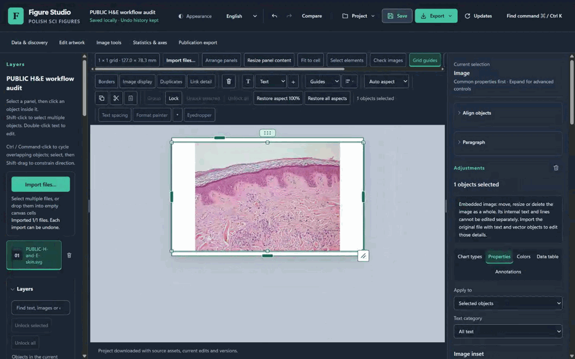
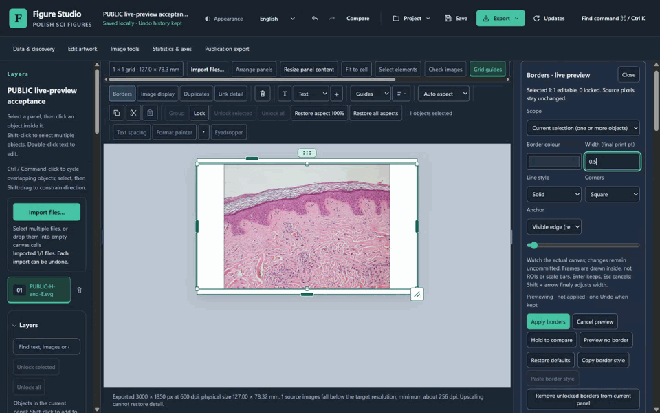
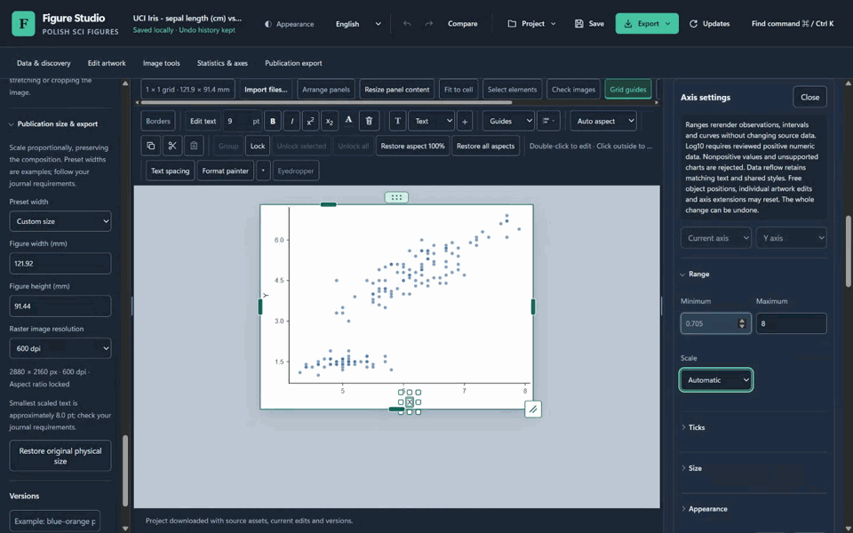
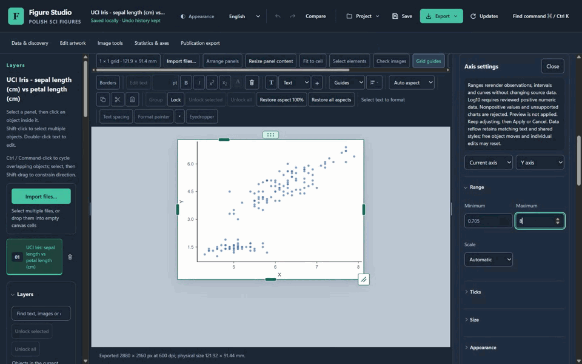
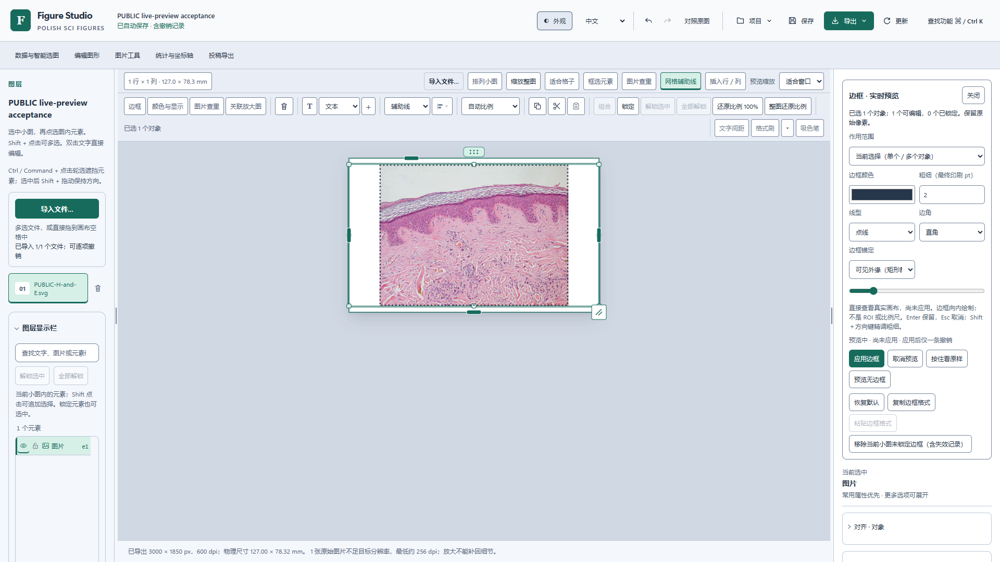
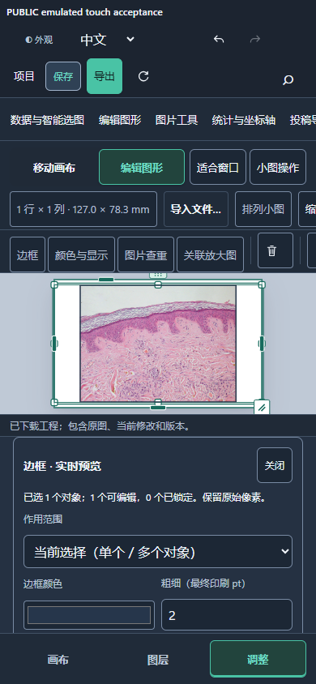

# 真实操作前后对照

这些短片取自本轮真实 Chrome 录屏。BEFORE 为 Studio 0.1.21 冻结 runtime；AFTER 为原始 Setup 实际安装的 Studio 0.1.22。全部使用公开 H&E 图像及 Iris 150 个观测。用户要求暂不发布，本页属于本地候选交付。

| 操作 | 升级前 | 当前候选 |
|---|---|---|
| 对象边框 | 打开遮挡画布的弹窗 → 修改 → 应用／退出 → 查看 → 再打开调整 | 选中 → 边框停靠面板 → 在真实画布连续调整 → 应用边框或取消预览；一次应用、一条撤销 |
| 原生坐标轴 | 开启所谓实时预览 → 三次改范围 → 三次自动提交 | 开启预览 → 连续改范围 → 本机真实异步重绘 → 应用一次或 Esc；草稿阶段零历史 |
| 未完成输入 | 不同字段处理不一致 | 保留原输入和最后有效画面，说明原因并禁提交；可继续输入或立即取消 |

## 边框：遮挡弹窗变为原位调整

升级前：

实际安装版：

当前短片展示 0.5／1／1.5／2 pt 连续输入及点线变化，面板和主图同时可见。中段输入 `0.` 时，真实画布保留最后有效边框、应用按钮禁用；结尾恢复为有效 2 pt。取消、一次撤销／重做和保存／导出隔离另有[实际模型及文件检查](qa/live-preview/windows-final17-core-demonstration-summary.json)，不是仅凭短片判断。

## 坐标轴：真实重绘保留为草稿

升级前：

实际安装版：

Iris 的范围输入依次为 8、9、10，等待时保留上一有效图，实际重绘改变数据到坐标的映射。结尾输入未完成的 `-`，图仍保留最后有效范围。短片可视区没有下方的状态文字，不将其描述为已经入镜；零历史、原观测不变、保存／导出隔离和 Esc 恢复由[同次真实断言](qa/live-preview/windows-final17-core-demonstration-summary.json)证明。旧版三次提交的历史索引 1／2／3 来自[原始流程审计](qa/live-preview/before-workflow-summary.json)。

## 不同界面条件

实际安装版的中文 Pearl 边框草稿：

390 × 844 Chrome 触控模拟，画布与调整区同时可见；这不是实体设备测试：

四段 GIF 均为 960 像素宽、10 fps、256 色派生文件；没有裁切、合成界面或插帧。缩放、量化及帧率转换只用于展示，不用于原图像素保真、实际帧率或输入时延判断。相同 H&E 原图字节和几何不等于同一工程 JSON，标题与 ID 有差异；Iris 使用同一公开输入。原 WebM 未改，留在本机忽略目录；公开包只提供审查后的片段、截图和[完整来源／取时／变换哈希](qa/live-preview/reviewed-before-after-media.json)。

完整操作见[中文指南](live-preview-editing.zh-CN.md)，全部执行条件与剩余范围见[验收报告](live-preview-validation.md)，正式性能与真实时序见[性能报告](stable-performance-validation.md)。
