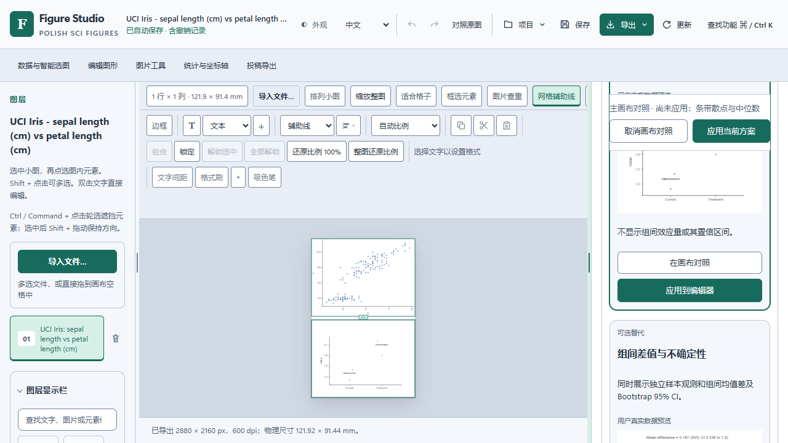
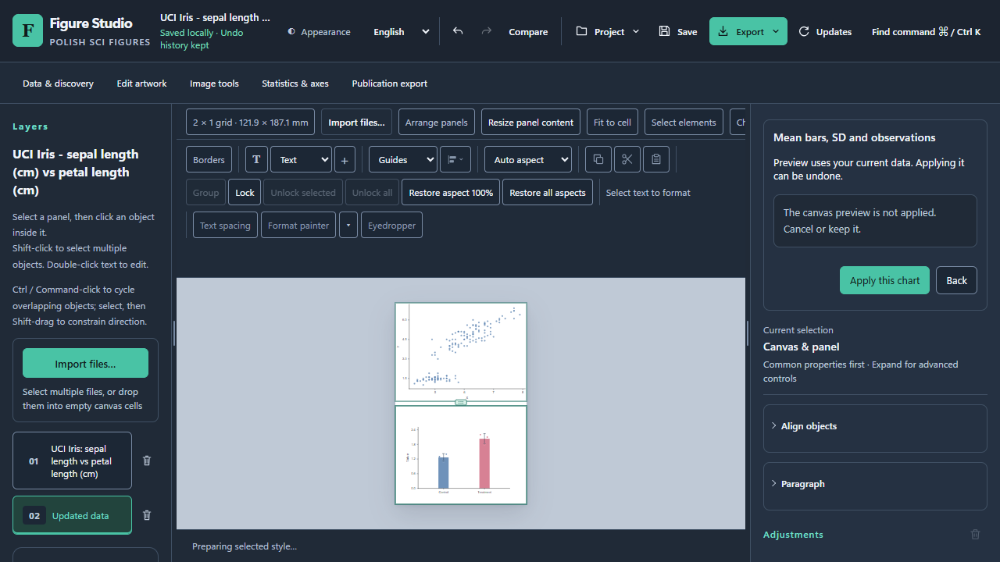

# 全局实时预览验收记录

截至 2026-10-18，最终打包源码为 source20：95 个组件脚本（91 Node、4 Chrome）、双主题 10 项真实 Iris 轴流程、唯一正式性能及独立四面板诊断已完成。新增数值轴拒绝输入锁存，尾部事件和再次取消候选不会把既有范围误改为自动；数据与科学渲染不变。source20 原始 Windows Setup 已完成实际安装、启动、完整编辑验收、正常重装及卸载保留数据，已正式发布。2026-10-18 发布后实测：原官方稳定版 0.1.20 → 0.1.22 已完成一次真实下载、安装、同会话自动恢复及正常卸载；原数据和设置保持一致。详见[发布后补充记录](https://github.com/zhoy0409-debug/polish-sci-figures/blob/main/docs/qa/live-preview/postrelease-20261018/README.md)；原官方预览版 21 → 22 也已独立通过：历史 3 状态、检查点 1、有效原表草稿 1 精确保留并完成正常清理；原始动画及未观测阶段分别报告。

source18 人工微软拼音已核对画布选词、候选 Esc／Enter 后继续换行并取消、无效 HEX 取消、F2／失焦确认、实际 Undo／Redo、保存／重开及 SVG／PNG 导出；Iris 150 条观测和源 SVG 保持精确一致。[Windows 输入法实际记录](windows-native-ime-acceptance.md)说明真实组合事件、人工确认与自动观察边界；F2 的发起由用户确认。source20 未重复人工 IME；[代码范围核对](qa/live-preview/source20-ime-change-scope.json)确认主编辑器相关处理器及文字间距、局部放大图两模块与 source18 精确一致，但专业轴模块已修改，不能称全部模块连续或新的原生 IME 实测。

## source20 最终源码范围

冻结清单 SHA-256 为 `6f63351be947e5415aff2b31515e34b24b3b4ec12c3e1e245ad82783f6c414fd`，HTML SHA-256 为 `8e8c76b6a84fa11502e4bfd4cd01538a5edb6994b6ecbc0f8efeb451da69999d`。以下均绑定 source20，不与此前阶段拼接为一次运行。

| 范围 | 实际结果 | 证据 |
|---|---|---|
| 组件回归 | 95／95：91 Node、4 个独立真实 Chrome 组件脚本；所有来源与 harness 前后核对一致 | [完整组件记录](qa/live-preview/source20-component-regressions.json) |
| 轴输入红绿回归 | 冻结 source19 实际 23 组为 13 过／10 败；最终 25 组在中间版为 23 过／2 败，补齐二次候选取消后 25／25，通过 9 项旧回归与 2 项语法检查；不虚构未执行的旧版 25 组结果 | [原失败、最终哈希及回归](qa/live-preview/source20-axis-composition-fix-regressions.json) |
| 双主题真实轴流程 | Carbon／Pearl 共 10 项：真实 Iris 本机重绘、普通键盘修正和明确清空、Apply 一次 Undo／Redo、Save → 新空白工程 → Open、实际 SVG 导出；原始观测与源图保持。拒绝组合与尾事件为明确合成的 DOM 事件，不是原生 IME | [实际范围和请求](qa/live-preview/source20-axis-composition-browser.json) |
| 正式性能 | 唯一 184 动作（160 正式、24 预热），原样保留。5000 选择 next／second-rAF P95 为 78.6／154.7 ms，改色为 123.1／195.4 ms；八卡 second-rAF P95 610.7 ms，未全面达标 | [全部八行、四指标](qa/live-preview/performance-v2-final20-summary.json)；[17／18／19 对照](qa/live-preview/performance-v2-final20-vs17-18-19.json) |
| 独立四面板 | 3 次预热、20 次正式手势；输入第二 rAF P50／P95 为 33.8／37.7 ms，Enter 为 70.6／82.4 ms。全部草稿隔离、一次 Undo／Redo、源工程、零外部请求与页面错误检查通过 | [独立诊断](qa/live-preview/four-panel-style-final20-diagnostic.json) |
| Windows 成品／官方更新 | source20 原包的实际安装、全部下列编辑范围、重装及卸载保留数据已完成；原官方 0.1.20 → 0.1.22 实测及正常清理已另完成，见[日期化补充](https://github.com/zhoy0409-debug/polish-sci-figures/blob/main/docs/qa/live-preview/postrelease-20261018/README.md) | [本次安装版汇总](qa/live-preview/windows-final20-acceptance-summary.json)；不以普通重装代替官方更新 |

与官方 0.1.20／0.1.21 相比，5000 选择第二 rAF P95 从 358.2／332.9 ms 降至 154.7 ms，改色从 451.8／520.2 ms 降至 195.4 ms；仅这两个核心操作的四种指标 P50／P95 均改善。source19 内部阶段的改色尾部 123.7 ms 和四面板 Enter 58.6 ms 更快，source20 不用它们替代自己的结果；120 图元与八卡等完整比较见[性能记录](stable-performance-validation.md)。未测因果不归因于 GC 或环境。

## source20 Windows 成品实际验收

本次使用原始未修改 Setup（SHA-256 `85b0355490eb2615f2cebc1097e6e51da1d89a9f3b5851a60d95831930be3d1a`）及 Portable（`15b721ce052359f540ad88dddc9776ae1279a8494567f58711d0003dbd6fa5e8`）。[原始成品来源证明](qa/live-preview/windows-final20-package-source-match.json)核对 78 个 UI 资产、27 项后端来源及完整 2622 文件；实际安装版起始 HTML 为 `df8f5d3fa9ac60ec10fe69d6ae668373c6692bee01d97e0ce998bf21c06afae0`，与源码 Iris 验收页不同，各自保留精确注入证明。最终阶段和包绑定见[独立汇总](qa/live-preview/windows-final20-acceptance-summary.json)。

| 实际范围 | 结果与边界 | 证据 |
|---|---|---|
| 原 Setup 安装／启动 | 实际安装路径、完整文件、x64 0.1.22、冻结自检、服务与受保护原实例身份均核对；不是解压或源码服务 | [本次成品／阶段汇总](qa/live-preview/windows-final20-acceptance-summary.json) |
| Own 8 套件 | 108 项通过：P0 72、资源 4、空白 1、触控模拟 8、科学／编辑 5、智能选图 16、核心真实录像 2 | [108 项独立记录](qa/live-preview/windows-final20-own-summary.json) |
| 高频属性 | Carbon／Pearl 各完整 37 项，共 74 项，源数据、草稿、取消、一次 Undo、保存重开及导出均核对 | [本次 P1](qa/live-preview/windows-final20-p1-summary.json) |
| 额外专业轴 | 双主题 10 项，真实 Iris 引擎／普通键盘／Apply／一次 Undo／Save → 新空白 → Open／SVG；组合尾事件明确合成，不是第二次原生 IME | [本次轴专项](qa/live-preview/windows-final20-axis-composition-browser.json) |
| 后台查重与编辑 | 60 张合成图／1770 对，真实任务期间编辑、原复核和工程保持；工作进程在 68／1770 对时实际确认取消。它不表示完成全批比对，也不构成检测准确率或正式性能证据 | [实际任务与取消](qa/live-preview/windows-final20-duplicate-summary.json) |
| 大型导入 | 10000 图元 PDF 和 SVG 两项完整通过，实际导入／草稿隔离／取消／一次 Undo／保存重开／SVG、PNG；PDF 字体替代提示保留 | [两项实际流程](qa/live-preview/windows-final20-large-import-summary.json) |
| 正常重装／卸载 | 实际 Reinstall、Uninstall 外层进程退出均为 0；同步 helper 检查原生返回，但未单独持久化原生数值，不补造原生退出码 | [重装](qa/live-preview/windows-final20-reinstall-summary.json)／[卸载](qa/live-preview/windows-final20-uninstall-summary.json) |
| 最终只读核查 | 自有 QA 进程 0、EXE 已移除、四登记视图为空；1 个受保护原实例身份不变，工程／设置／哨兵 3 文件精确保留，Iris 150 行和原始 12 个 SVG 变体字节一致 | [本次最终状态](qa/live-preview/windows-final20-native-final-state.json) |

安装包未签名，SHA-256 与来源证明不等于发布者数字签名。本次是本机隔离安装，触控仍是浏览器模拟；人工微软拼音 6 项继续绑定 source18，source20 未重复人工原生输入。原官方 0.1.20 → 0.1.22 的下载、校验、安装交接与自动恢复已由[发布后实际记录](https://github.com/zhoy0409-debug/polish-sci-figures/blob/main/docs/qa/live-preview/postrelease-20261018/README.md)独立核对；普通同版本重装与这条链仍分别报告。

安装器附带说明与 `audit/live-preview-inventory.md` 保留构建时快照。严格成品来源证明绑定 v1.4.22 发布时文件，仅允许逐个声明的 `docs/*.md` 快照差异；其中 ROOT 文档、Quickstart、bundled audit、源码及资源保持原字节。2026-10-18 主分支的 README、Quickstart 和报告另行补充发布后实测，原安装包、旧证明及原 Source／PublicQA 下载包保持原字节。[本次完整操作录像与媒体边界](live-preview-demonstration.md)区别于历史 source17 GIF。

## source19 阶段记录（已由 source20 替代）

冻结清单 SHA-256 为 `bf5299072f654e7ec01115b787cb2db9e6582566327afd086153532da98cc178`，HTML SHA-256 为 `4091e5b2f75e3a3b6e332736ae789da60e88a888559ee839402b06697730fba5`。以下范围不与 source17／18 拼接为一次运行。

| 范围 | 实际结果 | 证据 |
|---|---|---|
| 组件回归 | 95／95：91 个纯 Node 与 4 个独立真实 Chrome 组件脚本；源码与 harness 前后哈希一致 | [完整记录](qa/live-preview/source19-component-regressions.json) |
| 双主题定向浏览器 | Carbon／Pearl 共 14 项通过；普通选择、真实参考线、锁定、HEX 草稿／取消／一次 Undo 和完整八卡，源工程保持 | [实际 14 项](qa/live-preview/source19-selection-refresh-browser.json) |
| 正式性能 | 唯一 184 动作：160 正式、24 预热。5000 选择 next／second-rAF P95 为 81.9／157.6 ms，改色为 68.2／123.7 ms；完整八卡 second-rAF P95 607.6 ms 仍有等待 | [全部行与指标](qa/live-preview/performance-v2-final19-summary.json)；[source17／18／19 对照](qa/live-preview/performance-v2-final19-vs17-18.json) |
| 四面板 | 3 次预热、20 次正式手势；输入第二 rAF P50／P95 为 27.2／32.7 ms，Enter 为 51.3／58.6 ms；全部草稿、一次 Undo 和源工程断言通过 | [独立诊断](qa/live-preview/four-panel-style-final19-diagnostic.json) |
| source19 安装阶段（已替代） | 实际原包 own 8 套件共 108 项通过，外部 P1／查重／大型导入未执行；独立发现轴输入缺陷后弃用，不能称最终验收通过。随后正规清理退出 0，自有进程 0、四登记视图空、1 个受保护原进程及 3 个外部文件保持 | [部分安装记录](qa/live-preview/windows-final19-partial-installed-summary.json)；[未完成阶段清理](qa/live-preview/windows-final19-incomplete-cleanup-summary.json) |

## source18 已完成的阶段范围

| 范围 | 实际结果 | 证据 |
|---|---|---|
| 组件回归 | 94／94：90 个纯 Node 脚本与 4 个独立真实 Chrome 组件脚本；源文件与 harness 前后哈希一致 | [完整组件记录](qa/live-preview/source18-component-regressions.json) |
| 人工 Windows IME | 6／6 检查通过；823 条实际事件与操作清单、保留异常、保存重开与导出分别核对；页面错误与外部请求为 0。仅为源码 Edge 窗口的实际范围 | [6 项检查](qa/live-preview/source18-human-ime-summary.json)；[823 条事件](qa/live-preview/source18-human-ime-events.json)；[实际媒体](qa/live-preview/source18-human-ime-media.json) |
| 正式性能 | 唯一 184 动作，含 160 正式样本与 24 次预热，全部保留；5000 改色 second-rAF P95 从 source17 的 198.7 ms 降至 121.9 ms，但选择从 169.3 ms 增至 226.4 ms，细节到色板从 611.1 ms 增至 632.9 ms | [完整批次](qa/live-preview/performance-v2-final18-summary.json)；[source17 对照](qa/live-preview/performance-v2-final18-vs17.json) |
| 独立四面板 | 3 次预热与 20 次正式手势；Enter 第二 rAF P95 从 144.1 ms 降至 110.3 ms，但中位数从 79.9 ms 增至 99.8 ms，仍未全面达标 | [四面板诊断](qa/live-preview/four-panel-style-final18-diagnostic.json) |
| 新 Windows 成品 | 尚未构建、安装或发布；不能将下述 source17 成品与功能结论改称 source18 通过 | 新成品须另绑定自己的实际来源与哈希 |

以下为 source17 及更早冻结阶段的已完成记录。source17 在 source16 的完整功能验收后，进一步减少普通侧栏切换的整图重建和一次新选择的重复属性读取；85 个组件脚本、双主题 14 项定向浏览器流程与唯一正式性能批次已完成。5000 图元选择／改色 next-rAF P95 为 94／91 ms，四项操作的全部指标均改善；小工程少量尾指标、八卡生成与确认后延迟仍有明确限制。source17 原始 Setup 的 P0 72 项、双主题高频操作 74 项及主功能矩阵均通过；60 图后台任务期间编辑与取消、10,000 图元 PDF／SVG 导入、重装及卸载保留数据也已完成。[历史安装版汇总](qa/live-preview/windows-final17-acceptance-summary.json)绑定实际成品与各独立报告。下表严格区分各冻结版与安装版，不将 source17 的结果计为 source18 通过。

## source17 及更早阶段已完成的实际范围

| 冻结版本／范围 | 实际结果 | 证据 |
|---|---|---|
| source17 组件回归 | 81 个纯 Node 与 4 个真实 Chrome 脚本，共 85／85；运行前后资源、后端与各脚本哈希精确一致。原 VM 缺依赖失败保留，补真实生产 helper 后独立完整重跑 | [85 个脚本及日志哈希](qa/live-preview/source17-component-regressions.json) |
| source17 定向真实浏览器 | 双主题各 7 项，共 14／14；120／5000 图元普通切换保留画布节点及完整八卡；真实选择、拖动、锁定、键盘与边框／轴／数据候选草稿回退及取消 | [原失败与完整通过](qa/live-preview/pane-selection-source17-summary.json) |
| source17 缩放一致性 | 5 组实际生产函数对照，手动、滚轮、适配及待执行队列与原路径结果一致；未证实先前提出的缩放疑点，未增加修补 | [核验边界](qa/live-preview/pane-zoom-source17-review.json) |
| source17 独立正式性能 | 184 动作全部保留；5000 图元四项操作全部四指标 P50／P95 优于 v20／v21；四面板输入预览第二 rAF P95 43 ms，Enter 后为 144.1 ms，未全面达标 | [正式批次](qa/live-preview/performance-v2-final17-summary.json)；[独立四面板](qa/live-preview/four-panel-style-final17-diagnostic.json) |
| source16 资源主画布预览 | Carbon／Pearl × 中英文，4／4 完整通过；主画布 A／B、元数据／语言恢复、真实失败保留最后有效图、保存与导出隔离、取消、一次 Undo／Redo、锁定及换工程 | [4 条件真实流程](qa/live-preview/resource-source16-summary.json) |
| source16 P0 | 1280 × 720／1920 × 1080 × 中英文 × 双主题，8 条件、72／72 通过；含真实轴迟到响应、公开 H&E／TEM 边框与实际 TIFF | [72 项矩阵](qa/live-preview/p0-source16-matrix-summary.json) |
| source16 高频功能 | Carbon／Pearl 各一次完整 37／37，合计 74 次通过；英文、1440 × 900，真实录屏／trace，包含持鼠 Esc 尾事件与新手势 | [双主题完整 P1](qa/live-preview/p1-source16-summary.json) |
| source16 触控模拟 | 390 × 844／1280 × 720 × 中英文 × 双主题，8／8 通过；实际 tap、图像内容面积、导航、保存隔离与单次撤销／重做 | [8 条件记录](qa/live-preview/touch-source16-summary.json) |
| source16 独立科学／编辑回归 | 同一冻结版一次完整 5／5；8／9 元素多选、同色与空心排除、图层锁／显隐、富文本比例、Iris 150 原始观测及 SVG／分析／配方不变，双主题导出与 v1.4.21 同设备固定参考一致 | [5 项完整记录](qa/live-preview/selection-source16-summary.json) |
| source16 智能选图完整流程 | 16 项流程检查通过；已有工程追加与空白替换、已声明配对转换、未知单位主动阻断、实际 Save／重开及导出、隐私拦截、显式联网失败、同字节 standalone 零 HTTP 绘图与异步 Apply 后实际 Save 源行核对 | [完整智能选图回归](qa/live-preview/discovery-source16-summary.json) |
| source16 空白工程可用性 | 主预览由旧版约 46 × 35 修复为 344 × 258 CSS 像素；预览让出欢迎区，取消与一次撤销／重做恢复正确界面，保存数据不变 | [短专项及截图](qa/live-preview/resource-source16-blank-summary.json)；[原失败](qa/live-preview/resource-source15-blank-failure.json) |
| source16 组件回归 | 81 个组件脚本全部通过，按冻结资源及实际日志哈希逐项记录 | [81 脚本及保留尝试](qa/live-preview/source16-component-regressions.json) |
| Windows source17 成品来源 | 原 Setup／Portable 已构建；78 资产、23 生产后端、58 代码对象、2 原生模块和 ZIP 2606 文件均与已验源码精确核对，4 测试源码明确未分发 | [成品／源码证明](qa/live-preview/windows-final17-package-source-match.json) |
| Windows 安装版 P0 | 1280 × 720／1920 × 1080 × 中英文 × 双主题，8 条件、72／72；真实边框、坐标轴、迟到响应、保存与导出隔离 | [安装版 72 项](qa/live-preview/windows-final17-p0-summary.json) |
| Windows 安装版高频操作 | Carbon／Pearl 各 37／37，共 74 次通过；包含持鼠 Esc 尾事件、标定逐图隔离、文字／颜色／排版／统计／导出字段 | [74 项完整记录](qa/live-preview/windows-final17-p1-summary.json) |
| Windows 安装版资源对照 | Carbon／Pearl × 中英文 4／4，主画布 A／B、真实失败与最新结果、保存／自动保存／SVG／PNG／TIFF 草稿隔离、取消和一次 Undo／Redo | [4 条件完整记录](qa/live-preview/windows-final17-resource-summary.json) |
| Windows 安装版空白与触控 | 空白工程 1 项及 390 × 844／1280 × 720 × 双主题 × 中英文共 8 条件通过；实际 tap 与画布／控制几何，仅为触控模拟 | [空白工程](qa/live-preview/windows-final17-blank-summary.json)；[8 条件](qa/live-preview/windows-final17-touch-summary.json) |
| Windows 安装版科学／编辑 | 5／5 完整通过；Iris 150 观测、源 SVG／分析／配方、锁定、文字与实际双主题导出不变 | [5 项完整回归](qa/live-preview/windows-final17-selection-summary.json) |
| Windows 安装版智能选图 | 16 项完整流程通过；独立／声明配对／未知单位、应用撤销、真实 Save 重开、隐私边界与同字节 standalone 离线应用均核对 | [16 项完整回归](qa/live-preview/windows-final17-discovery-summary.json) |
| Windows 安装版真实录像 | 2 项独立 headful Chrome：H&E 连续边框草稿与真实 Iris 异步坐标范围；原 WebM 哈希及逐项模型／导出断言保留 | [原录屏与检查](qa/live-preview/windows-final17-core-demonstration-summary.json) |
| Windows 后台任务期间编辑 | 60 张合成图／1,770 对真实任务，启动与真实进度、查找／缩放／边框／Undo／Redo 可操作；取消确认 630 ms，旧人工复核与工程保持；不是准确率或正式性能测量 | [后台任务与保留失败](qa/live-preview/windows-final17-duplicate-summary.json) |
| Windows 大型导入 | 10,000 矩形 PDF 与 10,000 元素 SVG，两项完整通过：导入、有效草稿隔离、未完成输入、严格基线导出、Esc、Enter 一次 Undo、重开及实际 SVG／PNG；PDF 字体替换提示保留 | [两项完整验收及焦点诊断](qa/live-preview/windows-final17-large-import-summary.json) |
| Windows 原始 Setup 生命周期 | 原 AppId 四视图初始无登记；安装和重装各 2606 文件匹配，x64 PE 0.1.22，移除开发 Python 的冻结自检通过；同版本重装及正规卸载保留真实 Save、设置与哨兵，四视图恢复无登记，1 个受保护原进程身份未变 | [安装](qa/live-preview/windows-final17-install-stage.json)／[重装](qa/live-preview/windows-final17-reinstall-summary.json)／[卸载](qa/live-preview/windows-final17-uninstall-summary.json) |

卸载后另作[只读最终查询](qa/live-preview/windows-final17-native-final-state.json)：自有 QA 进程为 0，EXE 已移除，四个登记视图为空，三个保留文件前后哈希一致。两个阶段 PowerShell 进程实际退出码为 0；脚本同步等待并检查原生退出码，但没有独立持久化原生数值日志，报告不补造该记录。

每条结果绑定自己的冻结 HTML、harness 和原始报告哈希。source16 功能报告绑定 `46f45c68…cd0eef8`，source17 绑定 `b659049b…473d1b5`；两者只有 `studio.js` 不同，原公开工程及全部后端相同。旧阶段结果独立保留。Windows 安装版另以实际安装来源和包哈希验收，上表按“source”与“Windows”明确区分。安装版空白起始 HTML 与源码 Iris 验收 HTML 不同，分别逐字节证明来自同一组已冻结资源；没有把二者的 HTML 哈希混为一个。

source16 的两张实际草稿画面如下，图表尚未应用；文献区的本地图型对照明确不作为论文证据。

边框和坐标轴的[前后操作步骤、真实短片及安装版截图](live-preview-demonstration.md)已逐帧复核；坐标轴片段的下方状态未入镜，零历史事实由同次模型断言证明。全部取时、原视频及变换 SHA 在[媒体来源记录](qa/live-preview/reviewed-before-after-media.json)中。

## 基线与公开素材

基线为 main `f14c6f3` / Studio 0.1.21，使用冻结 Windows runtime 和独立数据目录。它不是本轮新安装验收。17 个基线流程覆盖 16 类功能，详见[操作审计](../audit/live-preview-inventory.md)及[安全汇总](qa/live-preview/before-workflow-summary.json)。原始录像保留两次隐藏入口选择器失败和后续可见入口补采。

真实 Chrome 确认的旧缺陷包括：边框和图片显示弹窗遮挡主图；坐标轴连续三次所谓“实时预览”产生三条历史；快捷字号 Esc 后仍被失焦提交。有效的色板悬停、图片显示、文字间距及 ROI 局部预览按原机制复用。

公开输入包括 UCI Iris 150 个真实观测、已核实公有领域 H&E 图片、CDC PHIL 23354 人工着色 TEM 副本，以及明确标注的同源裁剪／四图工程。120/5000/10000 图元仅是软件压力负载。私有科研图像留在本机，不进入公开报告、截图和资源。没有独立人工标注的样本不支持准确率、漏检率或误报率声明。

## 早期证据与保留失败

各阶段按自己的冻结 HTML 哈希记录，不能把不同版本、条件或补跑拼成一次完整运行。以下全部为本机实际 Chrome；开发版通过不等于安装版通过。

| 阶段 | 实际范围与结果 | 证据 |
|---|---|---|
| BEFORE 0.1.21 | 冻结可执行 runtime，17 个流程／16 类功能；原选择器失败和可见入口补采均保留 | [基线汇总](qa/live-preview/before-workflow-summary.json) |
| fresh01 P0 | Carbon／英文／1440 × 900，6 类流程通过；边框、锁定混选、失效、字号 Esc、原生轴及图片面板 | [首轮 P0](qa/live-preview/p0-dev-pilot-01-summary.json) |
| fresh02 P0 扩展 | 同一桌面条件，新增 3 类流程最新通过：非矩形 last-valid／删除失效、真实轴响应迟到／取消、实际 TIFF 导出；此前 QA 断言失败仍列出 | [扩展 P0](qa/live-preview/p0-dev-pilot-02-extended-summary.json) |
| fresh03 P1 | Carbon／英文；一次全跑中 P01–P21 通过，P22、P23 另作窄复测后通过，共 23 个不同案例有真实通过证据；不称为一次完整 23 项全通过 | [23 案例分次证据](qa/live-preview/p1-fresh03-summary.json) |
| source11–12 阶段 | source11 P0 在另行发现智能选图 Apply 缺陷后中止，45 项已完成通过；Carbon P1 37 项及触控 8 条件通过。source12 修复已有工程应用并完成旧 16 项智能选图流程；最终 source16 另完整重跑 | [中止记录](qa/live-preview/p0-source11-interrupted-summary.json)；[source12 应用修复](qa/live-preview/discovery-source12-summary.json) |
| Windows 09 阶段 | 原 Setup 实际安装、2552 文件对照及冻结自检通过；未启动最终功能验收，随后正规卸载、恢复四注册视图并保护原应用与外部数据 | [阶段安装与清理](qa/live-preview/windows09-stage-install-cleanup.json) |
| fresh04–06 源码 | fresh06 P0 两主题 × 中英文 × 1280 × 720／1920 × 1080，72／72 通过；比例尺 P26／P33 窄复测通过。触控模拟另有已确认入口／画布不可达问题，未计通过；完整 P1 与独立编辑回归另列 | [72 项阶段矩阵](qa/live-preview/p0-source06-matrix-summary.json)；后续修复版本仍须独立验收 |
| source09 阶段 | P0 两主题 × 中英文 × 1280 × 720／1920 × 1080，72／72 通过；触控模拟 390 × 844／1280 × 720 共 8 个条件通过，含图像内容尺寸、顶部与导航几何。P1 另发现滑块首次按下后的取消字段恢复问题，交由下一冻结版修复 | [72 项 P0 阶段矩阵](qa/live-preview/p0-source09-matrix-summary.json)；[8 条件触控记录](qa/live-preview/touch-source09-summary.json)；最终修复版另行验收 |
| 最终 Windows 安装版 | 原始真实 AppId／安装器、四视图预检、受保护进程、安装文件／冻结自检和 P0 72 项已通过；其余流程按上表更新 | 不以早期安装或源码结果替代最终安装版 |
| source16 正式性能 | 独立 v2 协议共 184 动作（160 正式、24 预热），与原 v20／v21 条件匹配；四面板另测，所有样本保留 | [本批结果](qa/live-preview/performance-v2-final16-summary.json)；[四面板诊断](qa/live-preview/four-panel-style-final16-diagnostic.json)。部分尾指标回退，不声明性能全部通过 |

fresh01 中，边框连续 30 次 input 保留实际输入节点；未完成值保留最后有效线条并禁提交。保存及 SVG／PNG 像素比较只包含已提交状态，Esc 恢复 project／state／history，保留修改对应一次 Undo／Redo，保存重开一致。原生 Iris 轴真实出现 10 刻度，三轮草稿不增加历史或改变原表；取消及一次应用的隔离检查通过。

fresh02 仅延迟真实本机轴响应，未伪造坐标结果。H&E 已知 ROI 的实际 TIFF 为 RGB、3000 × 2250、600 dpi，其独立解码 RGBA 像素与 PNG 一致；草稿导出等于原已提交版本，应用后的边框改变导出像素。600 dpi 是输出网格与元数据，不代表恢复源图细节。网络中止分支和忽略 AbortSignal 的受控 producer 单元测试分别说明。

fresh06 完整 P0 矩阵在 8 个条件分别执行 9 个顶层案例，均通过；各条件另实测公开 TEM 白色 1 pt 边框和普通 SVG 路径边框，实际 SVG 导出边框保留请求的最终打印 2 pt。所有条件的本地冻结 HTML 与 served HTML 经精确引擎注入重建验证。首个矩阵尝试因 QA 默认文件名 `editor.html` 与实际 `index.html` 不同，在 72 个前置检查中失败，尚未操作功能；[原失败记录](qa/live-preview/p0-source06-retained-path-attempt.json)与修正后的矩阵均保留。

触控模拟发现并推动修复了真实入口和布局问题。1280 × 720、`hasTouch: true` 会启用移动工作区；首次 QA 误用了被隐藏的左栏导入按钮，随后改为真实可见的顶部导入及 Edit 模式。source06 点击边框时 inspector 仍为 inert／aria-hidden，手动切换后又被抽屉暗罩阻断，见[原失败](qa/live-preview/touch-source06-retained-failures.json)。source08 已解除此问题，但 390 × 844 的初版功能断言虽通过，人工查看发现图像约 50 × 30 CSS 像素、顶部高 242 像素且导航重叠，因此明确记录为[功能断言通过、可用性失败](qa/live-preview/touch-source08-narrow-usability-failure.json)。source09 的 8 个条件均通过；390 英文 Carbon 首例实际解码图像内容约 193.58 × 145.18 CSS 像素，顶部高 121 像素，导航文字位于各自按钮内。脚本以实际图像内容至少 160 × 90 CSS 像素、窄屏顶部不高于 140 CSS 像素及无重叠作为工程下限，并保留人工截图检查。这是浏览器模拟结果，实体设备的范围集中列于末尾。

所有早期失败见 [QA 尝试记录](qa/live-preview/p0-pilot-retained-attempts.json)：PNG 数字数组传输资源膨胀、data URL fetch 被 CSP 拒绝、以及将实际下载焦点变化一律视作草稿失败的过强断言。原报告和原始视频均保留。DOM 按钮激活不合成 pointer／blur／focus，但真实下载仍可自然改变焦点；以模型、历史、源字节和导出断言判断隔离，不能仅凭一次下载判定未提交。

资源专项另保留[原始失败分类与报告哈希](qa/live-preview/resource-retained-attempts.json)：IDB 的 3 个 `undefined` 派生缓存键与 JSON 省略、未展开普通文献详情、以及根 SVG 的编辑适配尺寸，分别修正验收合同；科学值、源图、历史、检查点及数据草稿仍严格逐值比较。source15 的空白工程主图过小是实际产品缺陷，单独保留[原失败](qa/live-preview/resource-source15-blank-failure.json)，并在 source16 实际复验修复；[source13 补充证据](qa/live-preview/resource-source13-stage-summary.json)不计为最终全矩阵。

公开来源、固定哈希输入、生成器、完整复现命令及报告解释见 [QA 复现说明](qa/live-preview/README.md)。已生成的短片只取自本轮真实 H&E／Iris 原录屏，压缩、缩放和帧率派生须标明；原 WebM／trace 留在忽略目录，不把已应用画面标成草稿。

## 回归与性能

共享内核验证输入合并、异步新旧顺序、取消、上下文失效、单次完成、恢复失败阻提交。通用字段、文字间距、边框、图片显示、ROI 控制器及坐标轴影子资源另有隔离测试。它们证明相应工程合同，不能替代实际操作。

fresh06 冻结后已运行 54 个 Node 回归脚本，全部退出码为 0；运行前后 78 个源码资源哈希一致。另有 11 个 Python 回归脚本全部通过，覆盖推荐规则、统计、坐标轴、图像关联和版本／更新规则，见[组件范围与日志哈希](qa/live-preview/source06-component-regressions.json)。日志分别保留在 `.cache/live-preview-regressions-06/summary.json` 与 `.cache/live-preview-python-regressions-04/summary.json`。这里统计的是脚本数，不把它们表述为 65 个真实浏览器流程；这些工程检查不能代替智能选图入口和 Windows 安装版的实际操作验收。中间失败仍保留。

实际 H&E 比例尺验收还发现了科学几何缺陷：1280 × 960 的图像置于 600 × 340 视口并使用 `preserveAspectRatio="meet"` 时，实际图像内容宽度为 453.3333，而非 600。旧实现画出长度 120，正确长度应为 90.6667；多出的留白使比例尺长约 32.35%。fresh05 的原失败记录保留在 `.cache/live-preview-qa/p1-carbon-fresh05-scale-geometry-10`。fresh06 复用图像内容几何计算并统一规划与绘制；P26／P33 的实际 Chrome 窄复测通过。复杂裁剪、mask 或无法验证的几何不得用截短线条掩盖错误，旧无效标定记录保留并阻止错误导出。最终全矩阵及安装版仍另作验收。

本机后端的轴外观重绘增加统计复用缓存，5 组缓存隔离检查及 20 项既有统计测试通过。缓存键包含原始观测、统计配置和其他配方字段，仅剔除分析器本身不读取的 `axis_settings`；因此坐标显示变化可以复用同一统计结果，观测、方法或其他配方字段改变不能误用旧结果。显式分析请求仍重新计算。8 MiB 是编码后的缓存条目预算，不能表述为进程 heap 或峰值内存上限。本地日志位于 `.cache/live-preview-statistics-cache-regression`，不据此替代真实浏览器或冻结安装版验收。

大型工程的正式 v2 方法与本批完整数字见[性能报告](stable-performance-validation.md)和[source17 安全摘要](qa/live-preview/performance-v2-final17-summary.json)；[source16 退步阶段](qa/live-preview/performance-v2-final16-summary.json)与[候选 10](qa/live-preview/performance-v2-final10-summary.json)独立保留。各轮保留原始 20 个样本、3 次预热及所有尾部结果，不以旧候选较好结果替换本批。功能验收的耗时不纳入性能比较。next／second rAF 回调表示呈现机会，不是直接光学首帧或持续帧率。

## 仍需完成或组织的验证

- source20 完整八卡 second-rAF P95 为 610.7 ms，5000 改色为 195.4 ms，四面板 Enter 为 82.4 ms；source19 对应的 607.6／123.7／58.6 ms 更快。官方旧版核心选择与改色改善不代表所有指标无回退或所有操作低于 100 ms。source20 新包已完成上述本机安装和编辑／生命周期范围；source17／18／19 原始记录独立保留，不合并性能样本。
- Windows 验收在实际本机的隔离目录执行，未使用全新 Windows 虚拟机；四个原 AppId 登记视图初始为空，原用户应用始终受保护。触控仅为 Chrome 模拟，不能外推为实体设备或所有系统缩放组合已验收。
- 原官方 0.1.20 → 0.1.22 下载、校验、安装、重开与恢复已完成，范围见[发布后记录](https://github.com/zhoy0409-debug/polish-sci-figures/blob/main/docs/qa/live-preview/postrelease-20261018/README.md)；独立的 21 → 22 非空历史／检查点／原表草稿及正常清理也已通过，不用历史更新或同版本重装替代。
- 真实新手任务的独立完成率与时间、实体触控仍未验证；人工中文输入法的源码 6 项检查已完成，新安装版上的实际范围尚待核查，不外推为所有输入控件或设备通过。

本报告随实际结果更新，最终交付以对应源码和安装包哈希为准。
