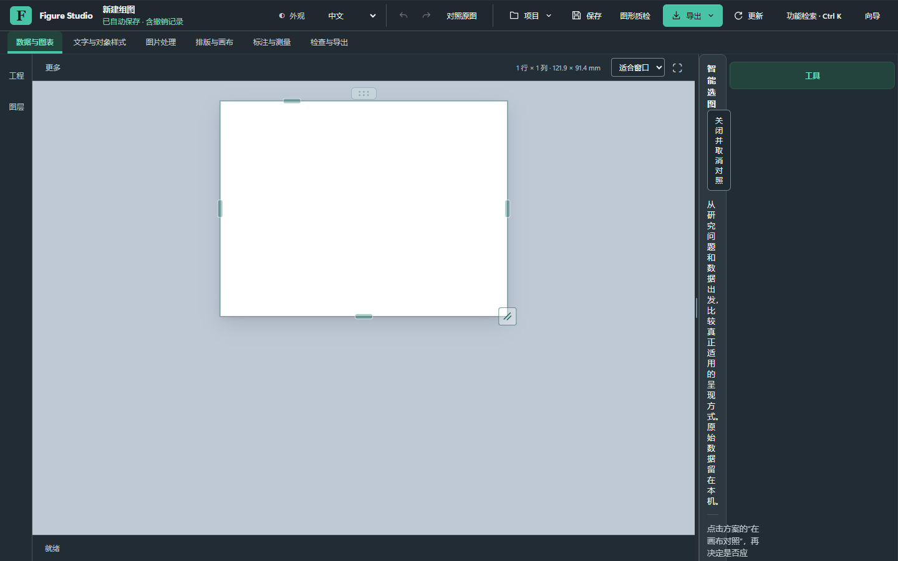
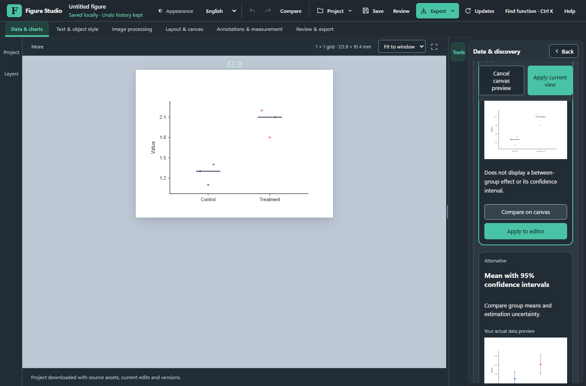

# 智能选图侧栏与连续操作验证

2026-11-25 · author a

## 原因与改动

智能选图的非模态对话框被直接插入右侧栏，成为侧栏网格的第三个子元素，占用了给工具按钮预留的 44 px 列。从首页和工具菜单进入均可复现。

对话框现在挂到已有的智能选图工具内容区。打开时通过现有工具抽屉控制器展示所属面板，继续使用原来的数据读取、方案渲染、画布预览、取消、应用和历史机制。触屏布局沿用原有停靠容器。

## 检查结果

| 检查 | 结果 |
| --- | --- |
| 最新 main 基线 | `03fff71f1041a7dbf997922921b65f7c8ed35b5c` |
| 修复前的首页和菜单入口 | 两条路径的对话框宽度均为 44 px，右侧栏有三个直接子元素 |
| 修复后的桌面布局 | 窗口宽 910、1440、1920 px 均通过，对话框宽 245 px，右侧栏恢复为两个直接子元素 |
| 中英文与主题 | 中文、英文，以及 Carbon 和 Pearl 下均可访问完整表单 |
| 首页、工具菜单、Ctrl+K | 自动展开正确的工具内容区，画布保持可见 |
| 收起再展开、返回工具列表再进入 | 保留输入、设计确认和已经生成的方案 |
| 数据导入与方案 | 六行明确标注的合成数据，经本机生产绘图引擎生成五个方案 |
| 画布预览与取消 | 保存时仍为原有工程和编辑状态，取消恢复原图 |
| 应用、撤销、重做、保存重开 | 应用只增加一条历史记录，撤销、重做及重开状态均符合预期 |
| 源码浏览器 | Windows Chrome 158.0.8127.88，无脚本错误或外部网络请求 |
| 本机安装版 | 已安装的 Windows Studio 0.2.1 加上本次局部资源补丁，在隔离测试目录中通过同一组实际浏览器流程 |
| 源码回归 | 17 组 Discovery 会话、9 组安装事务、抽屉导航及状态历史测试通过 |

浏览器回归脚本为 `scripts/test_studio_discovery_dock_browser.cjs`，已接入已有浏览器 CI 运行器。执行方式为 `node scripts/test_studio_discovery_dock_browser.cjs LOOPBACK_URL NEW_OUTPUT_DIRECTORY`。

本机局部补丁覆盖安装目录中的脚本和内嵌首页，以及当前 Codex Skill 的同一脚本。原文件已备份，应用版本号保持原有值。本记录的安装版检查针对这份局部补丁，正式 v1.6.2 安装包是修复前的版本。Mac 原生安装版尚待验证。

## 实际画面

修复前从工具菜单打开，面板进入 44 px 列。

本机安装版应用补丁后，用六行合成数据生成方案并在实际画布预览。

