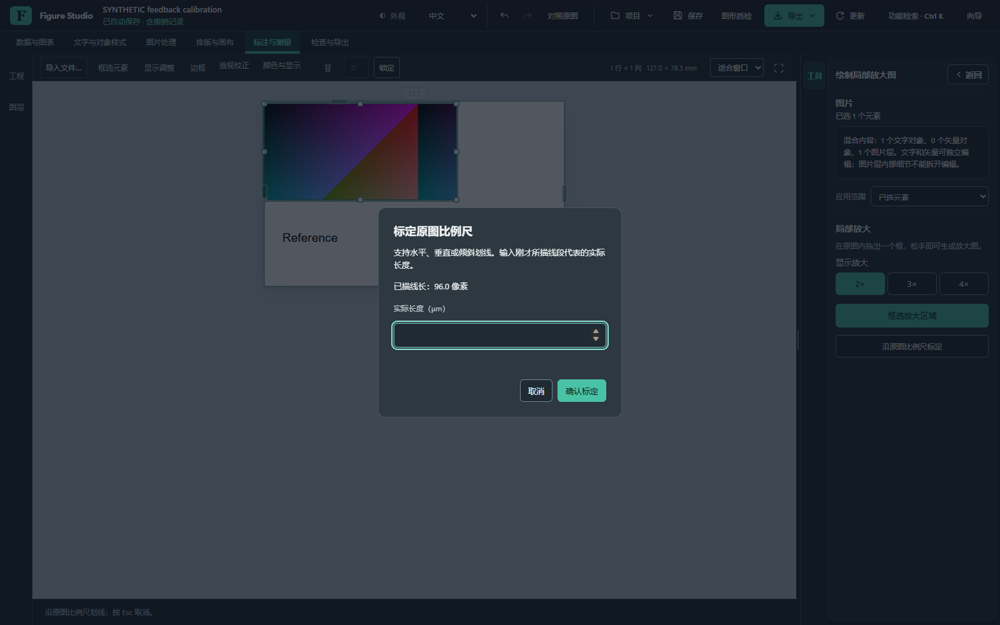
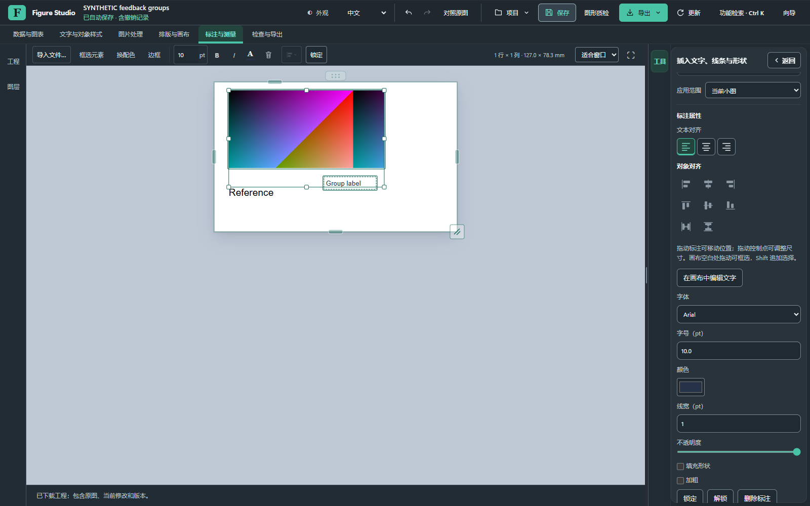
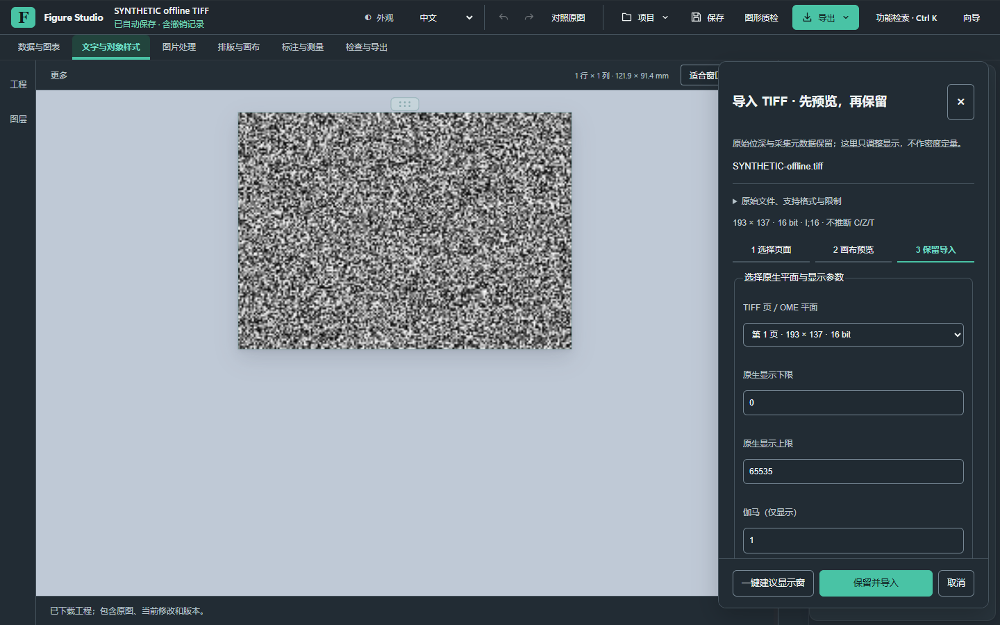

# Figure Studio 0.2.5：五项用户反馈

输入均为明确标记的合成图像及文本，不含用户工程或科研数据。Windows 源码编辑器与自包含 HTML 使用真实 Chrome、真实文件导入和下载；不会把 DOM 单元测试记为安装版验收。

| 反馈 | 实现与检查 |
| --- | --- |
| 标尺只能水平描线 | 保留原图像素坐标，端点欧氏距离支持水平、垂直、斜线及反向；预览与测量一致。320×160 图中垂直描线 96 px、实际 24 μm，对应完整宽度 80 μm。取消、一次撤销、保存重开均检查。 |
| 线条缺少箭头 | 新建单端及双端箭头，现有直线可改箭头；保存重开、反向绘制、SVG 图元导出及一次撤销。 |
| 文字连续空格折叠 | 原生文字及新增标注 `A   B  C` 均显示 8 字符；SVG 保留 xml:space 与 white-space，重开后仍保留。原有字符格式与多行定位回归继续运行。 |
| TIFF 不易导入 | 明确“选择页面 → 画布预览 → 保留导入”；取消不写工程，原文件与原始像素摘要保留。18 个编码／异常文件对照独立 Pillow 解码，覆盖灰度8/16、RGB8、大小端、多页、OME、无压缩/LZW/Deflate/PackBits、浮点拒绝及损坏拒绝。浏览器离线实测无远程请求。 |
| 图片及元素不能组合 | 新增跨图元组合，不改变整张小图分组。点任一成员选择整组；图片与文字拖动位移一致，整体缩放一次撤销，锁定、解锁、取消组合、保存重开及无效组合文件的原子拒绝均检查。 |

源码检查：`test_studio_image_insets_controller.cjs`、`test_studio_rich_text_regression.cjs`、`test_studio_group_alignment.cjs`、`test_studio_selection_commands.cjs`、`test_studio_canvas_clipboard.cjs` 和 `test_studio_tiff.py`。

真实浏览器：`test_studio_feedback_five_browser.cjs`、`test_scientific_tiff_offline_browser.cjs`；纳入本机服务浏览器集成门禁，Windows 冻结应用也运行五项交互回归及原有 TIFF 浏览器测试。检查输出保存在 CI 构建产物，发布资产的 `VALIDATION.json` 记录确切构建来源和安装测试结果。

Windows 安装版：发布门禁要求真实安装、重复安装、卸载、隔离运行和 0.2.4 → 0.2.5 升级，保留工程、历史及本机服务来源并导出 PNG。macOS Apple Silicon / Intel 各自原生构建、库与架构审计及冻结应用自测；未将这些结果等同于在实体 Mac 上逐项手工操作。

