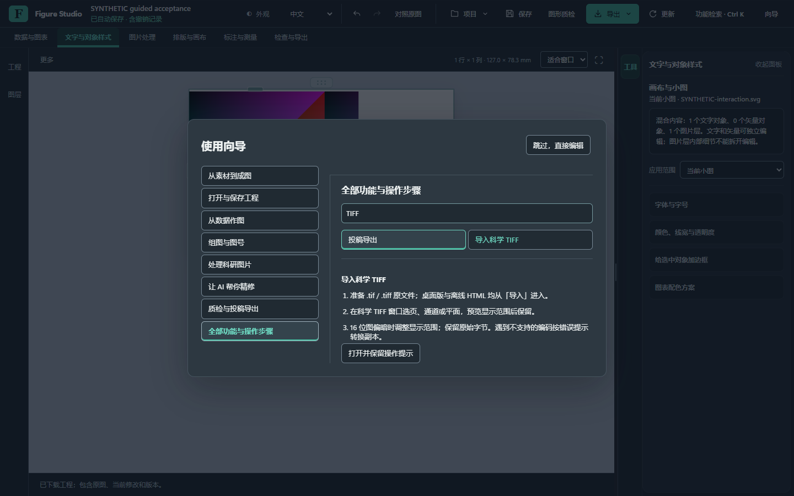
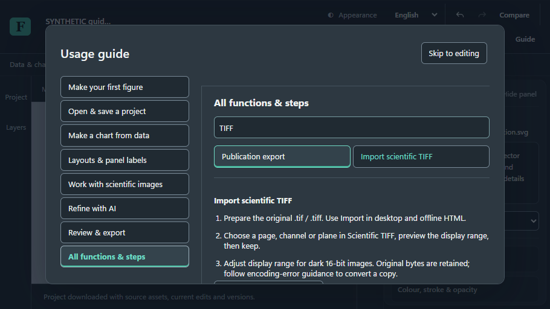
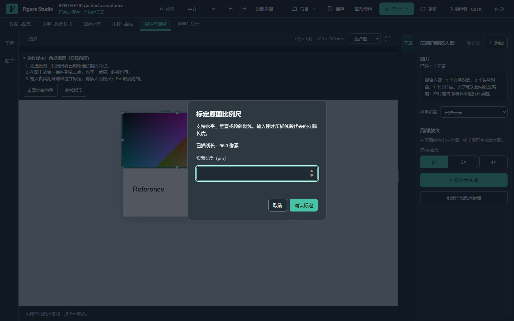

# 使用向导与重复验收

本轮从正式 v1.6.4 / Figure Studio 0.2.5 的 main 开始，在独立分支补齐可发现性与操作衔接。使用合成图形和已有公开测试数据，不上传科研文件。以下结果限定于列出的输入、动作和环境，不代表任意数据或实际采集图像的准确性认证。

## 已完成的真实浏览器检查

| 路径 | 验证内容 | 结果 |
| --- | --- | --- |
| 中文 1440×900、英文 910×512、中文 1280×720 | 逐一打开 57 个命令／任务的三步说明；搜索 TIFF、箭头；对应工具帮助 | 通过 |
| 同三种窗口的独立离线 HTML | 相同向导、箭头插入、保存重开、一次撤销、垂直两点标定 | 通过 |
| 向导打开另一个工具 | 图片预览未确认时拒绝跳转；关闭帮助后草稿仍在 | 通过 |
| 原有向导与手机窄窗口 | 工程、选图、排版、AI 请求／剪贴板预览、导出；跳过／Esc 不改变工程和预览 | 通过 |
| A/B/C 磁吸 | 基线坐标、缩放、自由横移、Alt、快速松手、一次撤销、保存重开及不可达边界 | 通过 |
| 完整原有浏览器组 | 工程校验、原生 TIFF／衍生显示、投稿配置、历史快捷键、抽屉、智能选图、反馈、文字、WB、统计报告、五项反馈；独立离线 TIFF 和反馈检查，共 17 组 | 通过 |

[三种窗口结果](guided-tasks.json)、[离线结果](offline-guides.json)、[完整浏览器结果](source-browser.json)、[磁吸测量](label-snap.json)均由实际运行生成。新向导测试不依赖截图文字来判断完成，而是检查真实 SVG 箭头、原始工程状态与历史、标定窗口和未确认预览。

完整浏览器组已接入源码 CI；新增向导检查也接入 Windows 冻结应用的验收工作流。它从真实程序服务打开编辑器，使用本地合成图形执行操作。源代码浏览器检查与安装版检查分别记录；macOS 原生打包／自检不替代真实 Mac 手动操作。

源码 164 项 Node 回归已通过；依赖渲染数据的检查先由当前 Python 渲染器重新生成夹具再运行。首次成图在 1440 与 910 两种窗口从导入到质检和 SVG 导出跑通。[完整数据工程往返](daily-roundtrip.json)保留原始数据及五个候选图形：局部 AI 样式修改只产生一次撤销，工程保存重开和 SVG/PNG 导出通过。单次本机操作测得打开 97 ms、检查 63 ms、任务准备 48 ms、粘贴预览 41 ms、重开 73 ms；这是该合成工程的本次测量，不是所有工程的性能保证。

## 使用入口

首页 **使用向导**；已有工程从 **向导 → 使用向导** 进入；工具标题旁 **怎么用** 直接定位当前工具。在 **全部功能与操作步骤** 搜索任务后，点 **打开并保留操作提示**，步骤留在画布上方。关闭或折叠说明不写入工程或撤销历史。

## 平台边界

共享浏览器交互已在本机 Windows Chrome 实测。Windows 发布候选需通过 Setup 安装／重装／卸载、冻结运行时、上一正式版升级与真实浏览器操作；工作流不跳过失败断言。macOS 两种架构需完成原生构建、自检、版本与架构核对；真实 Mac 的系统选择文件窗口、缩放与中文输入法仍需设备人工补测，不能仅凭共享 JavaScript 推定全部通过。
