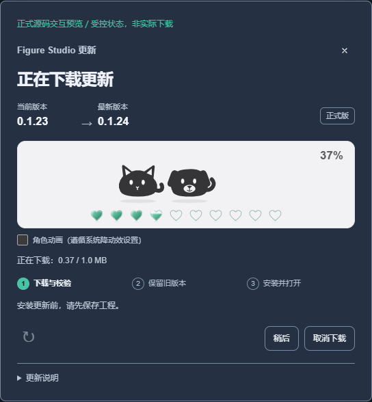

# Figure Studio 0.1.24 · Windows 验证范围

本目录分别记录心形进度的受控演示、实际 Windows 安装与编辑、科学源码回归，以及单次 5000 图元压力测量。各项当前状态见 [publication-readiness.json](publication-readiness.json)；这份初始记录保留 `finalAcceptance: false`，官方 0.1.23 → 0.1.24 升级须在稳定版公开后另行实际验证。

- [安装版编辑](installed-editor-summary.json)使用真实本机服务与独立 Chrome 会话，保留公开 Iris 的 150 条观测、12 份原 SVG 和完整工程容器。候选测试使用隔离数据目录，应用内安装按既有安全规则关闭；正式版默认目录的升级另行验证。
- [受控组件](controlled-component-summary.json)核对字节比例、降动效、窄屏与场景生命周期。演示使用实际界面资源和明确提供的状态，未执行真实下载或安装；早期失败与被拒绝的范围仍保留哈希来源。
- [科学源码测试](scientific-source-summary.json)、[最终源码对照](final-source-byte-comparison.json)与[选定编辑回归](functional-summary.json)分别报告自己的范围，不替代普通用户或全部工作流验收。
- [5000 图元测量](performance-summary.json)保留全部 40 个测量样本和 6 次预热的原始记录哈希。它使用合成压力工程，记录 Tab 改色和 rAF 回调机会，不代表 Enter、光学延迟、持续 FPS 或普遍加速。

原生记录包含真实安装、自检、同版本重装、正常卸载与独立终检；项目、设置和哨兵按原字节保留。[媒体索引](media.json)绑定未编辑原始录像与截图。人工审核范围是所列静态图和实际抽看的录像时间点，没有声称逐帧看完整片或进行 OCR 隐私认证。原始工程、表格、HTML、令牌和本机路径不公开。

材质对照：两张均为受控的 37% 界面状态，并非实际下载。

| 平面原型 | 透明翡翠材质 |
| --- | --- |
|  |  |

Original 0.1.23 draws its own real 0.1.23 → 0.1.24 download. New 0.1.24 heart states in controlled or installed-editor demonstrations do not establish a live official download rendered by 0.1.24. No new native IME, detector accuracy, clean-VM, Mac/mobile or all-workflows result is claimed here.
