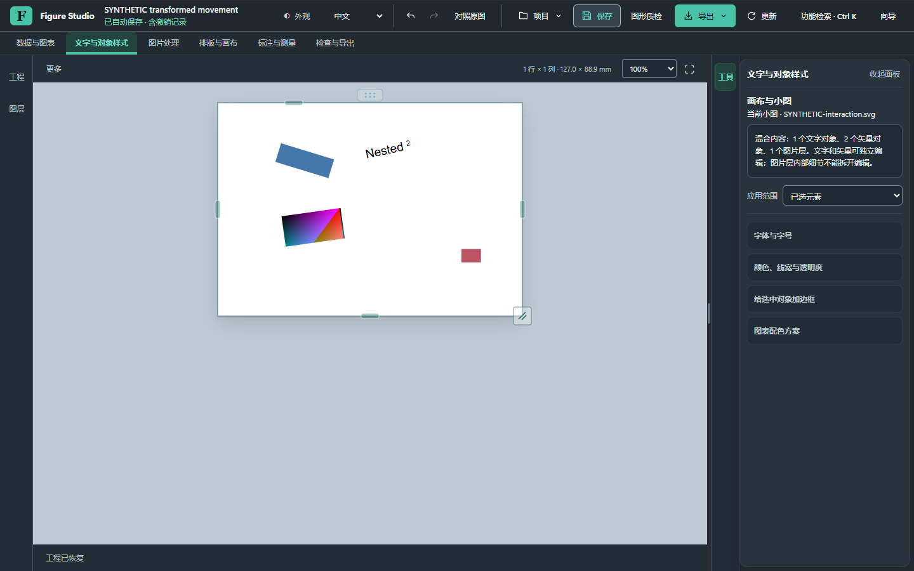
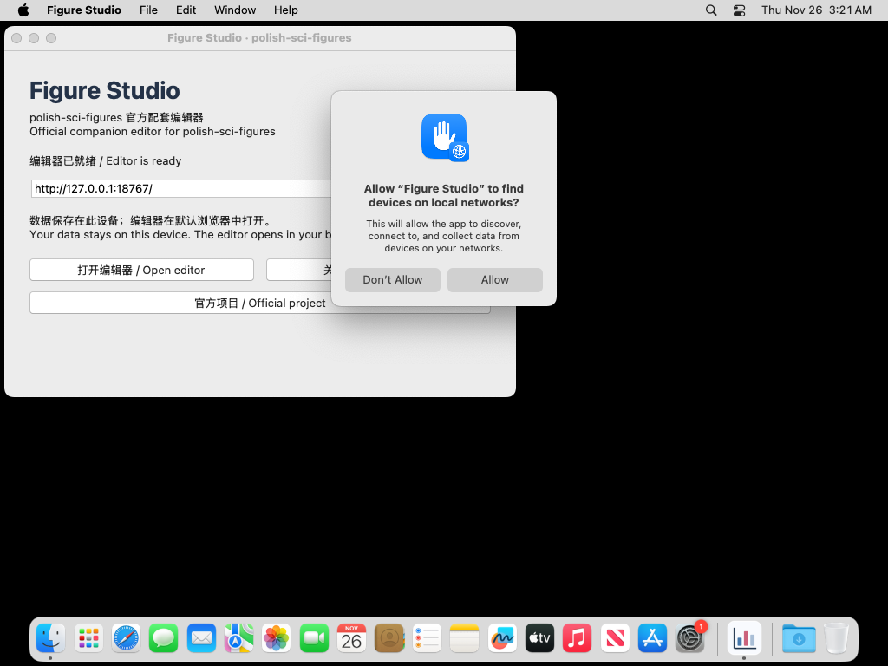

# 复杂大图松手提交与 Mac GUI 验收

起点是正式 v1.6.5 / Figure Studio 0.2.6，源码树与 main 的 `aa50a65` 一致。本轮使用独立分支、明确标记的合成 SVG 和已知像素夹具，保留原始素材与数据，不上传科研文件。

## 耗时与改动

旧版 5000 图元的四次 CPU 采样显示，松手后的 `commit → render` 约耗时 150–170 ms，包含整张 SVG 重建及重复属性面板刷新。此时拖动预览已到达最终位置。新实现对支持的纯移动保留这些节点，仍同步经过原有校验和历史提交；不是先显示成功、稍后补写模型。

结构性排版、紧凑布局、锁定呈现及依赖边框／关联／比例尺等仍走适用的完整渲染路径。移动后的轴缩放元数据按状态身份刷新，避免保留画布后使用旧缓存。目标已变化或提交校验失败时恢复当前工程的规范画布。

同一合成夹具、Windows Chrome、真实指针事件至第二次动画帧；性能测量不同时录屏或采样 CPU。每轮先预热两次，再记录 12 次松手。原始数据见 [pointer-up-metrics.json](pointer-up-metrics.json)。

| 图元数量 | 版本／轮次 | 中位数 | p95 |
| --- | --- | --- | --- |
| 5000 | 正式 0.2.6 基线 | 160 ms | 210 ms |
| 5000 | 新实现，第 1 轮 | 19 ms | 24 ms |
| 5000 | 新实现，第 2 轮 | 20 ms | 32 ms |
| 5000 | 新实现，第 3 轮 | 18 ms | 23 ms |
| 10000 | 新实现，第 1 轮 | 32 ms | 38 ms |
| 10000 | 新实现，第 2 轮 | 33 ms | 39 ms |
| 10000 | 新实现，第 3 轮 | 33 ms | 41 ms |

本机门槛为 5000 图元松手 p95 ≤ 100 ms、10000 图元 ≤ 150 ms，同时要求画布及未选节点保留、准确落点、一次撤销和规范重开几何一致。它限定测试输入与环境，不是任意设备和复杂度的承诺。

## 状态与图件正确性

每次拖动检查原始 SVG／数据未变、历史只增加一次；随后验证规范重开、撤销／重做、保留画布后立即缩放、取消拖动和 SVG 导出。额外覆盖旋转、非等比父级缩放、含上下标的文字及裁剪图片，比较移动后与重开后的实际边界。[几何记录](transformed-geometry.json)。

原有源码 164 项检查通过；指针点击夹具适配真实新提交函数后单独重跑。完整原有浏览器组及两种大图门槛共 20 组通过，新的变换几何检查另外通过，后续 CI 将其合入为 21 组。科学 TIFF、统计、WB、向导、预览及保存往返继续执行。[源码检查](source-gates.json) · [浏览器结果](source-browser.json)。

## Mac 验证方法

先在 arm64 macOS 15.8.2 和 x86_64 macOS 15.7.9 托管桌面运行真实正式 0.2.6 `.app`。CoreGraphics 确认原生 590×428 窗口在屏幕上，桌面截图及可见 Chromium 编辑通过。实际截图同时发现启动时出现系统“访问本地网络”提示，不能只据浏览器脚本成功就认定启动体验完整。

新版本移除数值回环服务绑定时多余的反向 DNS 查询。Apple [TN3179](https://developer.apple.com/documentation/technotes/tn3179-understanding-local-network-privacy) 说明本地名称解析也受本地网络隐私控制；本机服务不需要解析局域网名称。单元测试令 `socket.getfqdn` 抛错，验证桌面和 CLI 服务仍能正确绑定 127.0.0.1，并拒绝外部地址。Windows 地址独占、Host／Origin／令牌检查保留。

新包 Mac 门槛包含：原生窗口、真实桌面截图、经旧截图正例验证的系统提示检测、Chromium 与 WebKit 可见交互、原始像素／工程／历史检查，以及 5000／10000 图元各三轮。若新截图仍出现本地网络提示，门槛失败，不通过自动授权来隐藏问题。最终包的实际结果以 Actions 及发行 VALIDATION.json 为准。

这是 macOS 原生托管桌面自动 GUI 验收；人工实体设备、原生中文输入法和所有辅助功能组合不在认证范围内。macOS 包仍采用临时签名，要求 macOS 15+。
