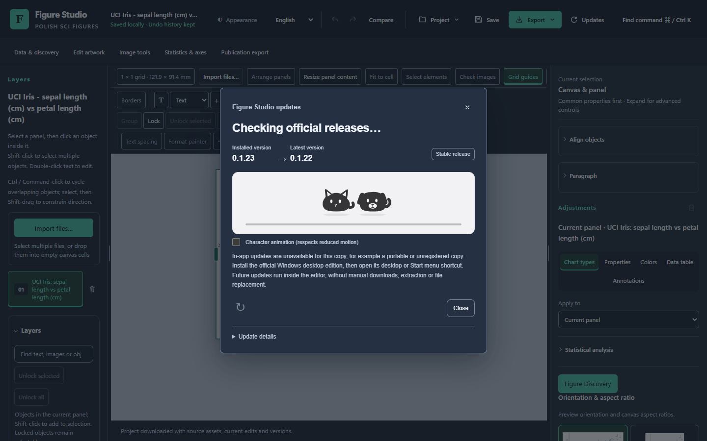

# Windows 0.1.23 实际安装、重装与卸载

原始 Windows x64 Setup 完成安装、启动、同版本重装和正常卸载。[安装](safe-install.json)、[启动](safe-start.json)、[重装](safe-reinstall.json)、[卸载](safe-uninstall.json)及[独立终检](safe-final-query.json)保留原安全记录的完整字节；[汇总](summary.json)明确各自范围。

- 安装程序包含的 2625 个文件逐一核对。冻结程序在移除系统 Python、设置无效 PYTHONHOME 的环境中完成实际自检。
- 设置、外部哨兵和实际保存的公开 Iris 工程在重装后按字节保留。正常卸载后四个 AppId 注册视图均不存在，隔离 EXE 已移除，外部数据保留。
- 首次重装因另一测试进程占用 EXE 而失败。用户明确授权关闭该实例后，第二次成功。[失败及恢复记录](reinstall-attempts.json)保留原始证据哈希；未将失败计入成功。
- 原生阶段完成时，原保护窗口身份保持一致。用户后来主动关闭旧窗口；后续手动升级采用另行确认的保护基线，不改写这些历史记录。

[安装服务上的浏览器摘要](browser-summary.json)记录实际 Chrome headless 操作、公开 Iris 150 条观测及 12 份原 SVG、完整保存对象、F2 编辑及撤销、双主题导出和猫狗指针反馈。该次隔离安装使用显式数据目录，因此 `inAppInstall=false`；它不替代默认配置下的真实官方应用内升级。[选定功能回归](../functional/README.md)与[匹配性能](../paired-performance/README.md)分别提供其证据。

[Pearl 截图](installed-pearl-theme-update.png) · [恢复后的 Iris 画布](installed-restored-public-iris.png) · [原始操作录屏](original-installed-browser.webm) · [媒体来源和抽帧审核范围](media.json)。截图及录屏来自受控公开数据场景；人工检查了静帧和所列录屏采样点，不宣称逐帧或 OCR 隐私认证。

This is an actual local Windows installation and frozen-program test, with owned headless Chrome against its real service. It is not a clean-VM, new native IME, image-detector accuracy, all-workflows or official app-driven update acceptance. Original evidence stays bound to this exact Setup and run.
