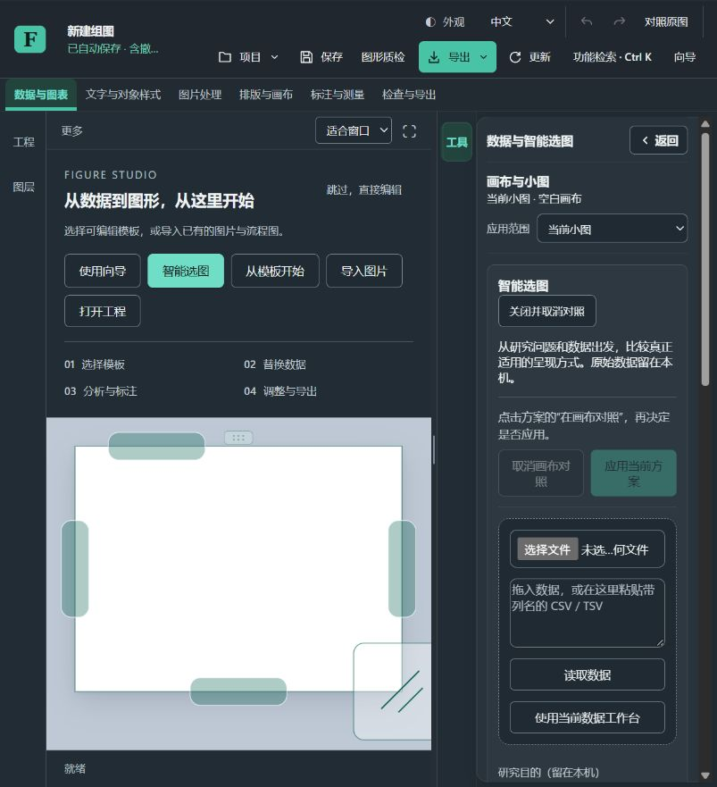
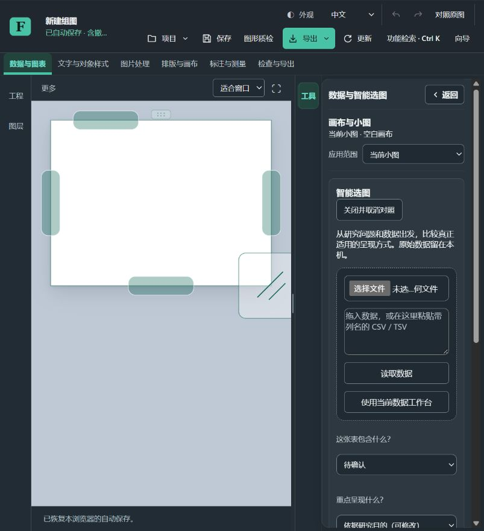
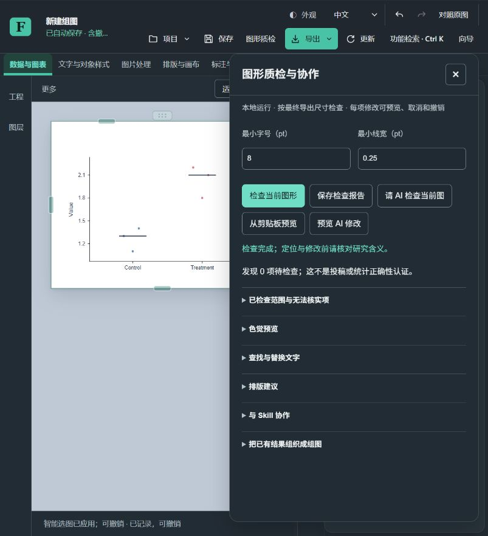

# Figure Studio 0.2.4 体验检查与发行验收

2026-11-25 · author a

本轮沿正常用户入口检查已有编辑器，基线为正式 Suite v1.6.2 / Studio 0.2.3 和 main `03fff71`。使用六行明确标注的合成数据，以及现有公开或合成测试素材。

## 六条用户路径

| 步骤 | 用户目标 | 检查与改动 |
| --- | --- | --- |
| 1 | 首次打开并找到下一步 | 首页、菜单和 Ctrl+K 均进入智能选图所属面板。进入后首页卡片让出画布 |
| 2 | 导入表格并选择图型 | 数据和必要设计确认先显示，五个选填背景字段折叠。为文件导入、粘贴和筛选补齐可访问名称 |
| 3 | 比较、取消、应用与精修 | 初始导入阶段隐藏尚不可用的画布对照操作；真正预览时再显示。生成中抑制重复点击，结束后允许重试 |
| 4 | 检查图形并交给 Skill | 色觉/灰度只作用于屏幕。文字替换和科学记号修改先预览再确认，可一次撤销。既有目标版本校验继续保护 AI 局部导入 |
| 5 | 保存、重开、导出 | 检查预览与已应用状态、源数据、历史和导出。保留既有 TIFF、JSON Worker、投稿尺寸与统计报告检查 |
| 6 | 安装与升级 | 从同一提交构建 Windows Setup、便携版、两种原生 Mac 预览和 Skill。发行工作流验证旧正式版升级、工程与历史保留及 PNG 导出 |

## 实测记录

- 本轮独立 Chrome 的 14 组现有浏览器流程通过，覆盖工程、科学 TIFF、显示派生、投稿尺寸、历史快捷键、抽屉导航、紧凑布局、智能选图、反馈、文字内容、WB、WB 高级操作、工作台和统计报告。
- 智能选图会话的 19 组测试通过，包含失效请求、异步竞争、失败恢复、语言切换、背景字段展开状态和生成中的按钮状态。
- 最终尺寸 SVG 检查、色觉/灰度、查找替换、记号修正和数据保留另有针对性测试。真实图表由本机工作台从合成 CSV 重新生成，保留源文件校验。
- 使用四个合成小图，核对坐标轴对齐后填充区与曲线的相对坐标及散点符号的形状；记号修正核对真实上下标、当前字体、再次质检和撤销。
- Windows 发行构建在干净的 Windows runner 上运行实际 Setup 安装、自包含运行时自检、14 组冻结程序浏览器流程、色觉与文字操作、填充区对齐，以及 Studio 0.2.3 → 0.2.4 的实际升级。
- macOS 的 Apple Silicon 与 Intel 分别构建，执行原生库架构审计、临时签名检查和冻结运行时自检。签名及公证状态仍按预览包说明。
- 各平台最终结果、源提交、构建链接和校验范围记录在正式发行附件 `VALIDATION.json`。自动检查及屏幕观察未替代 Mac 真机手工操作、Windows 原生输入法或完整辅助技术认证。

## 当前审查发现

1. 智能选图对话框误入侧栏工具列，宽度仅 44 px，现已归入内容区。
2. 进入功能后首页引导仍占画布，现按任务切换收起。
3. 选填背景信息先于必要设计确认，现以渐进展开保留全部字段。
4. 尚无候选时显示大块失效的预览控件，现随预览状态显示。
5. 生成方案时仍能反复点击重算，现用已有请求状态限制重复触发，并保证完成和失败后可重试。
6. 侧栏标题会遮住滚动后的预览状态，现为预览工具条留出标题空间。
7. 新的质检与批量文字功能已与工程保存、取消、撤销和源数据保留一并核对。

## 本轮实际画面

初始版本进入选图后，首页卡片继续占用画布，预览按钮和背景字段先占据侧栏。

调整后直接露出画布与导入数据，必要设计确认优先，选填内容保留在折叠组内。

已应用的合成数据图表进入图形质检，检查、保存报告和 AI 交接入口位于同一处。

