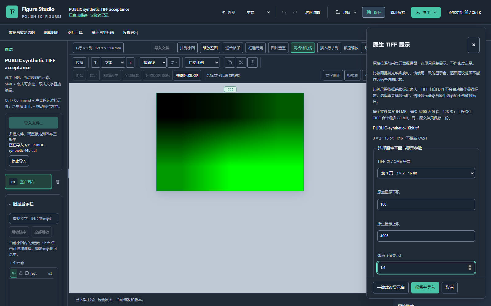
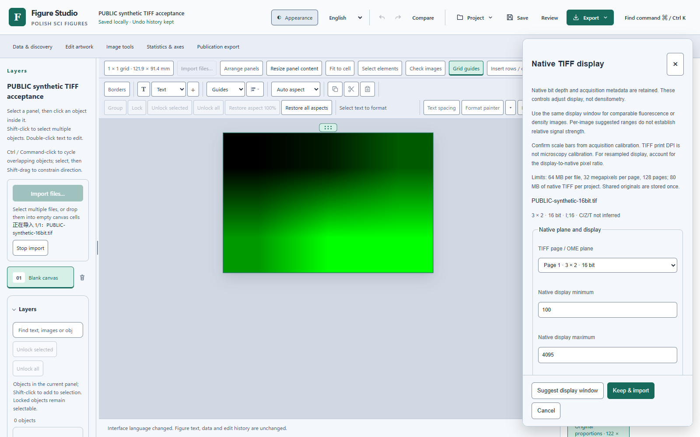
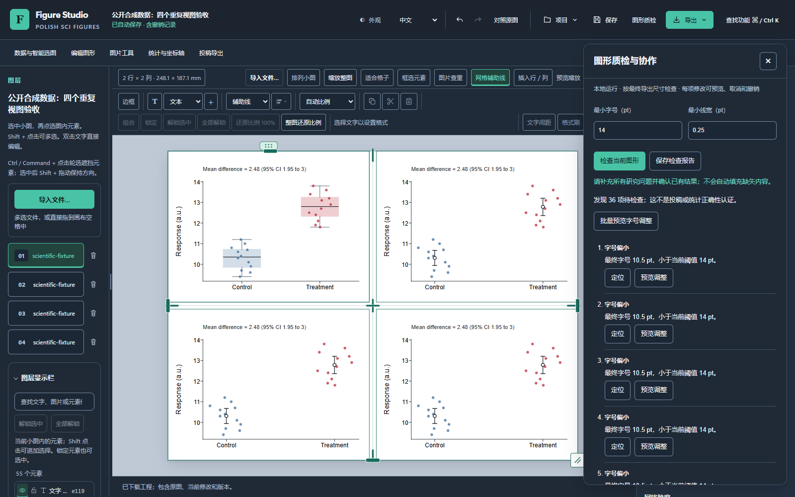

# Windows 集成候选：2026-10-28 证据

本目录记录源码集成的实际证据，不是新版安装包的发布证明。完整范围与保留失败见[审计记录](../../windows-next-stable-audit.md)。当前正式版仍为 v1.4.26。

## 原生 TIFF 与后台保存

[TIFF 工程证据](native-tiff-engineering-20261028.json)保留三份获准私有图像的两个流程批次，但仅公开去标识数值与通过范围；不包含私人像素、文件名、路径、源哈希或工程。大文件保存的主线程间隔减少，而总耗时并非全部缩短，保留／重开仍有长任务。该流程观察不是 ABBA 基准，不作独立查重准确率或 Windows 安装实操证明。

另做[大图保留 A3/B3/B4/A4](image-keep-20261028.json)，使用同一三份文件定位并减少尺寸读取的逐字节回调开销。报告包括全部阶段和独立 profiler 说明；最大文件主线程间隔减少，完整保留流程没有提速，长任务仍存在。

下图仅使用仓库可复现的六像素合成 16 位 TIFF；绿色来自明确选择的显示 LUT。原生输入未改变。操作、支持范围与定量边界见[指南](../../figure-studio-native-tiff.md)。

## 实际画布

下图来自 Chrome 155.0.8059.85 的生产编辑器。四个面板是同一份明确标注的公开合成输入的不同重复视图，用于编辑回归，不能作为四项独立实验。右侧使用人为提高的 14 pt 阈值检查最终字号；该阈值不代表期刊要求。

该次测试实操了字号预览、预览期间保存、取消、批量保留和一次撤销、面板局部操作文件导入、旧版本冲突拒绝、现成候选的科学确认、排版取消及已确认结果规划。没有页面错误或联网请求；原始面板、数据草稿及检查点保持一致。截图对应内部 `quality-ready-1` 快照，后续源修改需另行回归，不能仅凭此图证明最新安装包通过。

另用 [UCI Iris](https://archive.ics.uci.edu/dataset/53/iris) 的 150 条公开记录和 [scikit-image skin](https://scikit-image.org/docs/0.25.x/api/skimage.data.html#skimage.data.skin) 的 H&E 皮肤图像核查原数据、标记坐标与内嵌原始 JPEG 保留。Iris 按 CC BY 4.0 使用并归于 R. A. Fisher，数据 DOI 为 10.24432/C56C76；skin 原图由 Kilbad 置于公有领域。此处不分发私人实验图像，也不据此宣称独立查重准确率。

## 全部性能批次

[结构化摘要](performance-captures-20261028.json)保留四轮 ABBA 的十六个批次，包括较早的退步结果、第一次记录操作、重复操作的 P50/P95、长任务、源文件不变断言、错误数及原始记录 SHA-256。首次操作取自被排除的预热记录，不是冷启动或第一次安装耗时。`PASS_VERIFIED_CAPTURE` 仅表示测量完成并验证了操作，不表示耗时已达到性能验收标准。

共同协议：Windows 单设备、同版真实 Chrome、5000 个原生可编辑对象、每项 20 次有效操作、3 轮预热、250 ms 稳定等待；操作含选择、改色、拖动确认、侧栏缩放和配色切换。不混用历史 v1 协议。浏览器为 headless 模式，测量事件到 rAF 回调，不等于屏幕物理延迟。未在该协议记录进程峰值内存或原生安装版交互。

复测使用仓库的 `scripts/benchmark_studio_carbon_browser_v2.cjs`。先从对应源码生成独立 HTML（`desktop/build_starter.py --out ...` 可生成空白入口），只在本机提供该文件，再明确传入 `--url`、`--html`、`--assets`、`--label`、`--out`、`--elements=5000`、`--samples=20`、`--warmup=3`、`--settle-ms=250` 和 `--headless=true`。测试自身创建新工程并导入确定的 5000 对象 SVG；两个源码快照交替运行，重任务串行。记录 HTML 和全部资源的实际哈希，不能仅写一个未经核实的版本标签。若改用空白入口，需把新的 HTML 哈希与初次操作条件作为新批次记录，而不声称逐字节重现本目录原快照。

## 浏览器内存补测

[内存证据](browser-memory-20261028.json)来自另行运行的四批 ABBA，每个空白工程、导入、选择、配色、保存重开阶段各采样五次，不强制垃圾回收，也不与上述计时混算。工具仅查询自己启动的独立 Chrome 及其 CDP 返回的子进程，未保留进程 ID。全程没有外部请求，保存重开保留了原始面板。

| 观测最大值 | 基线两批 | 候选两批 |
| --- | --- | --- |
| 浏览器进程组工作集之和 | 990.5–1034.1 MiB | 905.1–910.8 MiB |
| 进程组私有提交内存之和 | 704.1–751.3 MiB | 621.4–624.4 MiB |
| JS 已用堆 | 26.9–34.8 MiB | 34.4–35.1 MiB |

工作集之和可能重复计算共享页；私有提交内存不等于物理驻留内存；JS 堆不包含大部分原生 DOM、图片缓冲及桌面 Python 引擎。只能报告所测阶段的观测值，不宣称绝对峰值、无泄漏、JS 堆全面下降或物理低端机表现。首次预检查因大型导航响应被 Chrome 调试缓存淘汰而失败，未产生采样；改由独立请求上下文在导航前后核实 HTML 字节后，使用新文件名重测并保留首次失败。

复测运行 `scripts/measure_studio_browser_memory.cjs`，明确传入 `--url`、`--html`、`--label`、`--out`、`--elements=5000` 和可核实的 `--source-commit`。使用已有 Playwright 及本机 Chrome；只接受本机 HTTP 地址，拒绝覆盖已有记录。

## 当前源码回归

`e04ec7de752a4d720d4dd84549c924a25d342cf0` 的八项现有 CI 检查已通过；保留现有多平台检查是兼容性回归，不代表新增移植开发。本机重建原有标记的浏览器测试前置产物后，177 条去重 Node 命令全部通过，包含此前因本地旧缓存失败的 WASM 定位回归。这里的合成定位仍不是独立标注准确率。

同一源码的四组生产 Chrome 测试均通过：真实 SVG 几何与 Worker、质检／协作／规划／取消和撤销、大工程配色及英文切换、公开 Iris 与 H&E 的数据／坐标／原图字节保留。后续源码或最终版本变化必须重新核实对应提交与产物；这些检查不替代原生安装和升级。

## 发布门槛

[冻结依赖实测摘要](frozen-dependencies-20261028.json)对应 `21e3ec5` 的内部 0.1.26 构建：实际 EXE 的原生 16 位 OME/LZW 解码与真实本机 HTTP 自检通过，Portable 全部 2671 个文件与运行目录一致。它没有安装或执行正式升级；后续再显示入口和离线说明补充不在该包内。完整冻结清单、代码对象核对和失败日志留在本机，不将旧快照冒充最终包。

仍须完成综合任务书的剩余成熟能力、最终源码回归、原生安装版编辑、真实编辑器内覆盖升级和失败恢复、最终版本与安装包一致性检查。已构建的内部 0.1.26 开发快照不作为正式升级包上传。工具原生控制停止、应用自身失败和测试前提错误分别记录，不互相替代。
