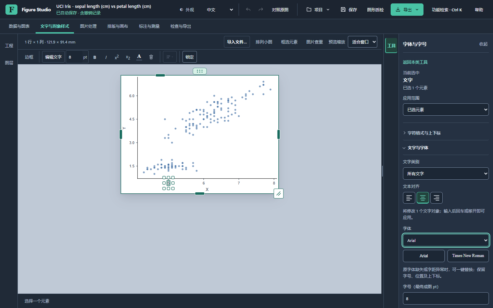
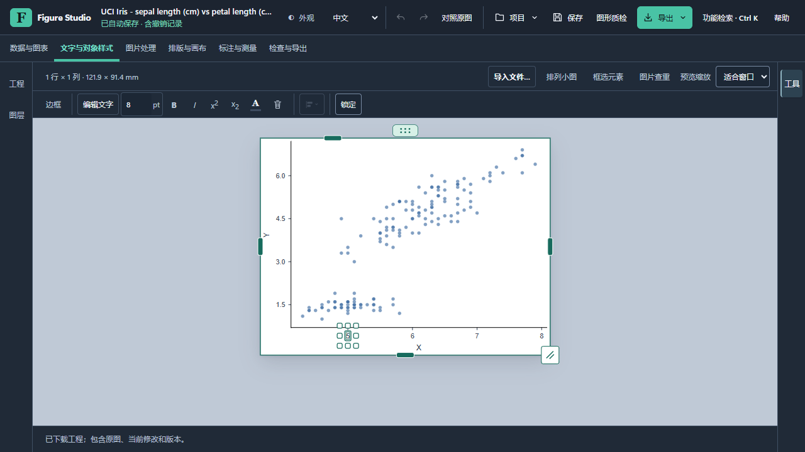
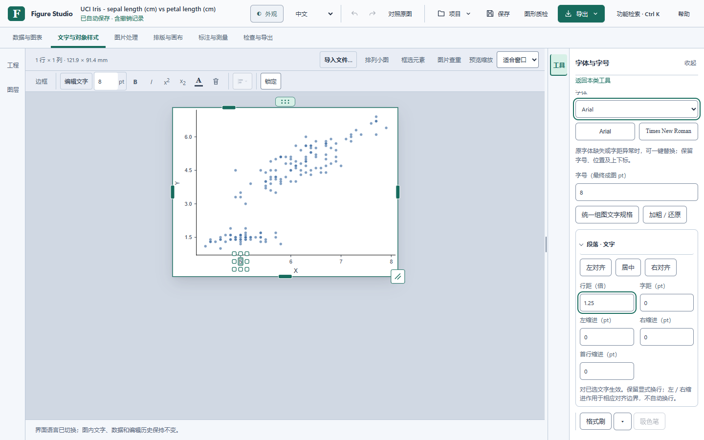

# Figure Studio 0.2.0 本地候选检查单

**已准备本地候选，尚未发布。** 用户要求先检查，再决定是否发布；PR 保持草稿，不合并、不创建标签、不上传发行安装包。软件源码为 `e7b2259887e69ec47b2b45eaf336b95029a509d8`，之后的验收材料提交不改变该候选运行时代码。

## 可以先检查什么

1. **分类是否好找。** 顶部六类任务打开右侧抽屉；左边是工程与图层。文字、图片显示、排版、标注和输出各归其类，同一功能不分散在不同抽屉。右上角 Ctrl + K 用“行距”“边框”“物理比例尺”等操作词搜索。
2. **调整是否连贯。** 在文字工具中重新选择画布对象，工具保持原位。收起后再点边缘“工具”，仍是刚才的设置；“返回本类工具”可找相关功能。
3. **草稿是否保留。** 边框连续调值、收起／展开、返回分类再进入，草稿保留。保存不带未保留草稿，取消恢复原状态，保留后可一次撤销／重做。
4. **风格是否合适。** Carbon Atelier 与 Pearl Pro 使用同一分类及控件。收起左右抽屉后，更多空间留给画布。
5. **反馈与统计是否清楚。** 帮助菜单中的反馈先预览，再到 GitHub 确认提交；无需附带工程或科研图片。下载统计需要主动联网，扣除基线和登记验收；未公开／未同步的台账及无法拆分的预发布流量显示待核实。没有活跃人数或行为采集。

本轮没有自动覆盖用户已安装的程序。候选 Setup 与 Portable 仅放在仓库本机 `.cache/wn12/`；检查安装版前应先保存正在编辑的工程。仅在浏览器查看源码预览不等于安装版验收。

## 已取得的证据

| 项目 | 实际结果 |
| --- | --- |
| 精确软件源码 CI | [e7b2259 的八项检查全部成功](https://github.com/zhoy0409-debug/polish-sci-figures/actions/runs/40940516107) |
| 本机规则与状态 | 184 条 Node 命令、13 项最终受影响检查、11 项下载／反馈规则检查通过 |
| 真实源码浏览器 | 七组生产本机服务流程通过；另补公开 Iris 专业坐标轴、公开许可 H&E 图片显示／取消、最终反馈／统计四组流程 |
| 本地候选 EXE | 实际执行正式自检，退出码 0；17 图形变体、真实授权 HTTP、PDF、图像检查／定位及原生 16 位 TIFF 检查通过 |
| 精确来源核对 | 101 UI 资源、385 数据／说明文件、59 套件代码对象、2 原生 EXE 模块、2682 个 Portable 文件；无文档快照例外 |
| 原图与科研信息 | 所列公开／合成流程核对原始 SVG、观察表、分析、原生 TIFF 字节、预览保存排除、取消、一次撤销、重做与重开；私人原图和工程未参与分发 |
| 5000 图元复测 | 四批320样本保留，P95 低于对应对照；仍有拖动长任务和偶发文字选择长任务，不宣称所有停顿消失 |

5000 图元数字属于源码浏览器事件至第二次 rAF 的口径；不替代安装版或物理显示延迟。原先 wn9 的用户人工文字／边框／5000 图元功能反馈属于旧候选，不能转称本次新界面的原生验收。

首次 CI 的六项基础检查失败日志、临时目录权限失败及旧脚本计数失败均保留。修正为精确的 Europe PMC／GitHub API 两源白名单和六段脚本（其中只有一个可执行运行时），没有允许任意外联；修复提交的八项 CI 全部通过。[全部记录、样本和边界](drawer-workspace-20261030.json)、[包与源码逐项核对](drawer-package-source-20261030.json)、[冻结资源](drawer-source-freeze-20261030.json)可分别核查。

## 本地包身份

| 文件 | 大小 | SHA-256 |
| --- | --- | --- |
| `polish-sci-figures-Studio-0.2.0-Setup-x64.exe` | 106213308 bytes | `1a5ec0c16ece1222306278b87a729bf34d11e5ec953b424b7f1d472335f3235a` |
| `polish-sci-figures-Studio-0.2.0-Portable-x64.zip` | 148277902 bytes | `e5a316ce8355d95bca58a0492c1d2b619a29de7ed3bbf13d3234e71b96c2b86e` |

仍待本次安装版的实际编辑／中文输入法、同包原生数值性能，以及真正官方升级与实际失败恢复。冻结 HTTP、自检、合成夹具和受控元数据不能填作这些检查已通过。真实 Issue 路由与邮件送达尚未部署验收，独立人工标注的检测准确率也未获得。

本次没有发布、覆盖旧发行资产或新增平台移植。先按上面的流程检查体验，收到用户再次明确批准后，才推进相应发布步骤。
