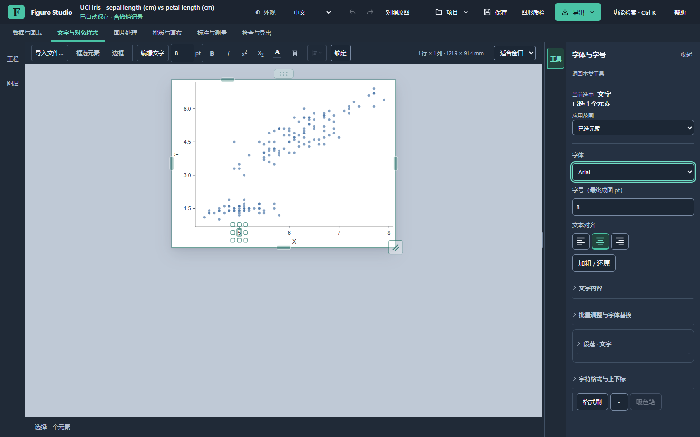
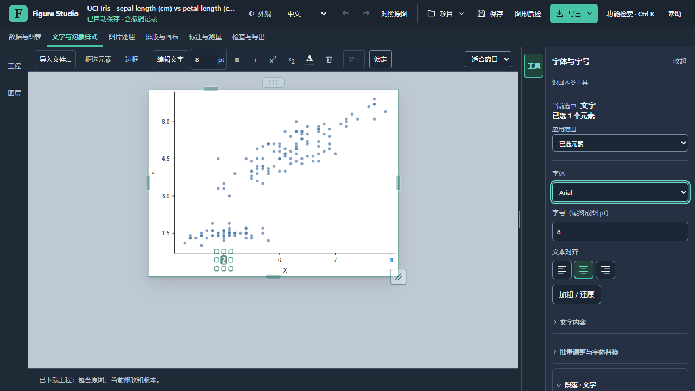
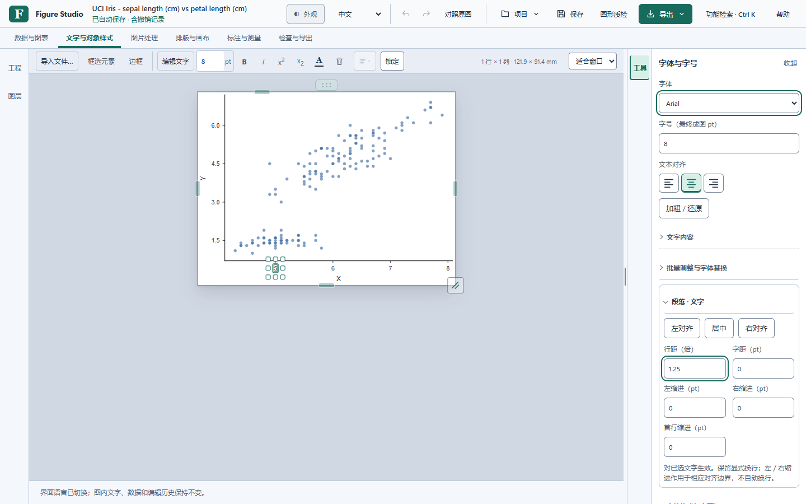

# 视觉层级与上下文工具：第二轮候选

本轮针对用户授权的体验问题做有限调整，不更换品牌、不增加图像算法或平台。仍为未发布候选；等待用户检查及再次批准，不合并、不创建标签、不上传发行安装包。

## 修改前后

| 工作步骤 | 之前 | 本轮 |
| --- | --- | --- |
| 在画布编辑文字 | 两排画布命令常驻，排列、查重与文字格式并列 | 一排上下文工具，保留文字编辑、字号、加粗、斜体和上下标；排列、查重与对齐从各自原有工具进入 |
| 打开字体设置 | 字体替换、说明、统一调整和段落参数混在主要区域 | 先显示字体、字号与基础对齐；文字内容、批量调整、段落及字符格式按需展开 |
| 换选图片，再选文字 | 旧主题逻辑会自动开关高级段落分组 | 手动展开或收起的分组保持；不强制切换已选工具 |
| 找到进阶参数 | 可用功能检索，但普通表单较长 | 搜索“行距”自动展开对应分组并聚焦实际字段，字体等精确检索仍有效 |
| 看清选择对象 | 小图边界与拖动把手较醒目 | 外围编辑提示减弱，悬停恢复，命中区域、键盘和缩放比例不变 |

顶部全局命令与六类任务保留。快捷入口仍调用原控制器，独立设置主页仍只有一个。子对象选择的新增上下文标识只写入短小工具栏，不写入科研 SVG 或工程状态。

在同为 1280 × 720、右抽屉展开的截图中，画布视口从 902 × 490 增至 902 × 546 px；1440 × 900 中当前画布为 1062 × 726 px。两种尺寸的画布快捷区均为 44 px。更窄画布可以换行，预留高度避免文字／图片切换时画布跳动；这不是物理性能指标。

## 可检查的操作

1. 选中文字 → **文字与对象样式 → 字体与字号**。无需滚动即可找到字体、字号及对齐；高级组默认收起。
2. 展开段落 → 改选图形 → 再选文字。段落展开状态及工具保持；手动收起也保持。
3. **Ctrl + K → 行距**。应直接展开段落并聚焦输入框，而不是只切换类别。
4. 打开边框 → 连续改宽度 → 收起再展开。草稿保留，保存排除未保留草稿，取消恢复；保留可一次撤销和重做。
5. 选择图片 → 通过快捷入口打开矫正／颜色与显示。图片查重在 **检查与导出**，总览与放大关联在 **标注与测量**，没有删除功能。

## 截图

修改前：[Carbon 字体抽屉](drawer-fonts-carbon-20261030.png)。

截图来自公开 Iris 数据的实际源码浏览器。Pearl 截图在搜索行距后，段落按用户动作展开且抽屉已滚动，不是默认展开或主题差异。

[实际浏览器操作录屏](hierarchy-refinement-20261030.webm)包含公开 Iris、H&E 及合成 5000 图元；不是安装版或人工输入法验收。

## 验证与边界

七组生产本机服务／Chrome 流程覆盖工程 Worker、真实本机 TIFF、衍生校正来源、投稿配置、文字历史、抽屉和反馈／统计。抽屉流程补查默认分层、手动分组状态、清除选区不改变工具栏高度及 1280 视图。公开 Iris 观察表／分析、H&E 原图、原生 TIFF 字节、工程取消、一次撤销／重做和重开分别核对。

Node 检查继续覆盖原控件身份与唯一归属、搜索焦点、旧界面主题行为、抽屉显式展开状态、历史快捷键、连续预览及异步隔离。图像显示及反馈统计仍沿用现有科学与隐私规则。

性能对照另存全部样本和失败批次；不把界面节省高度称作响应提速，不把浏览器事件至第二次 rAF 称作安装版物理延迟。原生安装版的本次界面实操／中文输入法、同包数值性能、真正官方升级和实际失败恢复仍未通过；本轮没有绕过原生接口保护，也没有操作用户安装目录。

最终源码与上一候选 `c07942b` 串行 A1/B1/B2/A2，每项三轮预热、20 次输入、250 ms 等待。最终四批与前一中间候选四批均保留，共 640 样本。

| 浏览器 P95 | 上一候选两批 | 本轮最终快照两批 |
| --- | --- | --- |
| 选择文字 | 55.5–60.8 ms | 52.4–54.4 ms |
| 选择矩形 | 40.8–54.6 ms | 45.4–52.3 ms |
| 改色确认 | 39.1–57.5 ms | 43.3–49.1 ms |
| 拖动确认 | 149.0–174.2 ms | 154.2–157.5 ms |

中位数相近，尾部存在批次波动，没有稳定整体提速的结论。拖动仍每批 20 个长任务；最终文字选择长任务与操作重叠次数由对照 1／2 降至 0／0。[配套完整样本、哈希及测试记录](hierarchy-refinement-20261030.json)保留未舍弃的结果。测试准备中的沙箱联网、辅助导入路径和旧迁移 junction 输出失败分别保留，未改 junction 或系统设置。

本地候选的精确身份和最新结果见配套 JSON 与检查单。旧 wn13 仍保留，不能把其测试当作本次新界面的安装验收。未取得独立标注准确率，未代发反馈或声称邮件送达。
