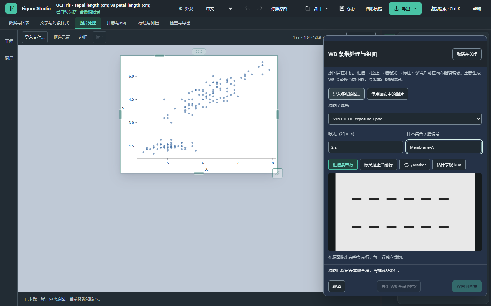
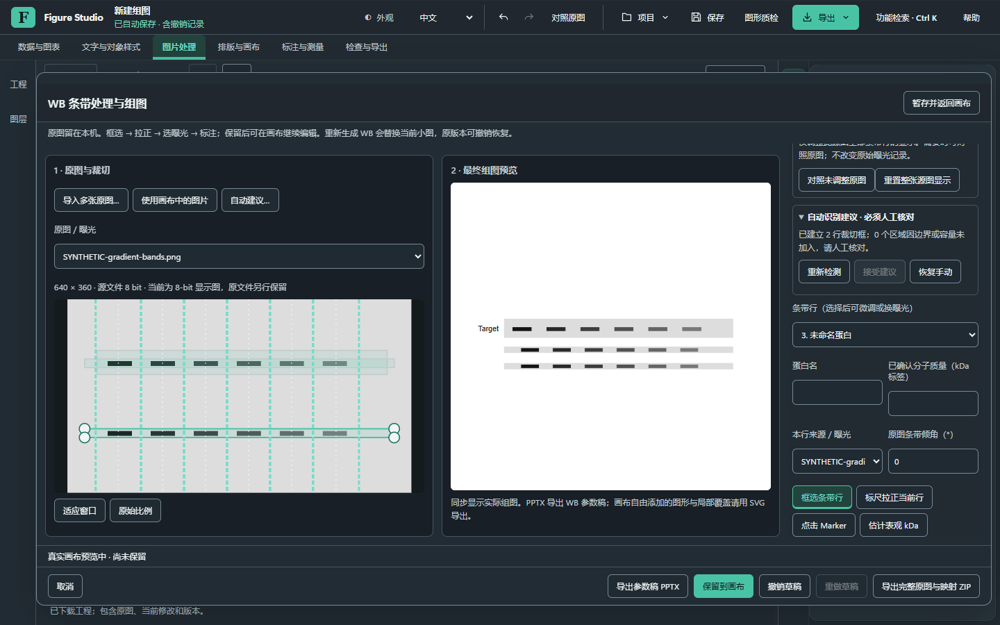
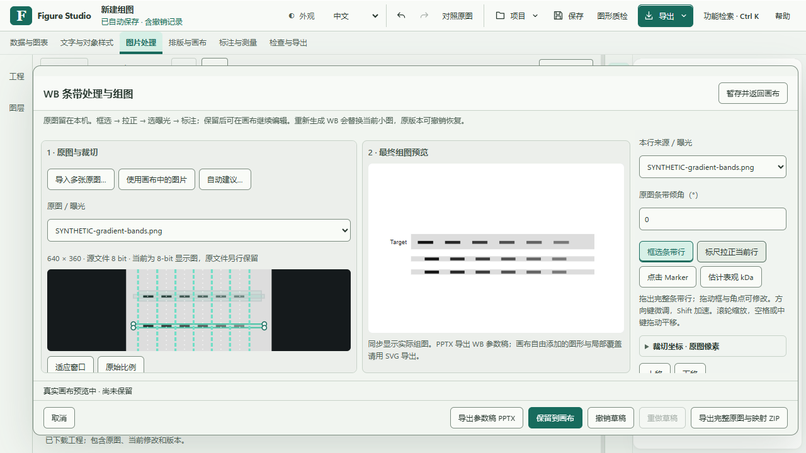
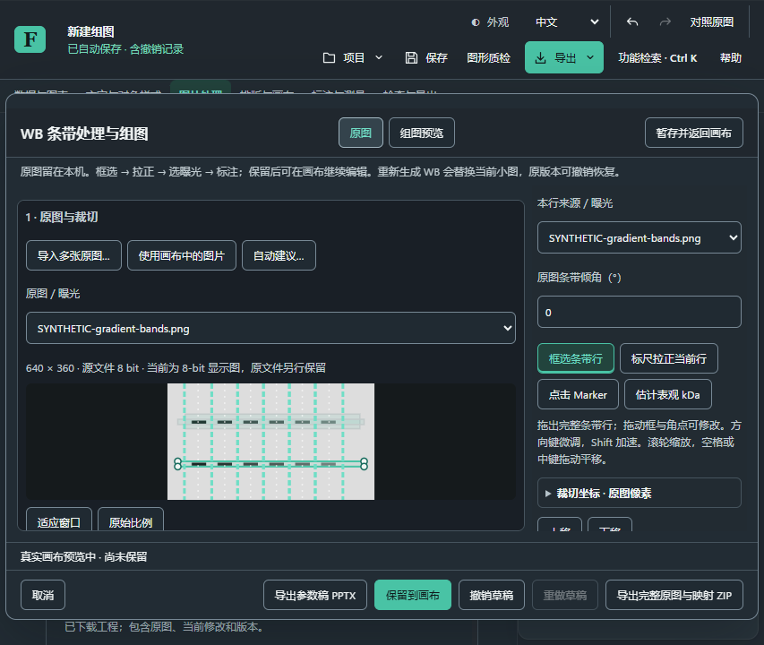

# WB 工作流工程验收 · 2026-10-31

**结论：专用 WB 流程已在当前源码中运行并通过本轮工程检查，仍是未发布候选。** 入口为“图片处理 → WB 条带处理与组图”。[使用步骤与格式限制](../../figure-studio-western-blot.zh-CN.md)面向实际用户；本页记录证据及尚未通过的门槛。PR #41 保持草稿，不合并、不发布。

## 功能与验证范围

| 工作流 | 本轮实际实现与检查 |
| --- | --- |
| 导入与来源 | 批量／拖入 PNG、JPEG、WebP；画布原图复用；TIFF 进入既有本机页／显示窗流程。重复字节保留，原图与衍生图分开，源 SHA 与位深／页元数据随工程保存 |
| 大图查看与裁切 | 大原图与最终真实画布并列预览，右侧属性独立滚动；滚轮缩放、平移、适应／实际比例、拖框／角点、方向键源像素微调、标尺／数值角度、越界拒绝 |
| 可修正检测 | Worker 给出未确认泳道边界／中心、条带区域和角度；拖动边界及条带位置、拒绝、重新检测、人工接受。中心线用于参考，位置通过两侧边界调整，不宣称所有不规则场景已可靠自动识别 |
| 科学显示 | 每个来源统一亮度／对比度，原始曝光另记；整源对比和重置；拒绝通用入口对单个 WB 片段独立调色 |
| 样本／拼接 | 来源独立泳道边界与名称，粘贴名称、显式复用标题；展示顺序不覆盖原始顺序；非相邻／倒序强制间隔和边界线。同一行不混入不同来源 |
| 组图与标注 | 增删／上下移动蛋白行、目标与内参、kDa、条件矩阵、分组括号、字体／字号／行间距及整行等比例缩放。未知膜配对和不同曝光不能由系统默认为可比 |
| 编辑融合 | 复用既有图层、对象组、实际预览事务、History 和工程；一次保留对应一次主历史，草稿内另复用 History。顶部撤销／重做切换为当前 WB 草稿语境 |
| 暂存和重开 | 暂存、切任务／菜单、保存未确认草稿、完整工程重开；取消恢复已确认画布。参数快照独立复制可变元数据和映射，避免异步保存读到后续修改；过期自动保存不能把新草稿标为已保存 |
| 画布续编 | 双击图片重进 WB，文字沿用原编辑器；画布修改的文字和粗体在 WB 实际预览及再次保留中维持。稳定对象 ID 对应已有覆盖，未改像素可保留对应标定／ROI；重新裁切后不可盲目继承过期几何关联 |
| 导出 | 实际工程、完整原图／映射 ZIP、原有 SVG／PNG／TIF；WB 参数稿 PPTX 为独立图片、文字框和线条组成的可编辑组。任意后续自由画布覆盖仍用 SVG／工程；没有 WB 原生 PDF 或 16-bit 裁切输出承诺 |

上述支持不表示每个导出格式、所有样本形态的全部组合都经过人工操作。特别是标签在 WB 参数变更或整个对象组移动时跟随；解除分组后单独移动图像，仍需用户自行调整标签。不同膜的样本对应和不规则泳道不会自动确认为一致。

## 真实样本、合成样本与精度

三张用户已授权的真实 WB TIFF 副本在本机完成导入、确认页／位深、框选、曝光切换、保留、一次撤销／重做、保存重开和来源记录检查。三张均为 **1792 × 1464、单页、8-bit 灰度**；其中弱／近空白图不能形成确定建议，转手动处理。未把近空白图解释为阴性实验结果。结束后只读复核三张原文件和副本，均与开始记录的 SHA-256 相同。私人原图、名称／目录、项目和录屏均未进入公开材料。

公开合成规则条带与梯度背景用于已知像素检查，不冒充实验数据。`1,3,2` 顺序产生两条强制拼接边界；三个 90 × 45 片段的 RGBA 与对应完整原图区域**最大差值均为 0**。两来源／两行测试核对独立曝光、标签、Marker 插值、实际画布预览、取消、保存重开，以及公开 Iris 的 150 条观察、表、分析、检查点和数据草稿保持不变。

大图夹具明确标为合成：**48,000,384 字节、4000 × 3000、两页 uint16 TIFF**。通过生产本机解码器选择第二页，做 3400 × 150 裁切与五次旋转预览、原图 ZIP、保留及工程重开。独立 Python/Pillow 读取 ZIP：原 TIFF 字节完全相同，两页仍为 uint16，源 SHA 与逐页样本 SHA 记录在[机器可读证据](wb-workflow-20261031.json)。这验证原图保留，不能证明真实实验 16-bit 场景或 16-bit WB 衍生导出。

WB PPTX 用独立 **python-pptx 1.0.2** 检查：一页、一个可编辑组、两张独立图片、25 个文字框，全部 XML 及内部关系可解析；修改蛋白名后保存重开成功。图片仍为栅格，不称为可编辑矢量条带。这不替代 Windows PowerPoint 的实际视觉／分组操作验收。

## 性能与内存：保留波动，不称全部不卡

以下为独立源码 Chrome，不是安装版或物理输入延迟。大 TIFF 计时包括工具提交、既有解码／页选择和就绪等待；预览含 220 ms 合并等待。所有批次保留，不挑最快批。

| 大 TIFF 批次 | 导入路径 | 五次预览范围 | 最长记录长任务 |
| --- | --- | --- | --- |
| large-r3 | 4514.7 ms | 489.7–523.0 ms | 235 ms |
| large-final-r1 | 4534.2 ms | 486.1–516.7 ms | 225 ms |
| large-final-r2，当前源码 | 5225.0 ms | 413.8–486.2 ms | 290 ms |

三个未经主动回收的 JS 堆快照分别为约 22.4／159.4／338.0 MB（开始／导入后／重开后）。它们包含存活工程和临时分配，不能直接诊断泄漏。另做三次重进／取消并经 Chrome `HeapProfiler.collectGarbage` 后，保留 JS 堆为 **151,597,238／151,676,958／151,716,874 字节**。该诊断批与其他回归重叠，计时不混入上表；原始计时和最长 743 ms 长任务仍完整保留。仅说明这三个回收点未见持续大幅增长，未测总进程峰值，也不证明长期无泄漏。

本轮 5000 图元另行串行测 3 次预热、每项 20 样本、250 ms 等待，输入事件至第二次 rAF，不录像／CPU 采样：文字选择 P95 **51.7 ms**、矩形选择 **48.8 ms**、改色确认 **41.0 ms**、拖动确认 **148.2 ms**。原有 5000 个对象均保留，无页面错误或非主动外联；拖动仍有 **20 个长任务**。这是单批当前源码复测，不能替代匹配对照、同包原生性能或声明整体提速。此前全部对照与失败批次继续保留。上述计时先于最后的浏览器草稿恢复校验／选中行／展开状态修复，最终完整回归随后通过，不将旧计时重标成最终安装版数据。

## 修改前后操作与画面

本轮早期窄侧栏原型需要在右边滚动选源、框选、再返回主画布查看结果；下面“之前”截图属于本轮失败原型，不是正式版。现在原图与最终组图同时可见，属性单独滚动；短窗口通过原图／组图页签查看，不需要应用后关闭再反复进入。截图与录屏均为公开 Iris／明确合成条带，不能当成原生安装版。









[完整浏览器操作录屏](wb-workflow-20261031.webm)包含框选、撤销／重做、泳道重排、显示重置、ZIP、暂存重开、检测接受和双主题／短窗口。它使用自动操作，不证明普通用户首次发现效率。

## 自动检查与可复现入口

七项受影响的抽屉、层级、文字几何／字符及 IME 合同检查通过。最终 **11／11** 生产本机服务浏览器套件通过：工程 Worker、原生 TIFF、校正来源、投稿配置、文字历史、抽屉、短窗口、反馈／统计、文字内容、WB 基础与高级。IME 合同测试不是本轮微软拼音人工验收。WB 核心测试另核对越界、单源唯一泳道、快照独立、Marker 单调／不外推和明确合成检测。

```powershell
node scripts/test_studio_wb.cjs
python scripts/run_studio_tiff_browser_checks.py --out <新的证据目录>
python scripts/create_wb_large_qa_fixture.py --out .cache/wb-workflow-20261031/large-synthetic
node scripts/test_studio_wb_large_browser.cjs http://127.0.0.1:<本机服务端口>/ <新的证据目录>
```

需要项目依赖、Playwright／Chrome 和带原生 TIFF 能力的本机测试服务；大夹具生成器及输出目录拒绝覆盖旧记录。常规生产浏览器入口自行启动真实本机服务，CI 已登记 WB 核心及两组 WB 浏览器流程。最后另补浏览器真实重载，恢复前校验草稿原图 SHA，并保留选中来源、蛋白行、编辑模式和显式展开状态；首次新增重载测试暴露展开状态丢失，修复后11组再次全过，失败批次保留。Windows 构建4项、启动器10项、更新器18项及原生TIFF23项共55项通过，源码归档、解包CLI与字节码运行检查通过。首次组合调用因模块搜索路径及沙箱本机套接字限制产生16个错误，保留记录后按原始脚本入口和获准的隔离本机服务重跑，不改断言。版本冻结、安装包来源和当前 CI 在候选构建记录中另行核对，不能由以上源码结果自动推定。

首轮检测阈值未检出已知合成条带、原生位深字段取值错误已修正；保留原始失败。后续失败包含网络沙箱、本机样本副本路径、Playwright 50 MB 内存上传上限、重开等待竞态、富文字粗体父节点定位以及新增页签后的旧按钮选择器。相应修正使用真实页加载／落盘文件／实际字形断言，未削弱来源、像素或历史检查。最后截图发现短窗口裁切操作被挤住，移入属性区后逐个检查其可达性。所有失败目录和诊断批次保留在本机，公开材料只选取无私有数据的结果。

## 尚未完成或尚未验证

| 范围 | 当前边界／下一步 |
| --- | --- |
| 独立检测准确率 | 无人工成对／区域真值；补真实不规则泳道、过曝、倾斜、弱条带及盲测标注，再报告准确率、漏检和误报 |
| 真实高位深实验样本 | 本轮真实图为 8-bit，16-bit 仅明确合成；补获准真实高位深图实操。当前不输出 16-bit WB 裁切图 |
| 全格式全场景 | SVG／PNG／TIF 沿用原引擎，但未对每种 WB 形态逐一人工核对全部格式。PPTX 限参数稿；原生 PDF 未实现 |
| 全部画布关联组合 | 已实测文字、粗体、工程／数据保留；边框、全部 ROI、插入对象和复杂重组的所有组合尚未穷尽。单独解除关联后的排版需人工调整 |
| Windows 安装实操 | 新 WB 安装版编辑、微软拼音、同包 5000 图元原生计时待验收；中文安装页裁切仍为用户复验失败，未因构建成功改判 |
| 真正升级及恢复 | 官方旧版到候选的应用内下载／校验／安装／重启和实际失败恢复尚未通过；不重试此前已停止的原生控制接口 |
| 发布 | 本轮禁止自动合并／发布；用户完成检查并明确批准后再处理 |

本轮没有灰度定量、背景扣除或归一化分析，也没有把检测结果转成实验结论。没有上传私人图像、数据或工程。完整待办仍见[Windows 收尾检查](remaining-20261031.md)。
