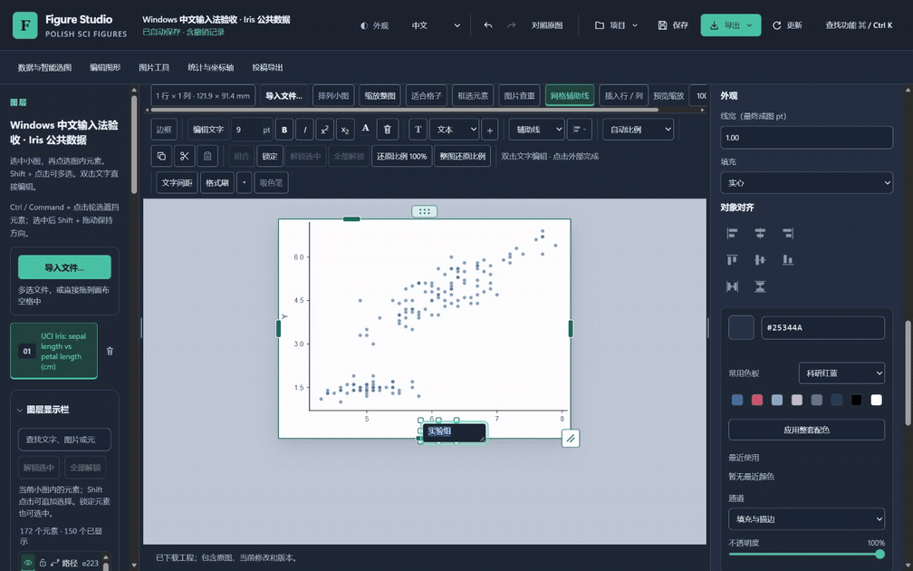

# Windows 中文输入法协同验收

本页记录本机 Windows 中文输入法的实际操作与证据边界，更新日期为 2026-10-18。source18 源码窗口的本轮人工流程已完成并核查。用户已授权通过剩余验收后发布稳定版；源码结果尚不代表新安装包或正式发行已经通过。

## 方法

用户在独立 Edge 窗口中使用微软拼音手动输入、选择候选及操作 Enter／Esc。观察脚本只准备普通编辑控件、记录真实浏览器事件、读取本地自动保存和核对实际下载，不键入中文、不合成 composition 事件，也不调用 Windows 按键注入。

Windows 原生操作工具在此前 Chrome 与 Edge 会话中均因无法可靠识别浏览器 URL 而停止。后续采用用户明确同意的人工协同，未绕过该工具限制。真实操作由用户完成，自动检查负责核对结果；不能把这一方式表述为原生工具自动验收。

记录包括 `compositionstart/update/end`、`beforeinput/input`、键值与 229 状态，以及事件后 0／150／600 ms 的只读 UI 和 IndexedDB 观察。`isTrusted` 单独不足以证明人工输入，须结合明确披露的脚本动作、用户反馈和组合事件链判断。回到聊天会使控件失焦，因此关键操作在编辑器内连续完成，先观察再结束编辑。

浏览器录像不包含独立的 Windows 输入法候选浮窗。选词行为由用户现场确认，组合事件和最终文字另有记录；未捕获的浮窗不作为录像已显示的内容。

## 数据与冻结版本

使用 UCI Iris 的 150 条公开观测（DOI `10.24432/C56C76`，CC BY 4.0）。验收只修改文字或显示参数。每个检查点核对原始工程来源，另验证实际保存、撤销／重做、重开及导出。私有科研图片和工程不参与本次人工输入法测试。

source18 的 HTML SHA-256 为 `b596058ff9fec68257d8bfecc41e56762db2b056f22c8a219520fda343eefca4`，冻结清单为 `ec2966258cbacbea79c03b5539140527e1e1f8aed9e0a41d52d71a335f6cf01b`。实际服务端页面通过精确注入重建验证，未删除图形、数据或脚本以取得相同结果。人工浏览器为 Edge `155.0.4283.45`。

## 已执行范围

| 操作 | 当前实际结果 |
|---|---|
| 画布文字通过拼音改为“实验组” | 用户确认使用微软拼音；实际组合开始、组合输入和 229 键事件存在。选词后的两个观察点仍为历史 0／编辑框保留；普通 Enter 后历史为 1，图中文字为“实验组” |
| 上述修改的撤销／重做 | 实际按钮及下载检查通过，一次撤销可恢复，重做后状态精确一致，原始工程来源保持 |
| 候选 Esc 后继续编辑 | 用户在候选窗打开时按 Esc，随后以 Shift+Enter 验证编辑框仍可换行；实际组合输入和换行事件存在。最后 Esc 取消后，状态、撤销历史和原始工程来源与基线精确一致 |
| 候选 Enter 后继续编辑 | 用户输入 `zhongwenceshi` 后按 Enter，随后确认 Shift+Enter 可换行。实际 229 组合按键、组合输入、结束后 0／150／600 ms 编辑框保留及换行事件存在；最后取消精确恢复基线 |
| HEX 框输入中文及取消 | 实际组合输入“颜色”未改变已提交颜色；用户确认显示不变，Esc 后恢复 `#25344A`。状态、撤销历史及原始工程来源与基线精确一致 |
| F2 编辑、选词及失焦确认 | 用户确认通过 F2 开始，将文字改为“对照组”，点击画布空白后关闭文字框；组合结束 600 ms 后仍是历史 1／编辑框保留，4.4 秒后的实际 blur 才提交至历史 2。F2 本身由用户确认，观察器只记录输入控件事件 |
| 最终撤销／重做、保存及重开 | 实际按钮、下载和重新 Open 均通过；保存状态、原始工程及重开后状态精确一致。三条历史状态仅包含两次预期的文字修改 |
| SVG／PNG 实际导出 | 已检查下载字节和哈希，SVG 包含“对照组”，PNG 已实际打开查看并正确显示中文；Iris 150 条观测及原始 SVG 变体保持一致 |
| 新安装包上的实际操作 | 尚未执行；源码窗口结果不冒充安装版结果 |

首轮候选选定至普通 Enter 的实际间隔约 173 ms；两个检查点覆盖其间状态，不宣称用户完成了预设的两秒停顿。功能观察时序不纳入正式性能测量。

此前两次 Esc 和一次 Enter 的异常反馈完整保留。一次 Esc 和一次 Enter 尝试没有收到组合输入，不计入候选测试；另一次 Esc 的用户感受与编辑框观察不一致，随后通过“候选按键后换行”的明确步骤核查。后续通过不改写这些尝试，也不据此凭空推断产品缺陷。Enter 复测中的 `compositionend.isTrusted` 为 false，原始记录予以保留；人工反馈、可信的组合开始／输入、229 按键及后续换行分别提供证据，不能称所有组合事件均为可信事件。

已审查的 [6 项实际检查及保留异常](qa/live-preview/source18-human-ime-summary.json)与 [823 条公开测试事件和操作清单](qa/live-preview/source18-human-ime-events.json)分别保存。无断言的观察点明确标为观察，不因底层脚本统一输出 `PASS_REQUESTED_ASSERTIONS` 而计为通过。页面错误和外网请求均为 0，人工窗口已正常关闭，录像已结束写入。X 轴文字仅为界面编辑验收内容，不把“实验组／对照组”当作 Iris 的实际变量或研究分组。

下面为同次实际录像的连续 13 秒片段，原速播放，降至 6 fps、宽 1008 像素；未合成候选浮窗。原帧 835／841／846 秒已查看，分别为选中文字、选词后保留编辑框和点击空白提交。取时、原片及派生文件哈希见[媒体来源](qa/live-preview/source18-human-ime-media.json)。

## 复现与后续核查

操作准备和观察脚本为 [run_studio_human_ime_acceptance.cjs](../scripts/run_studio_human_ime_acceptance.cjs)，其独立 [6 组合同检查](../scripts/test_studio_human_ime_contract.cjs)不启动浏览器，也不计作 Windows 原生输入法通过。观察脚本要求明确的本机 URL、冻结 HTML 哈希和全新缓存目录，拒绝覆盖既有记录。

原始事件、公共测试工程、录像和下载保留在忽略目录；公开结论只收录经审查的范围、哈希与必要画面。早期准备失败和工具中止记录保留，不由后续通过改写。最终结论应与新安装包哈希、对应源文件及实际回归报告一起核对。

## source19 连续性与保留的候选记录

完成上述人工实操后，source19 只在 `studio.js` 中改动三行，减少参考线的无用刷新和相同 HEX／ARIA 值的重复写入。已[逐字节核对组合输入、通用字段、快捷编辑、F2 与三个相关模块](qa/live-preview/source19-ime-code-continuity.json)，这些输入法处理代码与 source18 一致。

人工输入法实操在 source18 完成。source19 候选安装包另通过了 [8 套流程中的 108 项指定检查](qa/live-preview/windows-final19-partial-installed-summary.json)，但后续独立审查发现专业坐标轴数值框的无效组合尾事件可能误清上限，因此该候选没有发布，并按[隔离候选清理记录](qa/live-preview/windows-final19-incomplete-cleanup-summary.json)卸载。原记录不改写为 source20 安装验收，也未重复人工原生输入。

## source20 的范围与后续安装验收

source20 修复了上述数值框问题：无效组合输入及第二次候选取消后的尾事件不能把已有范围变成自动；输入有效数值或明确删除后可以继续操作。实际 [25 组受控合同及 9 项既有回归](qa/live-preview/source20-axis-composition-fix-regressions.json)通过，保留修复前失败。双主题 [10 项浏览器流程](qa/live-preview/source20-axis-composition-browser.json)核对真实 Iris 重绘、普通键盘修正、一次撤销、保存、新建空白后重开和实际 SVG 导出；其中组合尾事件由脚本明确合成，不是原生输入法实测。

已[逐字节核对输入范围](qa/live-preview/source20-ime-change-scope.json)：主程序的组合、HEX、F2／失焦处理，以及文字间距和放大图两个模块与 source18 一致；专业坐标轴模块已经更改，不再列为整模块连续性。代码连续性支持复用此前文字／HEX 的证据背景，不构成第二次原生输入法操作，也不外推到所有控件或输入法。

最终 source20 安装包的来源、实际编辑和生命周期验收见[总报告](live-preview-validation.md)的对应阶段；本页记录人工输入来自 source18，source20 未重复人工原生输入。合成合同、真实本地渲染和 Windows 原生输入分别报告。
